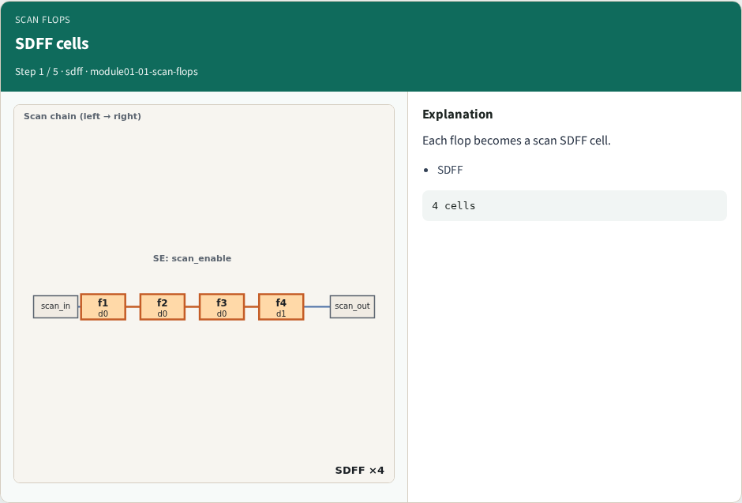
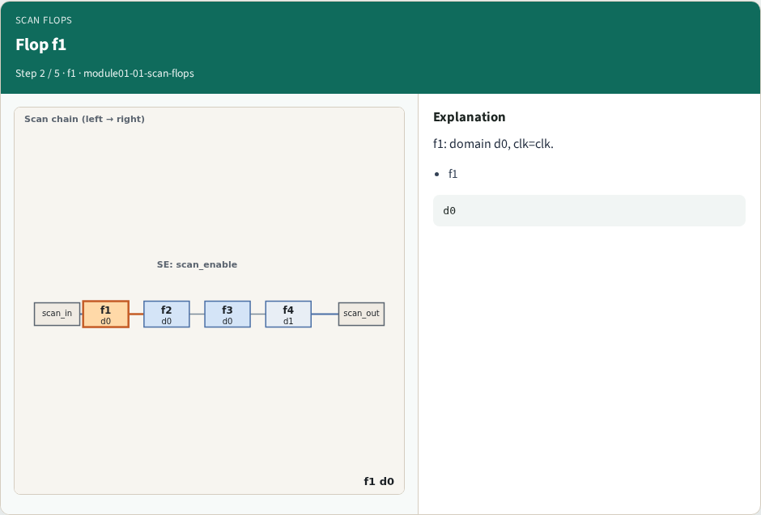
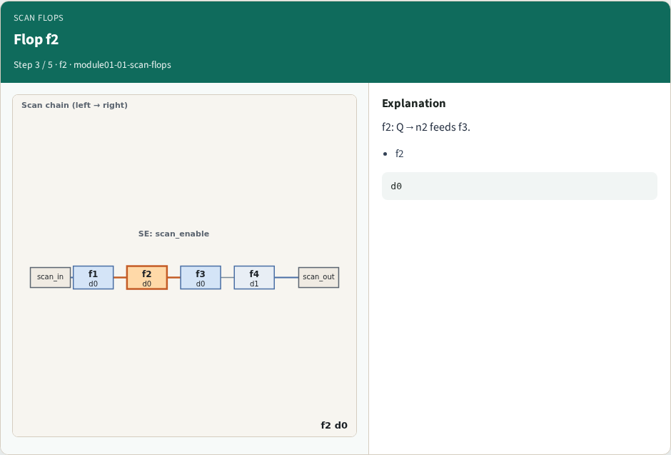
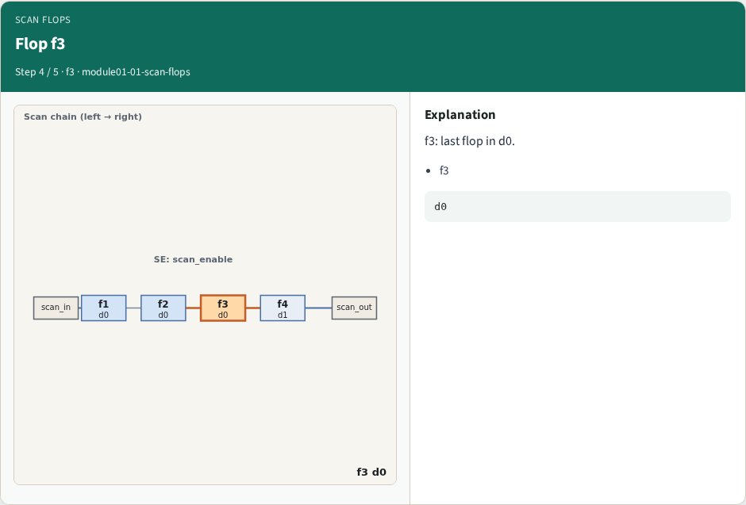
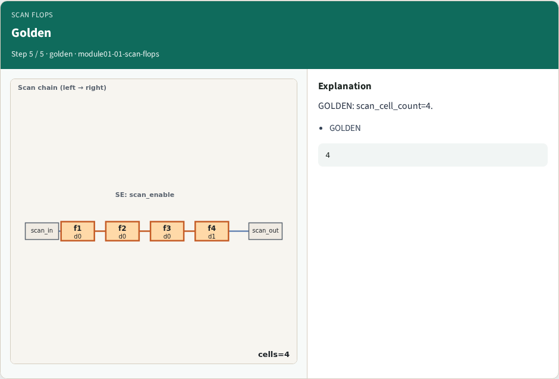
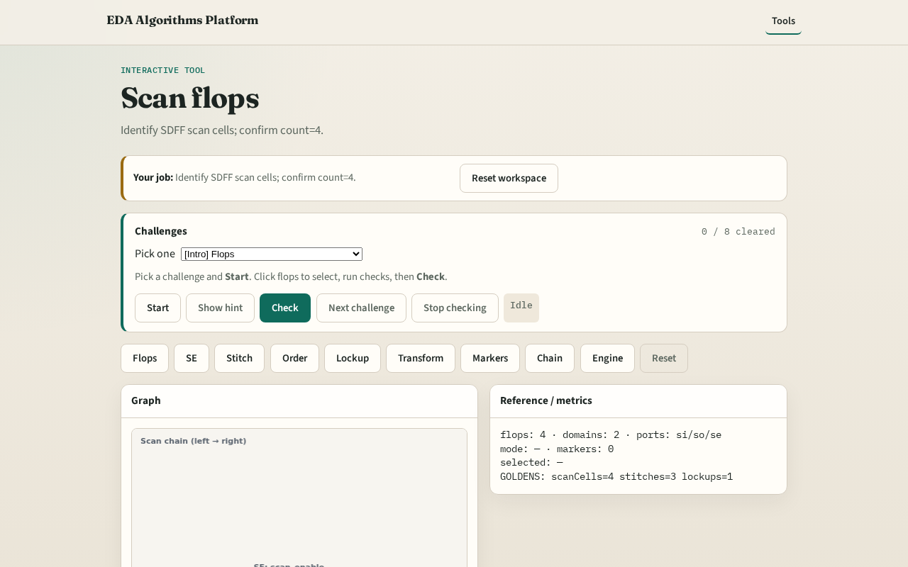

# Scan flops

**Module id:** module01-01-scan-flops
**Lab:** scan-flops
**Tracks:** A (implement) · B (browser lab)

## Slide 1 — Why scan flops

Every flop becomes a scan SDFF in this full-scan toy.

## Slide 2 — The idea

GOLDEN: scan_cell_count=4.

<!-- algorithm-walkthrough -->

## Slide 3 — SDFF cells

Each flop becomes a scan SDFF cell.

## Slide 4 — Flop f1

f1: domain d0, clk=clk.

## Slide 5 — Flop f2

f2: Q→n2 feeds f3.

## Slide 6 — Flop f3

f3: last flop in d0.

## Slide 7 — Golden

GOLDEN: scan_cell_count=4.

<!-- /algorithm-walkthrough -->

## Slide 8 — Browser lab track

Open **scan-flops**. Inspect tiny_dft; confirm 4 SDFF cells.

## Slide 9 — Implement track

Call identify_scan_flops(); assert count==4.

## Slide 10 — Pitfalls

Counting only functional flops. Missing SE hook.

## Slide 11 — Your turn

Next: scan enable ports.
