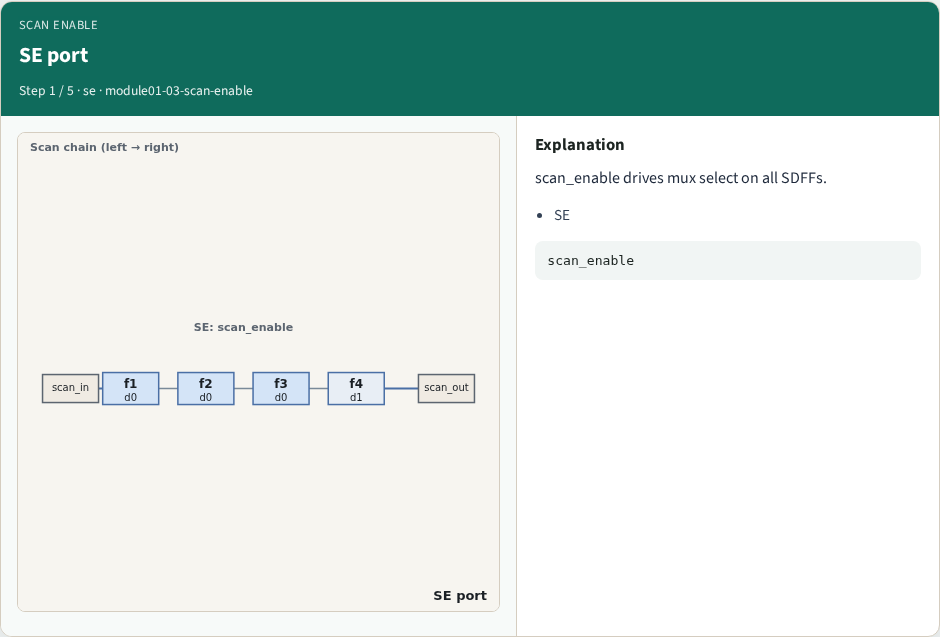
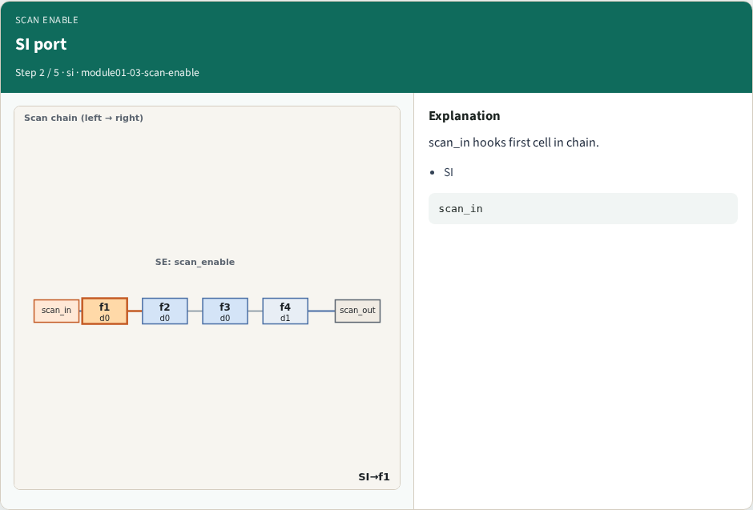
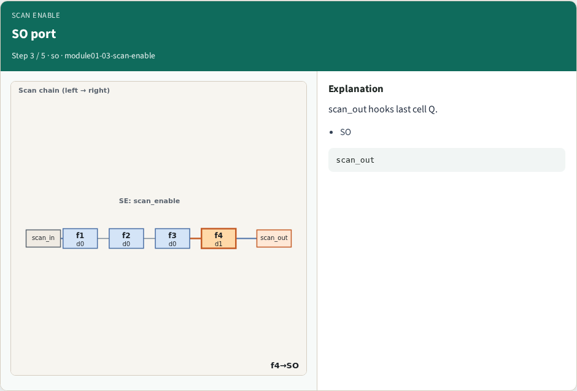
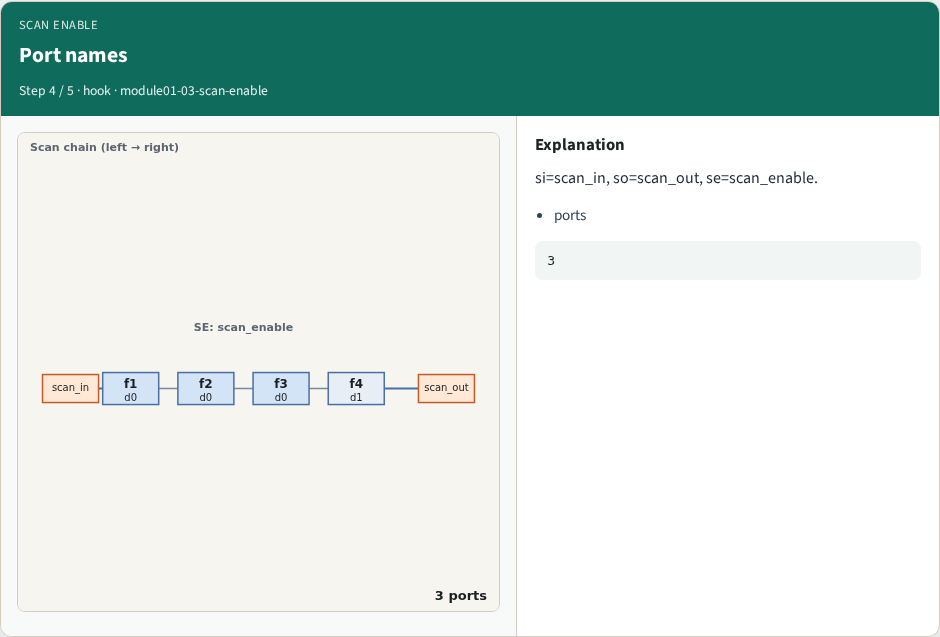
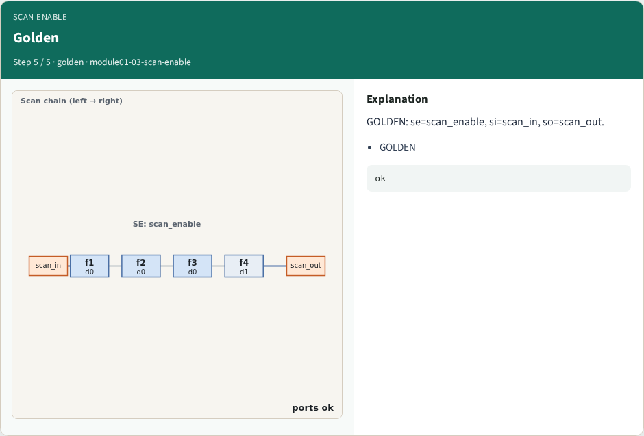
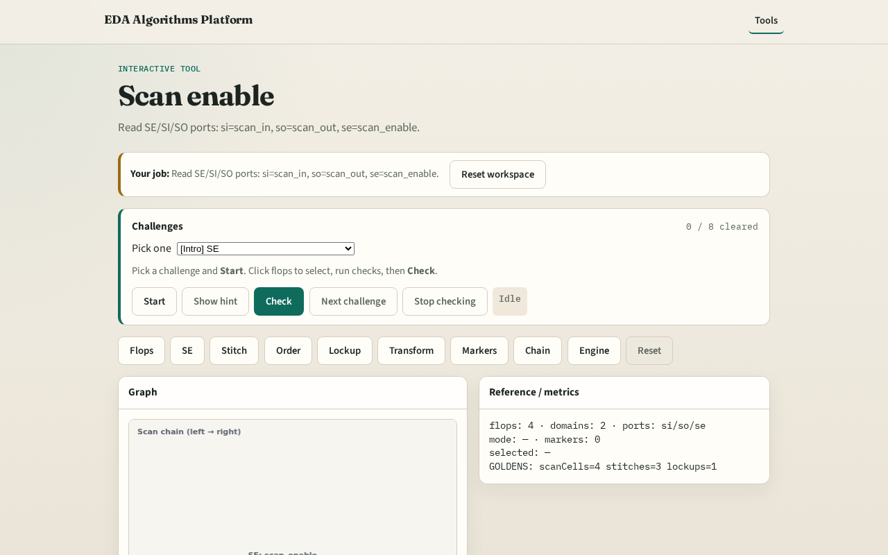

# Why scan enable

Scan enable muxes functional vs scan data; SI/SO bookend the chain

---

## The idea
- GOLDEN: se=scan_enable, si=scan_in, so=scan_out

---

## SE port

---

## SI port

---

## SO port

---

## Port names

---

## Golden

---

## Browser lab track

---

## Implement track
- Call scan_enable_port(); assert se/si/so match goldens

---

## Pitfalls
- Confusing SI with functional D
- Wrong port order

---

## Your turn
- Next: chain stitch

