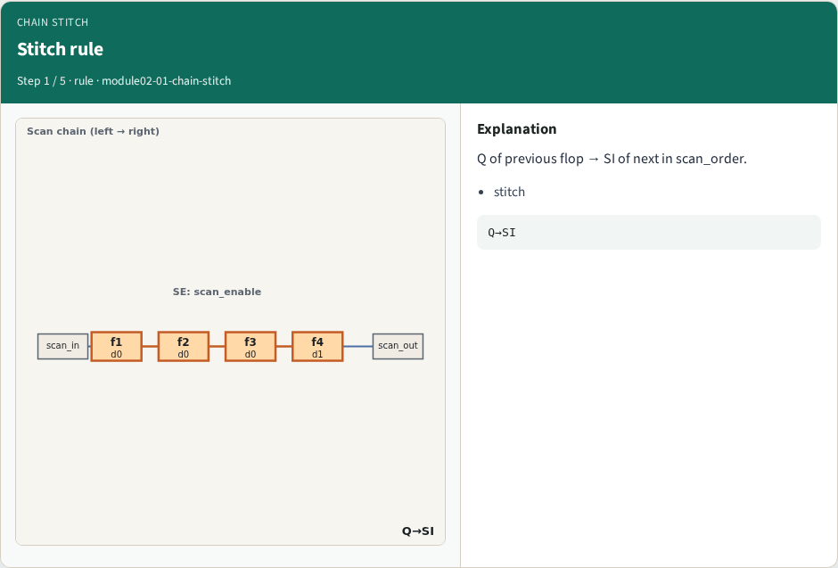
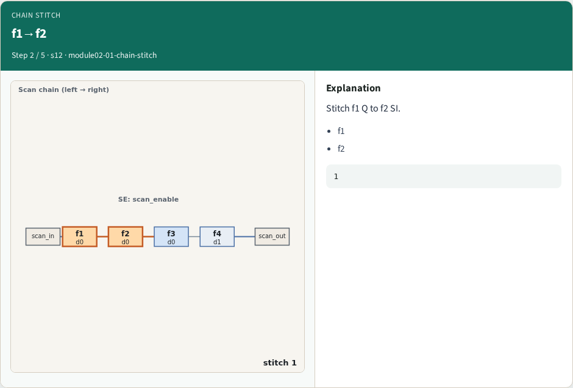
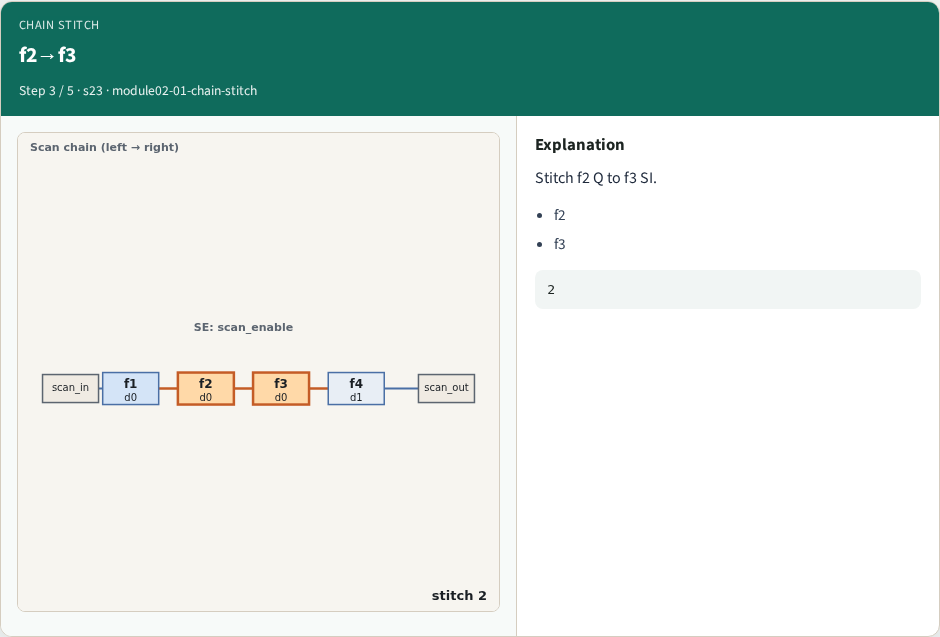
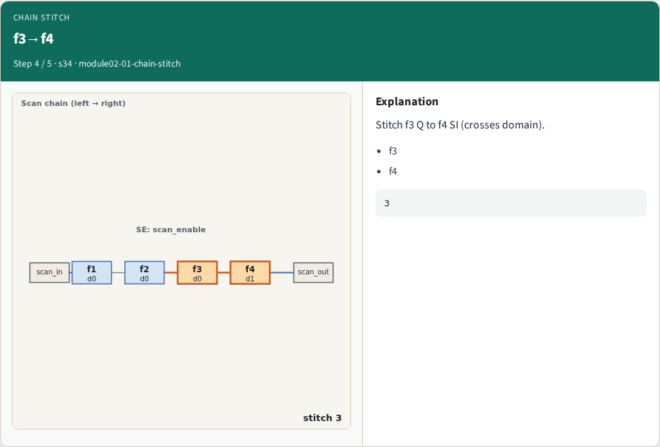
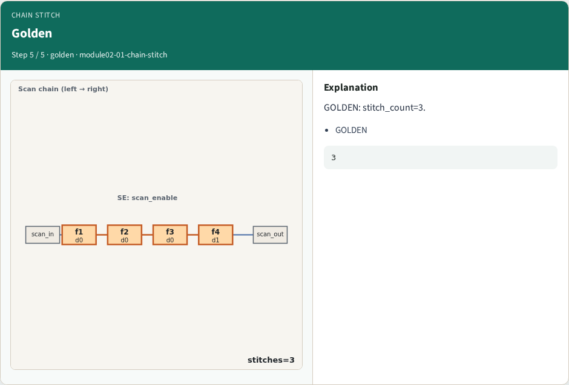

# Chain stitch — step-by-step (for slides / transcript)

**Module:** `module02-01-chain-stitch`  
**Lab / algo:** `chain-stitch`  
**Viewer:** `/tools/algorithm-walkthrough/?algo=chain-stitch&step=1`

Use each **Caption** as spoken prose (or a shortened slide note).
Use **Bullets** on the PPT; pair with the PNG in `assets/steps/`.

## Step 1 — Stitch rule



**Caption (transcript):** Q of previous flop → SI of next in scan_order.

**Slide bullets:**

- stitch

**On-screen metrics:**

```
Q→SI
```

## Step 2 — f1→f2



**Caption (transcript):** Stitch f1 Q to f2 SI.

**Slide bullets:**

- f1
- f2

**On-screen metrics:**

```
1
```

## Step 3 — f2→f3



**Caption (transcript):** Stitch f2 Q to f3 SI.

**Slide bullets:**

- f2
- f3

**On-screen metrics:**

```
2
```

## Step 4 — f3→f4



**Caption (transcript):** Stitch f3 Q to f4 SI (crosses domain).

**Slide bullets:**

- f3
- f4

**On-screen metrics:**

```
3
```

## Step 5 — Golden



**Caption (transcript):** GOLDEN: stitch_count=3.

**Slide bullets:**

- GOLDEN

**On-screen metrics:**

```
3
```

