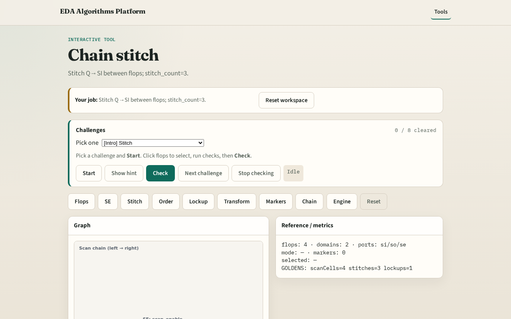

# Chain stitch

**Module id:** module02-01-chain-stitch
**Lab:** chain-stitch
**Tracks:** A (implement) · B (browser lab)

## Slide 1 — Why stitch

Chain stitch wires Q of previous flop to SI of next in scan_order.

## Slide 2 — The idea

GOLDEN: stitch_count=3.

<!-- algorithm-walkthrough -->

## Slide 3 — Stitch rule

Q of previous flop → SI of next in scan_order.

## Slide 4 — f1→f2

Stitch f1 Q to f2 SI.

## Slide 5 — f2→f3

Stitch f2 Q to f3 SI.

## Slide 6 — f3→f4

Stitch f3 Q to f4 SI (crosses domain).

## Slide 7 — Golden

GOLDEN: stitch_count=3.

<!-- /algorithm-walkthrough -->

## Slide 8 — Browser lab track

Open **chain-stitch**. Confirm 3 stitches f1→f2→f3→f4.

## Slide 9 — Implement track

Call stitch_chain(); assert stitch_count==3.

## Slide 10 — Pitfalls

Counting SI/SO hooks as stitches. Wrong order.

## Slide 11 — Your turn

Next: scan order check.
