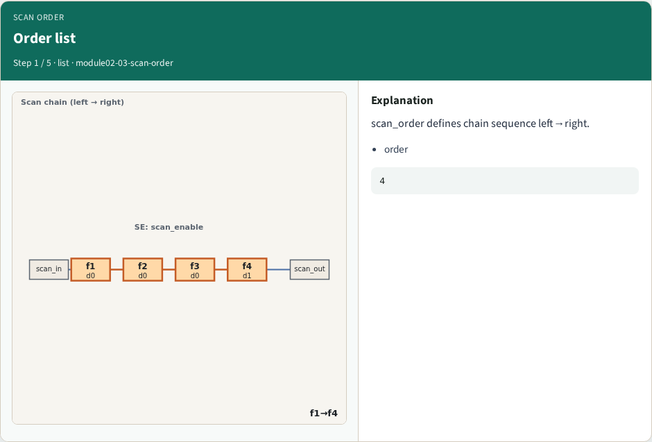
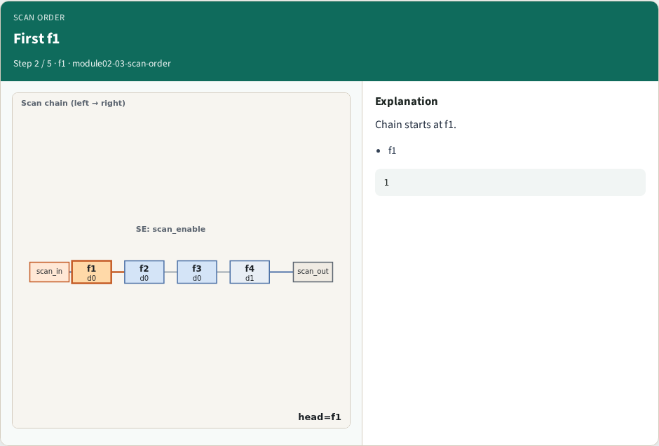
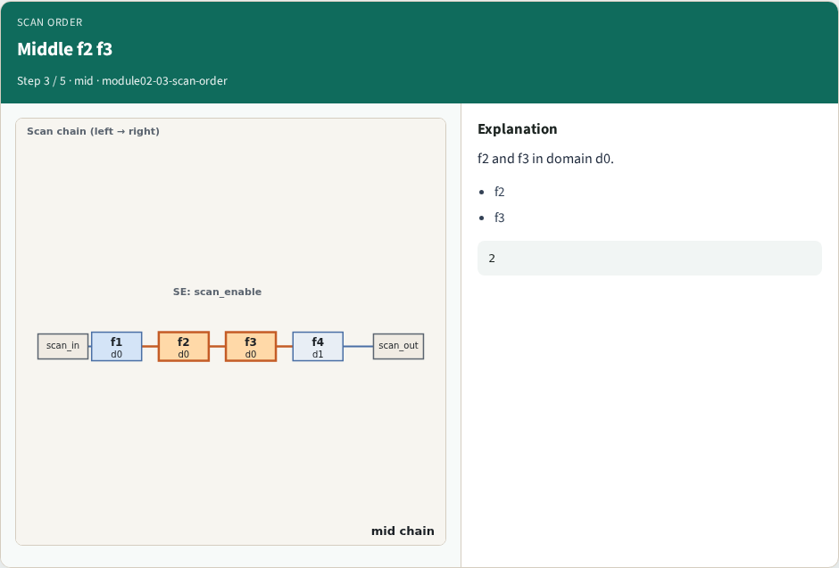
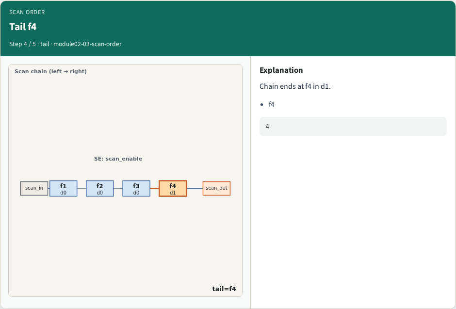
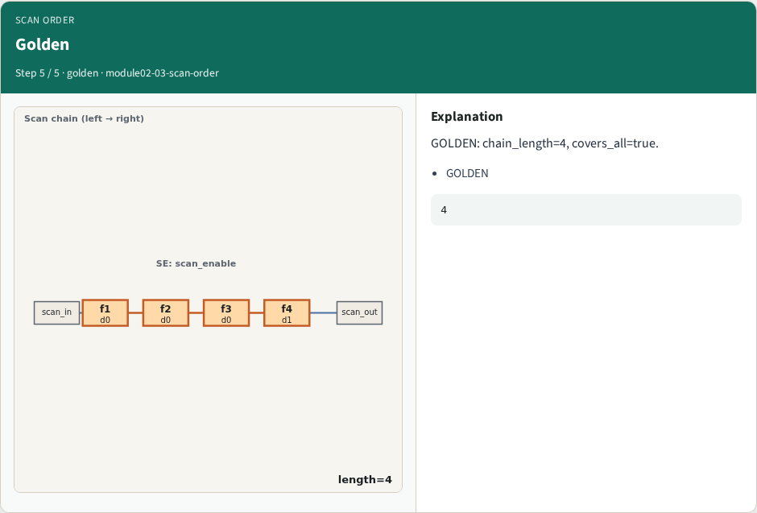
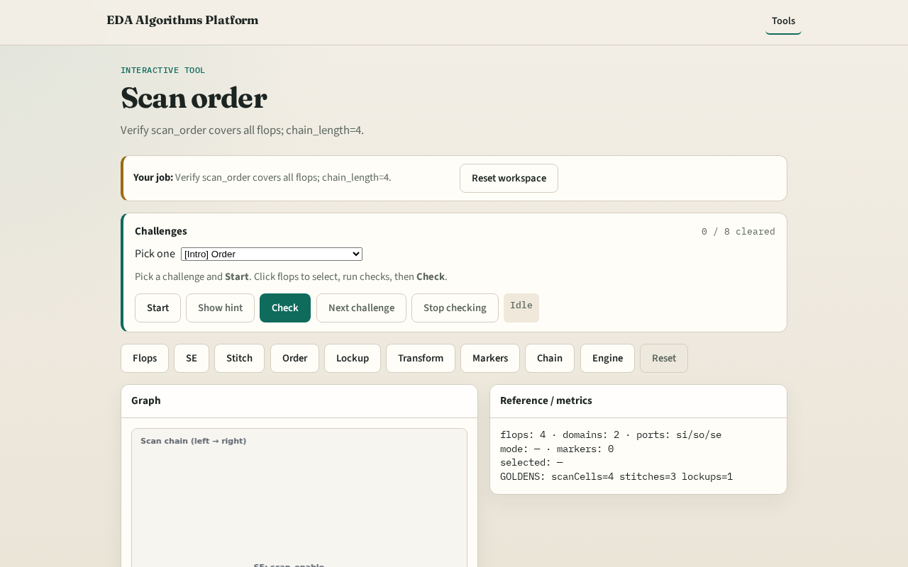

# Why order

Scan order must include every flop exactly once

---

## The idea
- GOLDEN: order f1→f2→f3→f4; covers_all=true

---

## Order list

---

## First f1

---

## Middle f2 f3

---

## Tail f4

---

## Golden

---

## Browser lab track

---

## Implement track
- Call scan_order_check(); assert length==4 and covers_all

---

## Pitfalls
- Duplicate flop in order
- Missing f4

---

## Your turn
- Next: lockup latch

