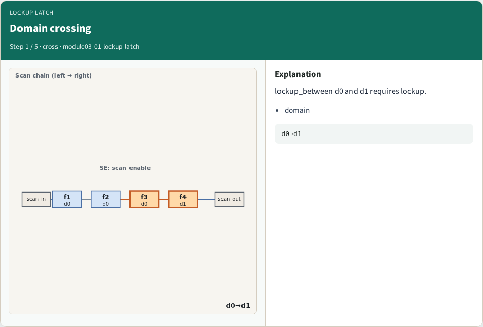
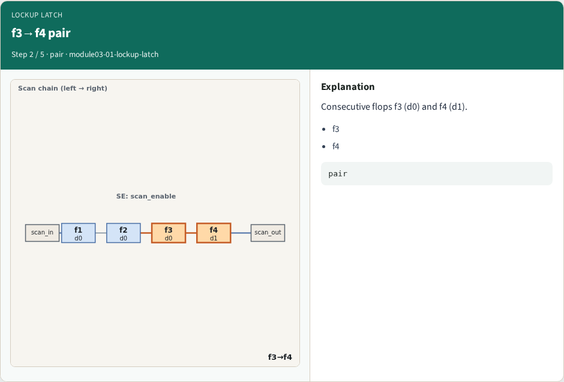
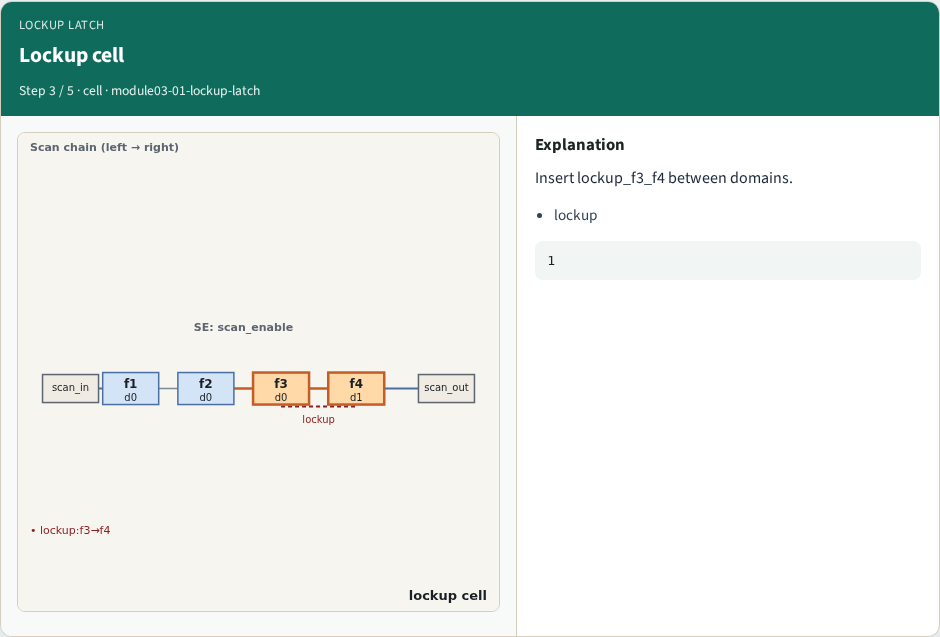
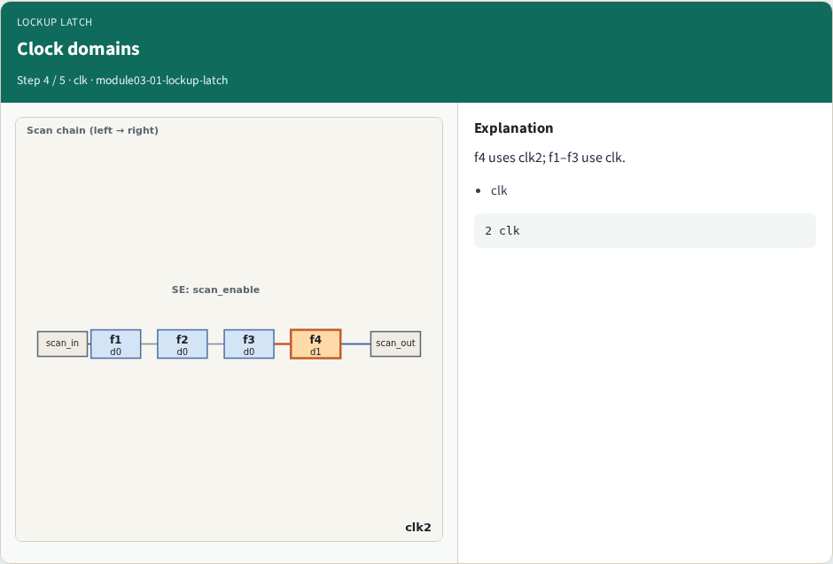
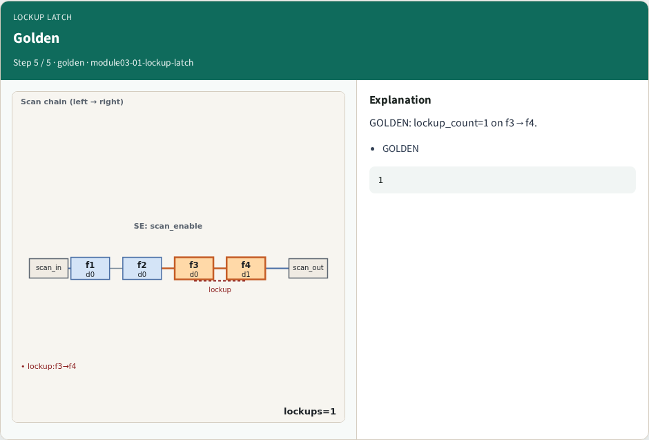
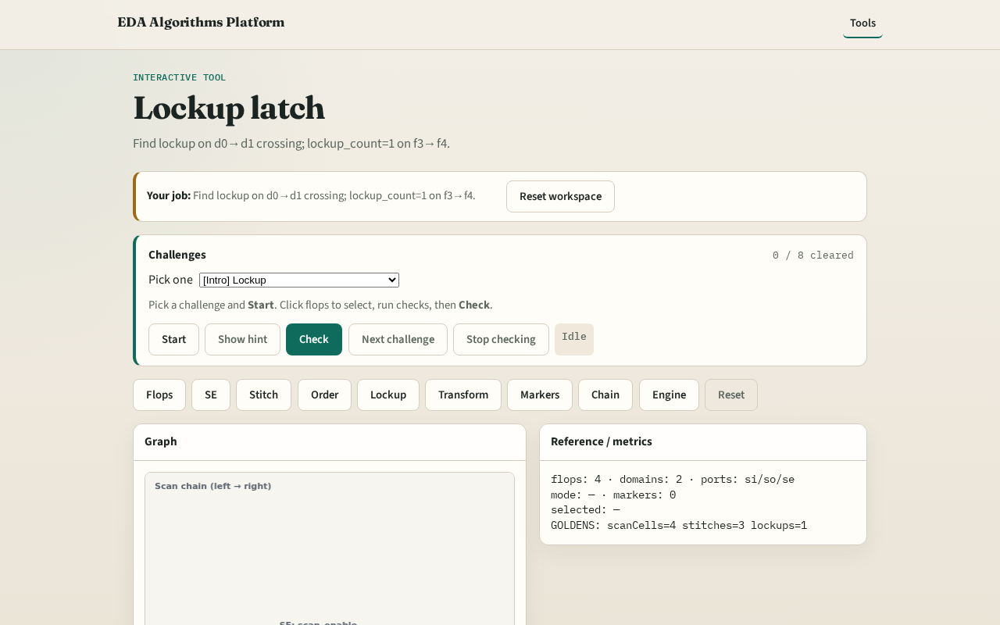

# Why lockup

Lockup latches bridge clock domains on scan path

---

## The idea
- GOLDEN: lockup_count=1 on f3→f4 (d0→d1)

---

## Domain crossing

---

## f3→f4 pair

---

## Lockup cell

---

## Clock domains

---

## Golden

---

## Browser lab track

---

## Implement track
- Call find_lockups(); assert count==1 and from f3 to f4

---

## Pitfalls
- Lockup on same domain
- Missing clk2 crossing

---

## Your turn
- Next: netlist transform

