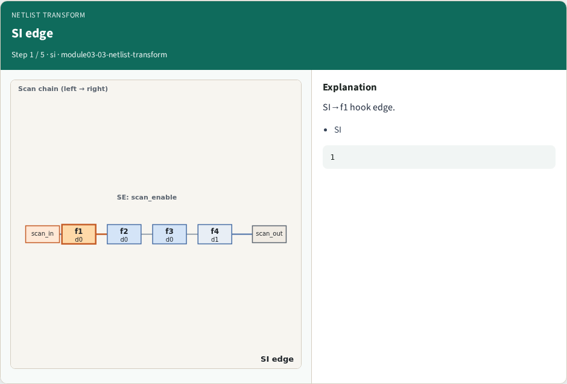
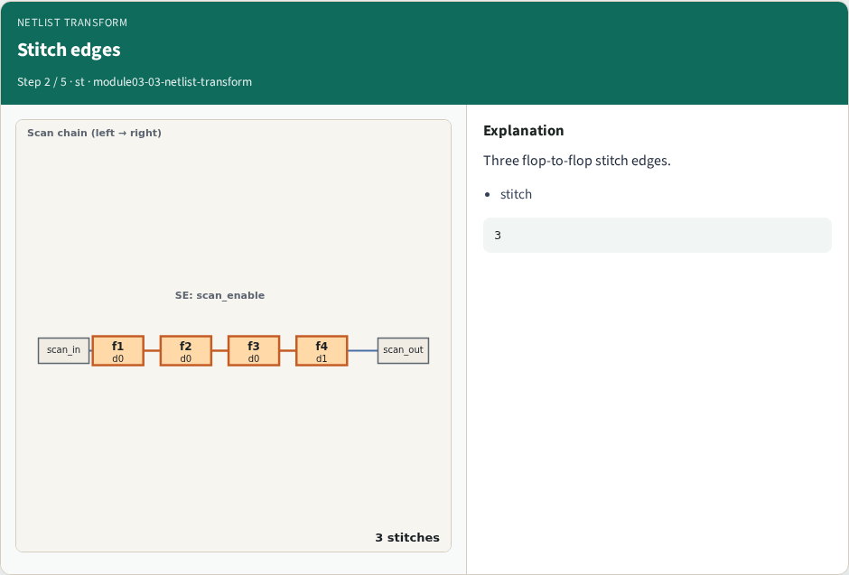
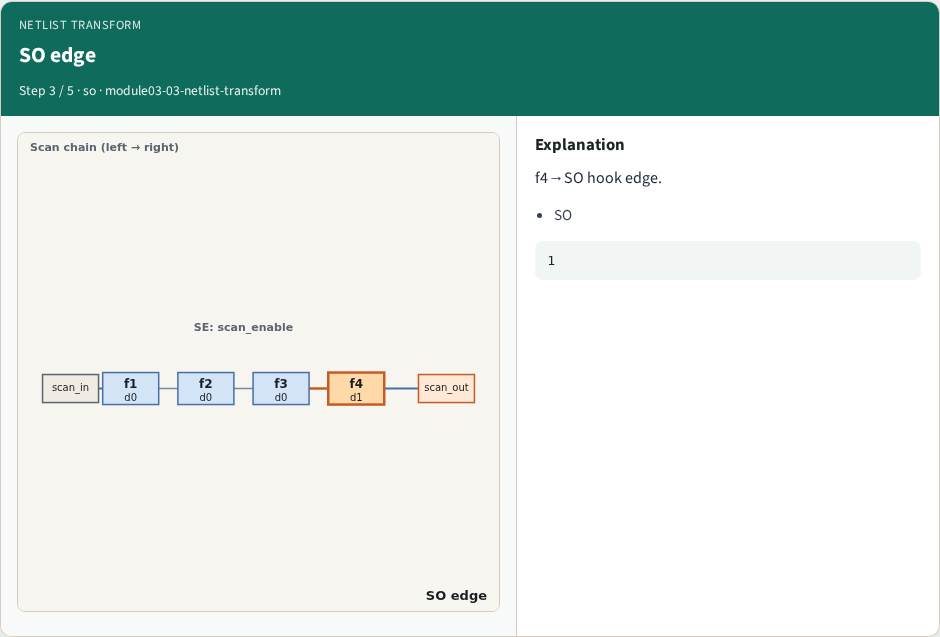
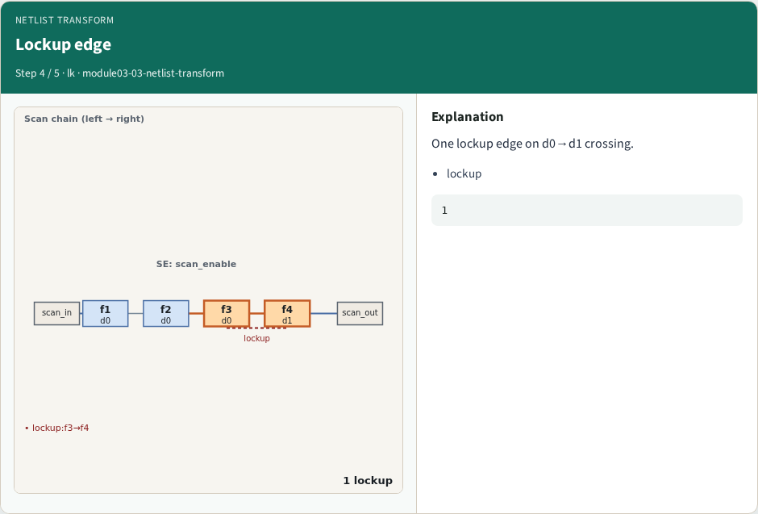
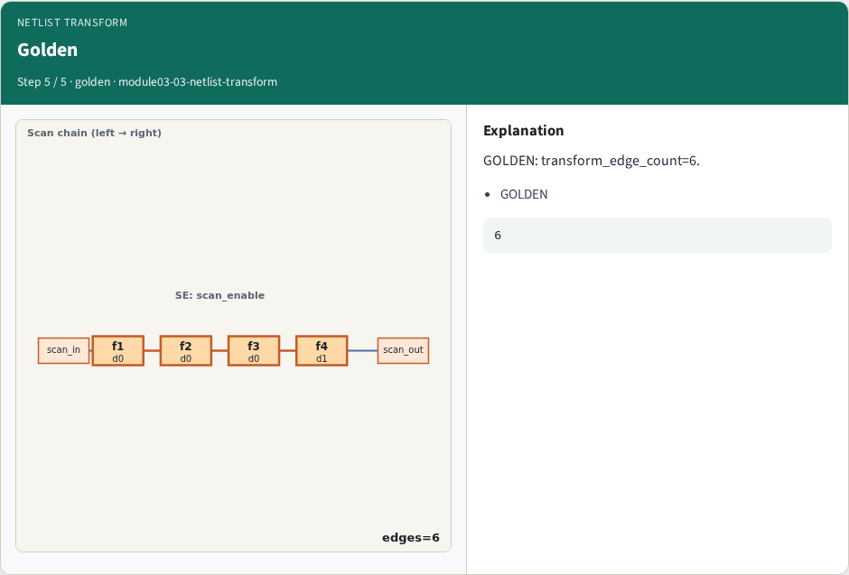

# Netlist transform — step-by-step (for slides / transcript)

**Module:** `module03-03-netlist-transform`  
**Lab / algo:** `netlist-transform`  
**Viewer:** `/tools/algorithm-walkthrough/?algo=netlist-transform&step=1`

Use each **Caption** as spoken prose (or a shortened slide note).
Use **Bullets** on the PPT; pair with the PNG in `assets/steps/`.

## Step 1 — SI edge



**Caption (transcript):** SI→f1 hook edge.

**Slide bullets:**

- SI

**On-screen metrics:**

```
1
```

## Step 2 — Stitch edges



**Caption (transcript):** Three flop-to-flop stitch edges.

**Slide bullets:**

- stitch

**On-screen metrics:**

```
3
```

## Step 3 — SO edge



**Caption (transcript):** f4→SO hook edge.

**Slide bullets:**

- SO

**On-screen metrics:**

```
1
```

## Step 4 — Lockup edge



**Caption (transcript):** One lockup edge on d0→d1 crossing.

**Slide bullets:**

- lockup

**On-screen metrics:**

```
1
```

## Step 5 — Golden



**Caption (transcript):** GOLDEN: transform_edge_count=6.

**Slide bullets:**

- GOLDEN

**On-screen metrics:**

```
6
```

