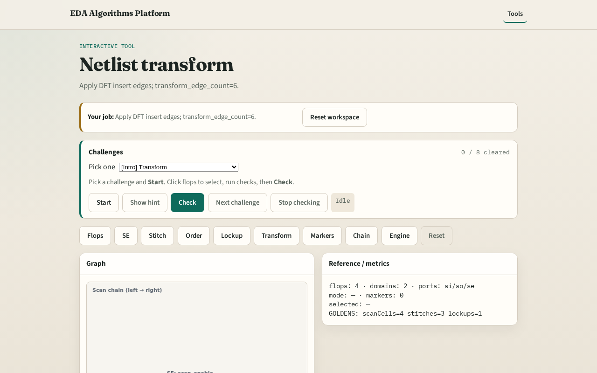

# Why transform

DFT insert adds scan wiring edges to the netlist

---

## The idea
- GOLDEN: transform_edge_count=6 (SI + 3 stitches + SO + 1 lockup)

---

## SI edge

---

## Stitch edges

---

## SO edge

---

## Lockup edge

---

## Golden

---

## Browser lab track

---

## Implement track
- Call netlist_transform(); assert edge_count==6

---

## Pitfalls
- Double-counting stitches
- Forgetting lockup edge

---

## Your turn
- Next: DFT markers

