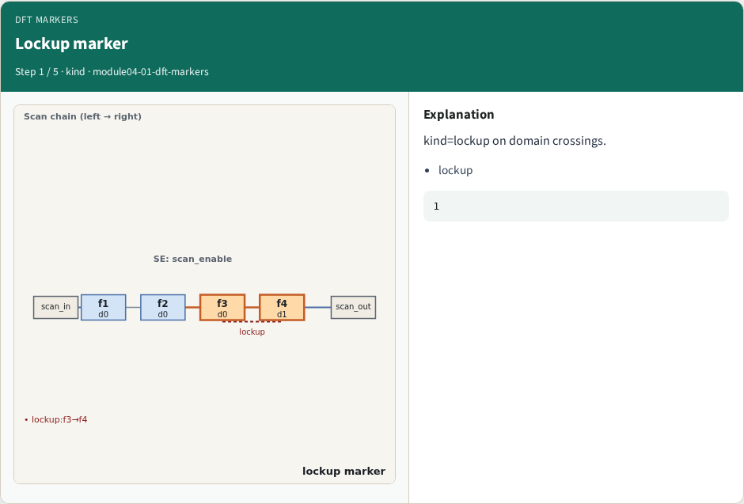
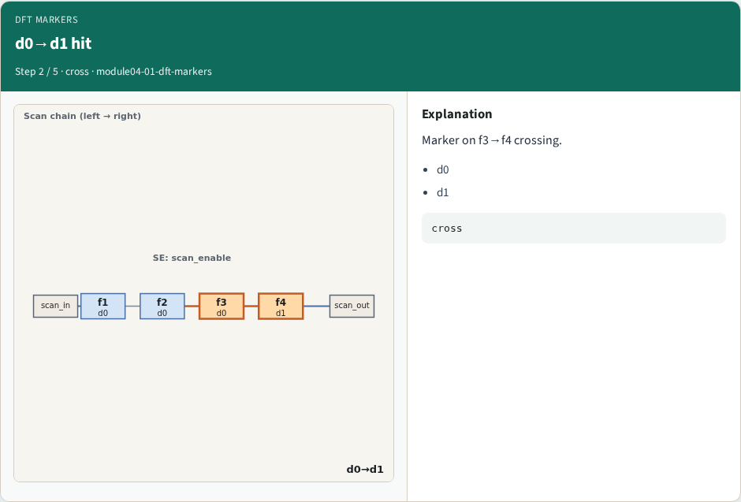
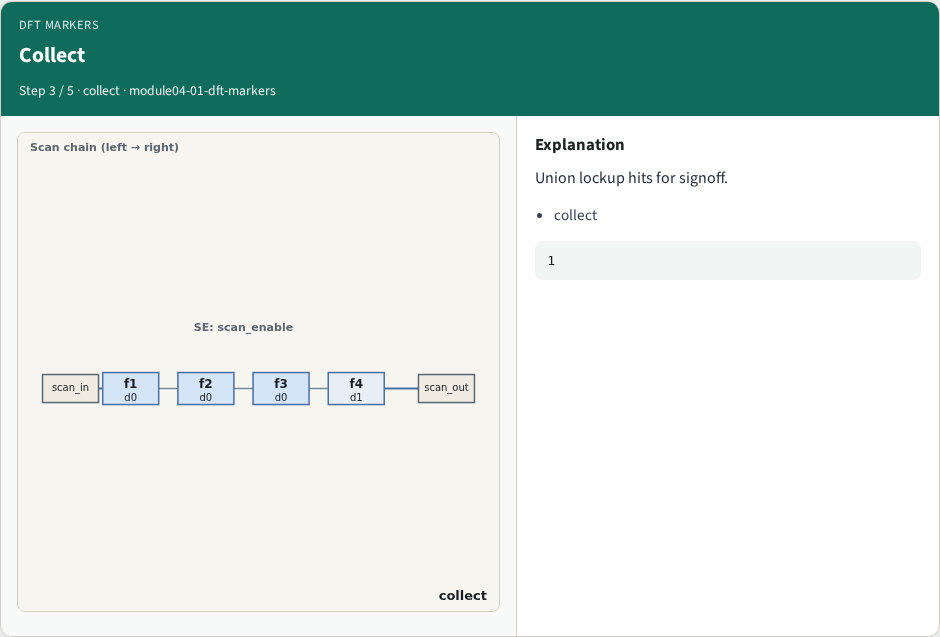
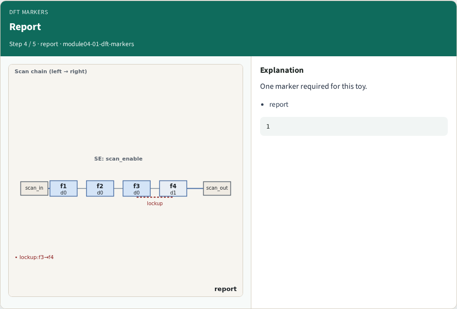
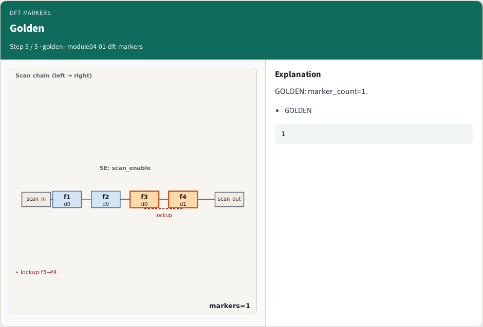
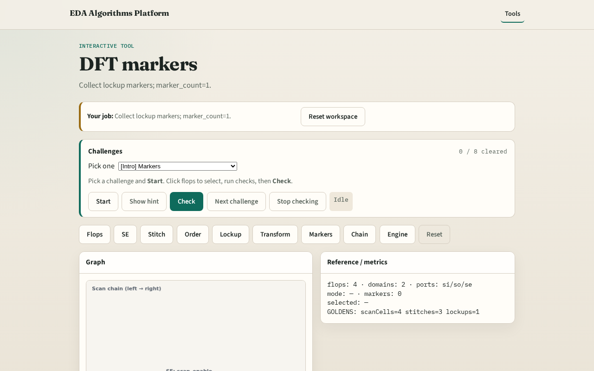

# Why markers

Signoff DFT emits markers for required lockups on domain crossings

---

## The idea
- GOLDEN: marker_count=1

---

## Lockup marker

---

## d0→d1 hit

---

## Collect

---

## Report

---

## Golden

---

## Browser lab track

---

## Implement track
- Call collect_markers(); assert count==1

---

## Pitfalls
- Counting stitches as markers
- Missing domain cross

---

## Your turn
- Next: scan chain view

