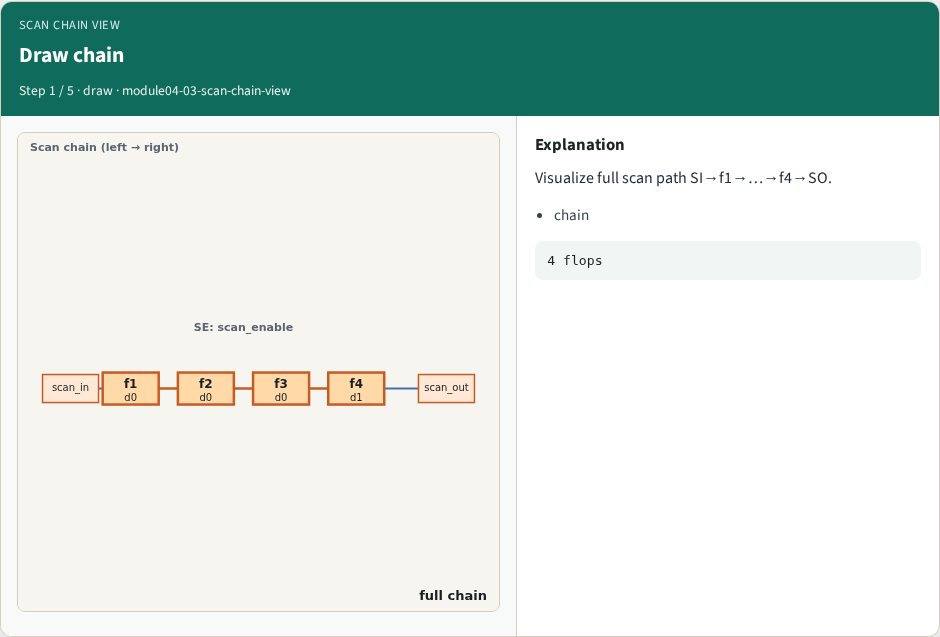
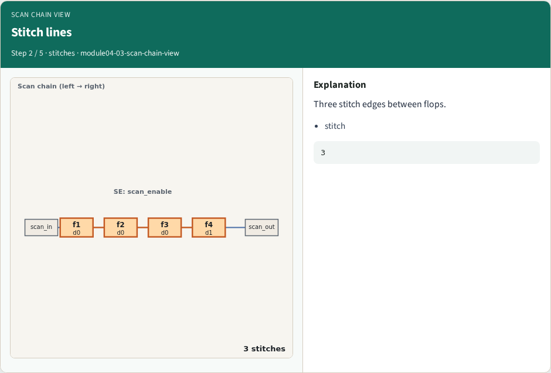
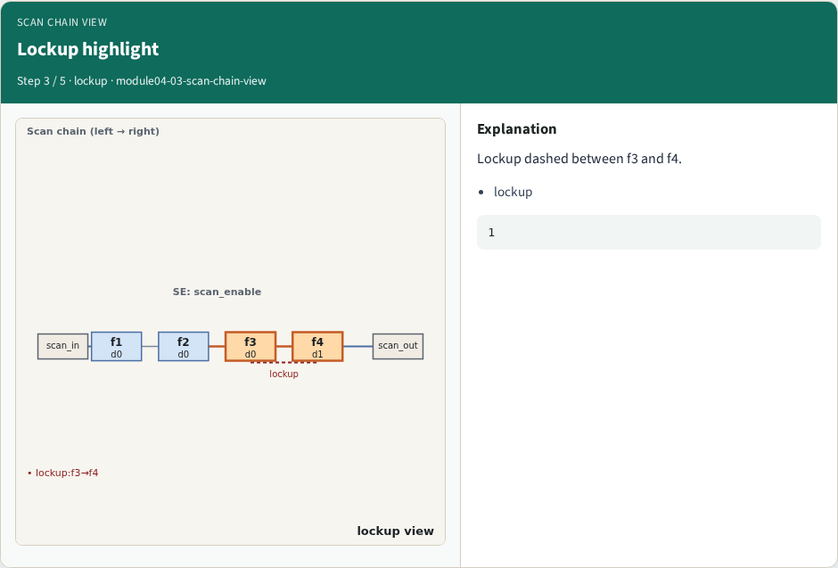
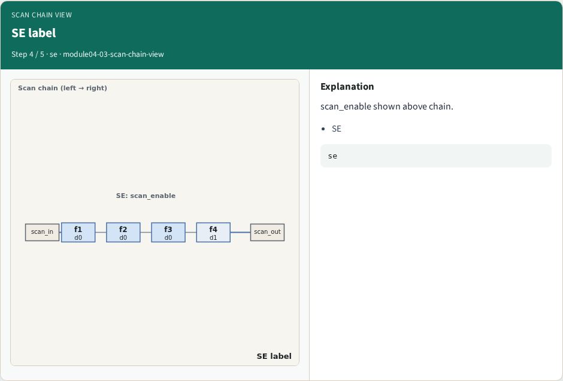
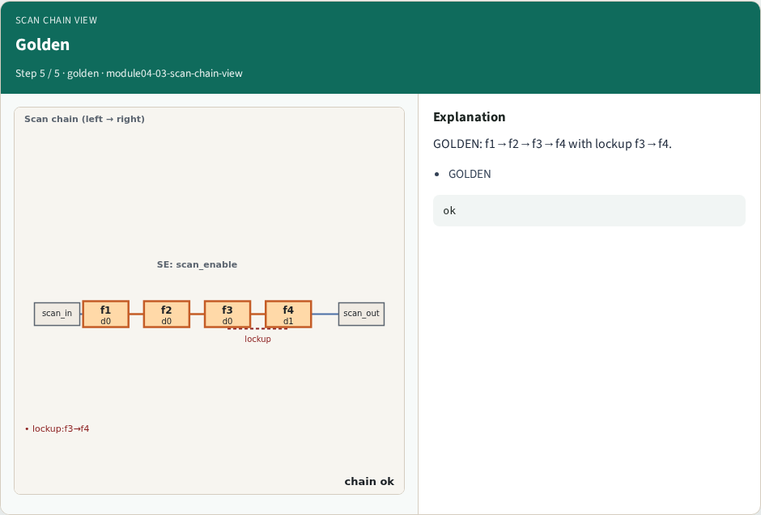

# Scan chain view — step-by-step (for slides / transcript)

**Module:** `module04-03-scan-chain-view`  
**Lab / algo:** `scan-chain-view`  
**Viewer:** `/tools/algorithm-walkthrough/?algo=scan-chain-view&step=1`

Use each **Caption** as spoken prose (or a shortened slide note).
Use **Bullets** on the PPT; pair with the PNG in `assets/steps/`.

## Step 1 — Draw chain



**Caption (transcript):** Visualize full scan path SI→f1→…→f4→SO.

**Slide bullets:**

- chain

**On-screen metrics:**

```
4 flops
```

## Step 2 — Stitch lines



**Caption (transcript):** Three stitch edges between flops.

**Slide bullets:**

- stitch

**On-screen metrics:**

```
3
```

## Step 3 — Lockup highlight



**Caption (transcript):** Lockup dashed between f3 and f4.

**Slide bullets:**

- lockup

**On-screen metrics:**

```
1
```

## Step 4 — SE label



**Caption (transcript):** scan_enable shown above chain.

**Slide bullets:**

- SE

**On-screen metrics:**

```
se
```

## Step 5 — Golden



**Caption (transcript):** GOLDEN: f1→f2→f3→f4 with lockup f3→f4.

**Slide bullets:**

- GOLDEN

**On-screen metrics:**

```
ok
```

