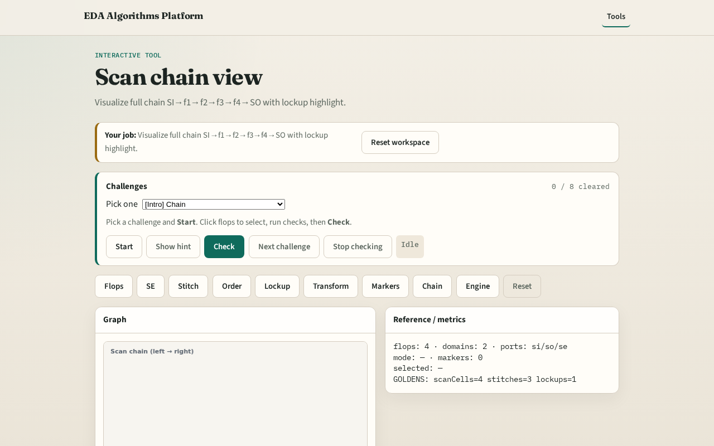

# Scan chain view

**Module id:** module04-03-scan-chain-view
**Lab:** scan-chain-view
**Tracks:** A (implement) · B (browser lab)

## Slide 1 — Chain view

Browser view stitches chain, ports, and lockup for sanity check.

## Slide 2 — The idea

GOLDEN: f1→f2→f3→f4; lockup between f3→f4.

<!-- algorithm-walkthrough -->

## Slide 3 — Draw chain

Visualize full scan path SI→f1→…→f4→SO.

## Slide 4 — Stitch lines

Three stitch edges between flops.

## Slide 5 — Lockup highlight

Lockup dashed between f3 and f4.

## Slide 6 — SE label

scan_enable shown above chain.

## Slide 7 — Golden

GOLDEN: f1→f2→f3→f4 with lockup f3→f4.

<!-- /algorithm-walkthrough -->

## Slide 8 — Browser lab track

Open **scan-chain-view**. Confirm full chain + lockup drawing.

## Slide 9 — Implement track

Reuse stitch + lockup + transform; drawDft shows chain.

## Slide 10 — Pitfalls

Drawing functional D paths instead of scan. Hiding lockup.

## Slide 11 — Your turn

Next: DFT engine.
