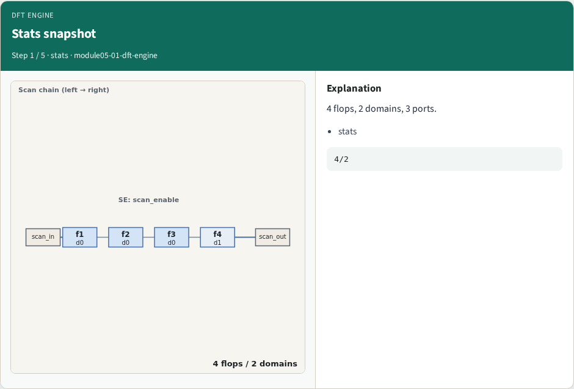
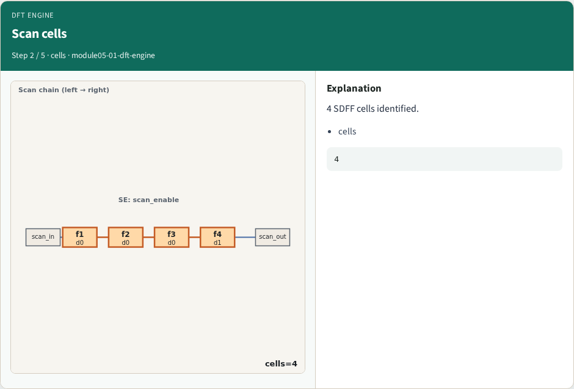
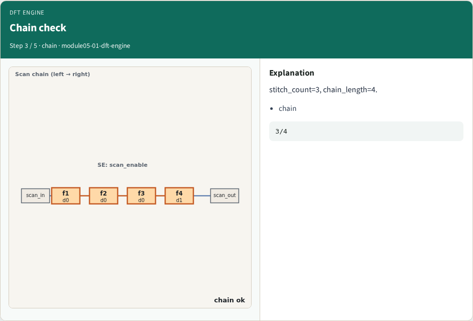
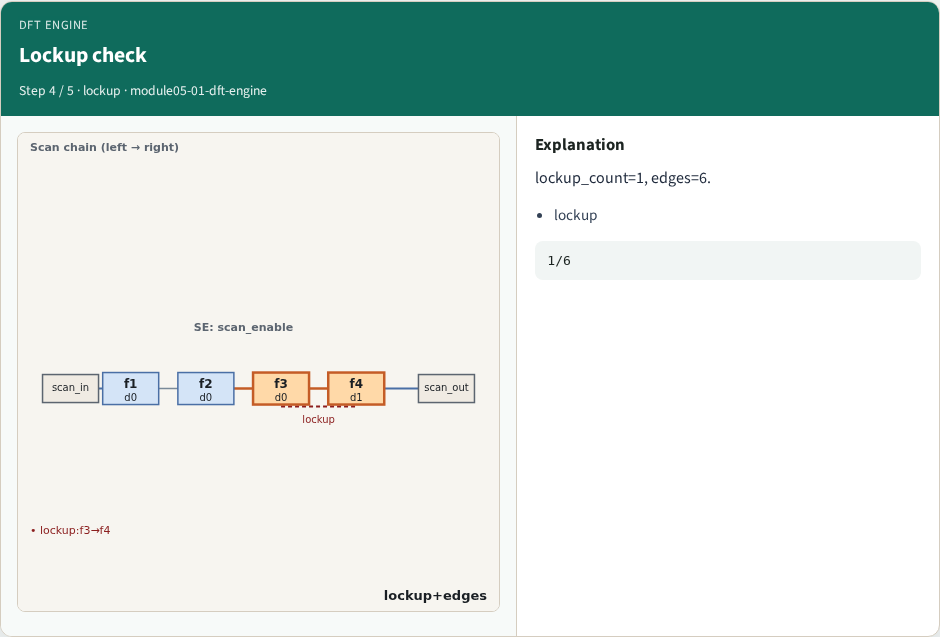
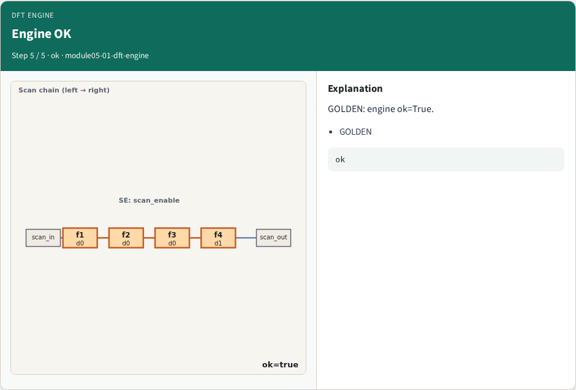

# DFT engine integration — step-by-step (for slides / transcript)

**Module:** `module05-01-dft-engine`  
**Lab / algo:** `dft-engine`  
**Viewer:** `/tools/algorithm-walkthrough/?algo=dft-engine&step=1`

Use each **Caption** as spoken prose (or a shortened slide note).
Use **Bullets** on the PPT; pair with the PNG in `assets/steps/`.

## Step 1 — Stats snapshot



**Caption (transcript):** 4 flops, 2 domains, 3 ports.

**Slide bullets:**

- stats

**On-screen metrics:**

```
4/2
```

## Step 2 — Scan cells



**Caption (transcript):** 4 SDFF cells identified.

**Slide bullets:**

- cells

**On-screen metrics:**

```
4
```

## Step 3 — Chain check



**Caption (transcript):** stitch_count=3, chain_length=4.

**Slide bullets:**

- chain

**On-screen metrics:**

```
3/4
```

## Step 4 — Lockup check



**Caption (transcript):** lockup_count=1, edges=6.

**Slide bullets:**

- lockup

**On-screen metrics:**

```
1/6
```

## Step 5 — Engine OK



**Caption (transcript):** GOLDEN: engine ok=True.

**Slide bullets:**

- GOLDEN

**On-screen metrics:**

```
ok
```

