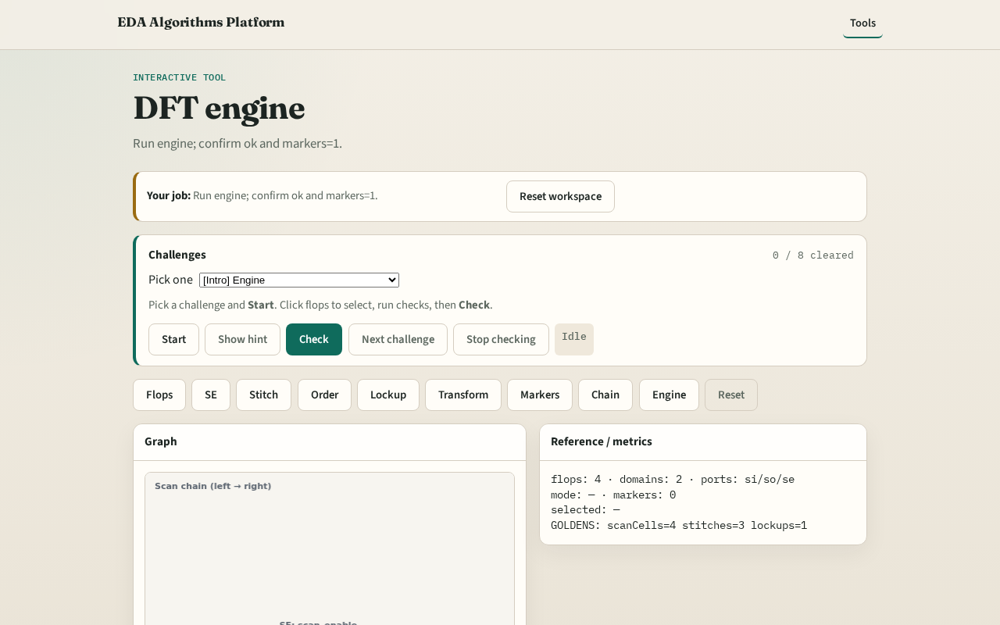

# DFT engine integration

**Module id:** module05-01-dft-engine
**Lab:** dft-engine
**Tracks:** A (implement) · B (browser lab)

## Slide 1 — Engine

A tiny engine chains scan cells, stitch, lockup, transform, and markers.

## Slide 2 — The idea

GOLDEN: scan cells=4, stitches=3, lockups=1, edges=6, markers=1, ok=True.

<!-- algorithm-walkthrough -->

## Slide 3 — Stats snapshot

4 flops, 2 domains, 3 ports.

## Slide 4 — Scan cells

4 SDFF cells identified.

## Slide 5 — Chain check

stitch_count=3, chain_length=4.

## Slide 6 — Lockup check

lockup_count=1, edges=6.

## Slide 7 — Engine OK

GOLDEN: engine ok=True.

<!-- /algorithm-walkthrough -->

## Slide 8 — Browser lab track

Open **dft-engine**. Run engine; confirm ok.

## Slide 9 — Implement track

Call dft_engine(); assert ok and markers.count==1.

## Slide 10 — Pitfalls

Reporting partial checks. Changing toy without updating goldens.

## Slide 11 — Your turn

Next: offline compare, then wrap.
