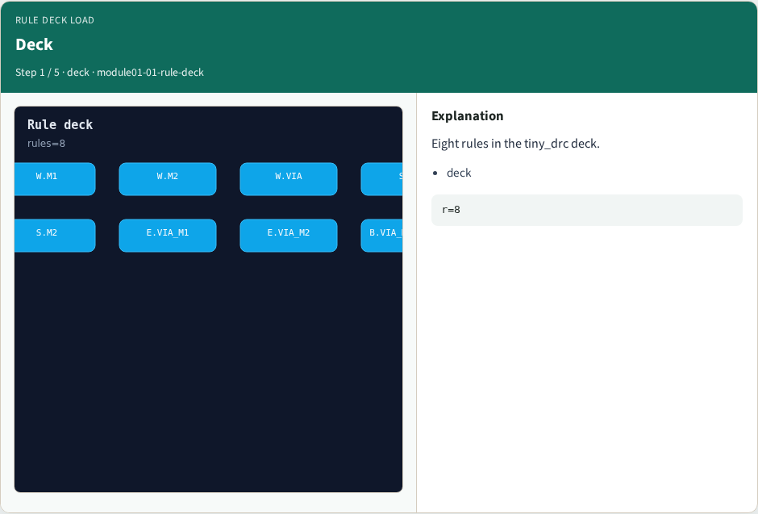
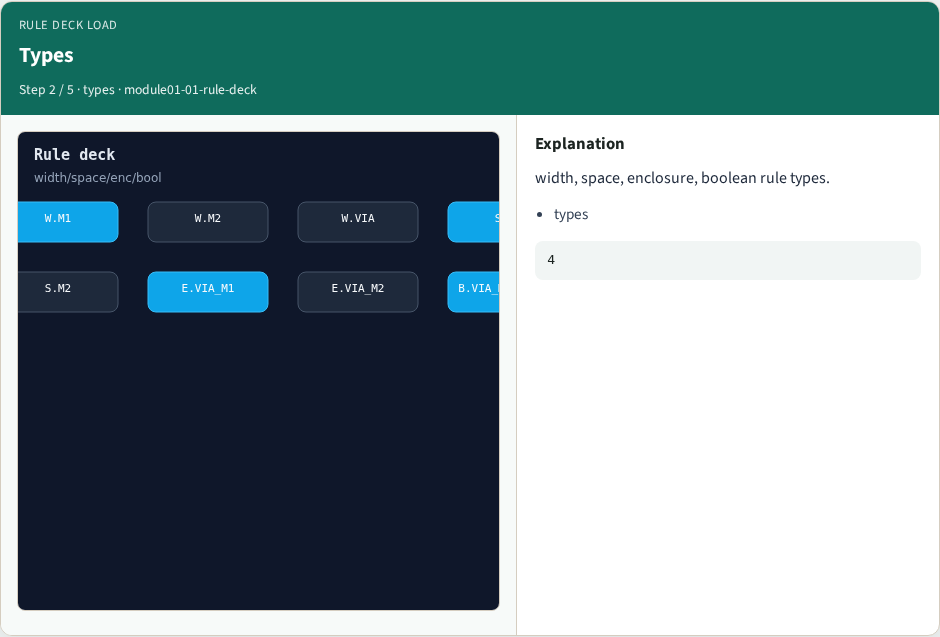
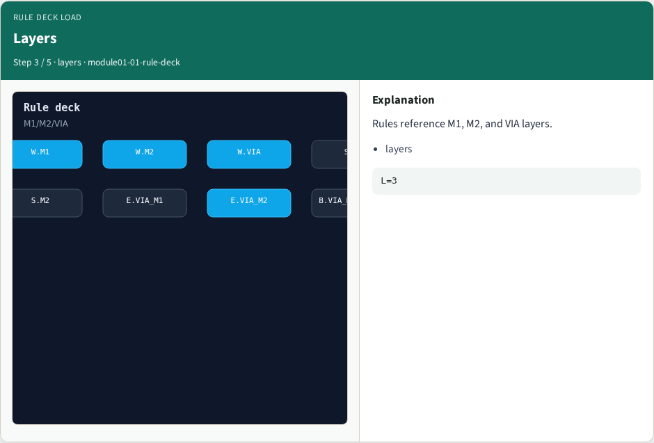
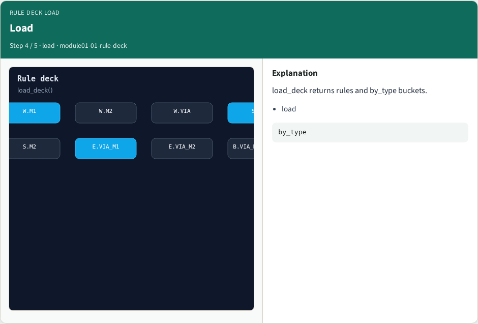
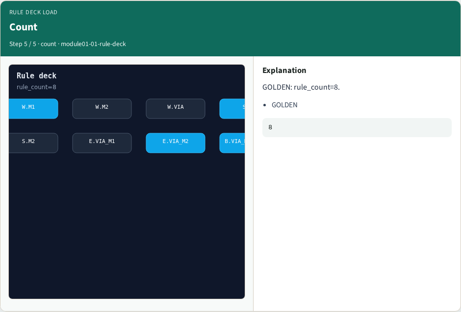
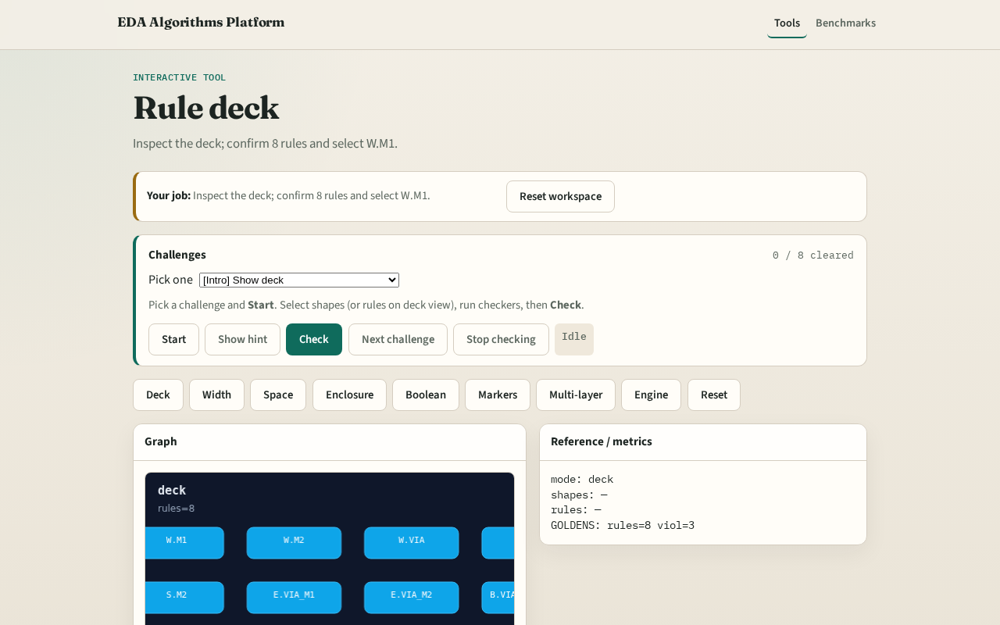

# Rule deck load

**Module id:** module01-01-rule-deck
**Lab:** rule-deck
**Tracks:** A (implement) · B (browser lab)

## Slide 1 — Rule deck

DRC starts from a rule deck — typed rules with limits on each layer.

## Slide 2 — The idea

GOLDEN: rule_count=8.

<!-- algorithm-walkthrough -->

## Slide 3 — Deck

Eight rules in the tiny_drc deck.

## Slide 4 — Types

width, space, enclosure, boolean rule types.

## Slide 5 — Layers

Rules reference M1, M2, and VIA layers.

## Slide 6 — Load

load_deck returns rules and by_type buckets.

## Slide 7 — Count

GOLDEN: rule_count=8.

<!-- /algorithm-walkthrough -->

## Slide 8 — Browser lab track

Open **rule-deck**. Inspect the deck; confirm 8 rules.

## Slide 9 — Implement track

Call load_deck(); assert rule_count==8.

## Slide 10 — Pitfalls

Counting shapes as rules. Ignoring boolean rules in the total.

## Slide 11 — Your turn

Next: width checker.
