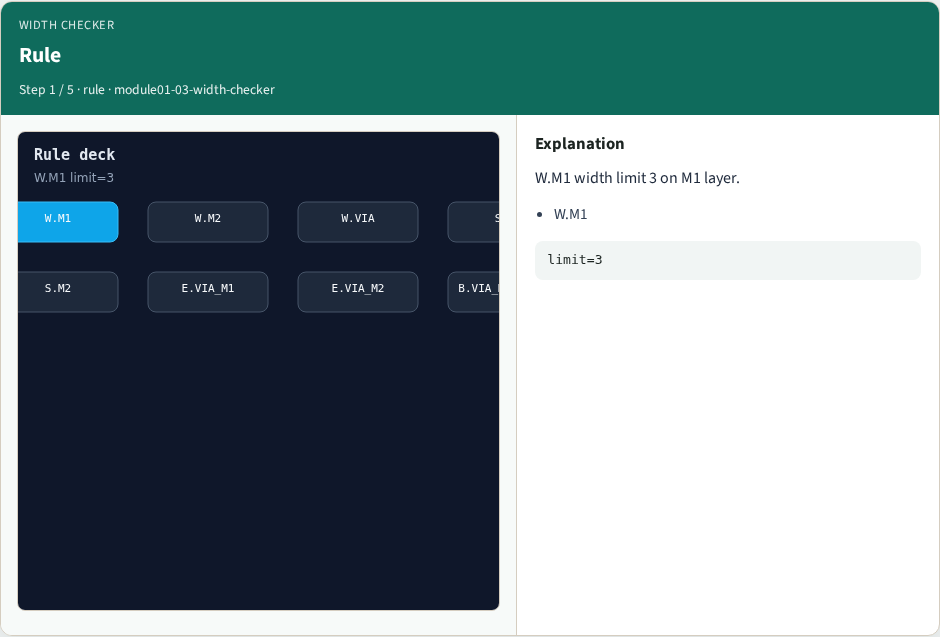
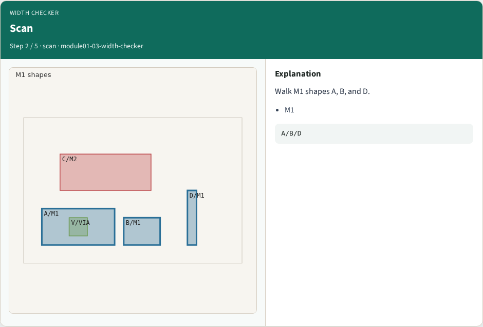
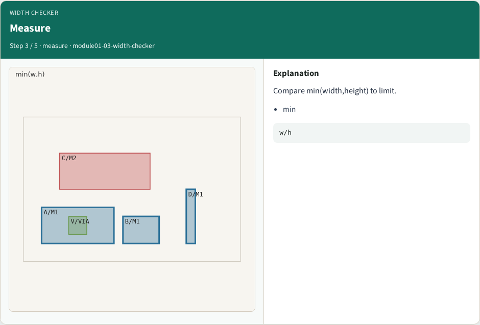
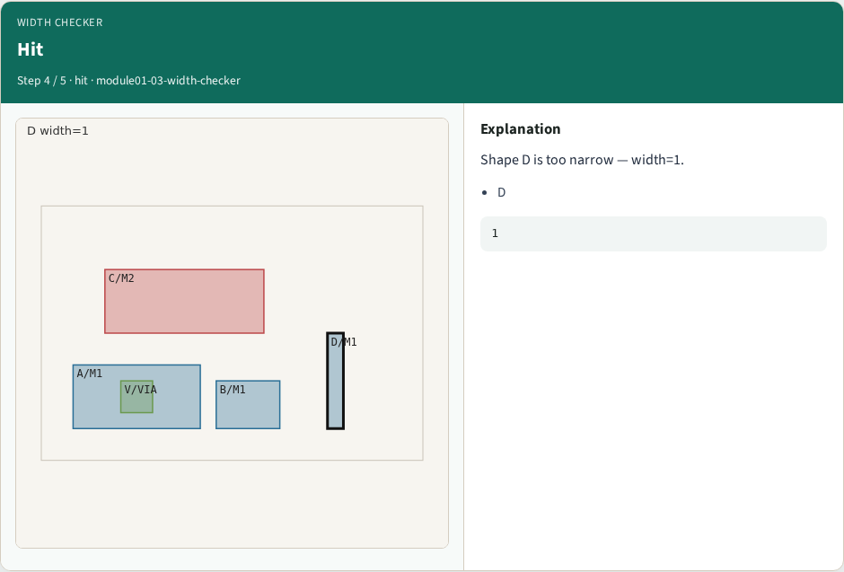
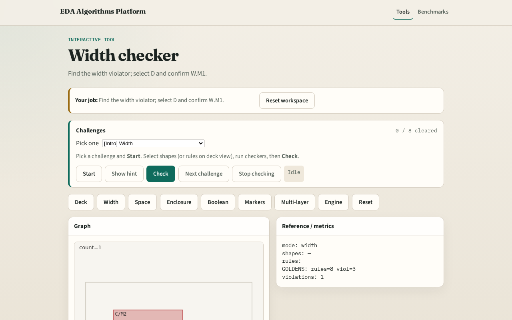

# Width checker

**Module id:** module01-03-width-checker
**Lab:** width-checker
**Tracks:** A (implement) · B (browser lab)

## Slide 1 — Width

Width rules flag shapes whose min(width,height) is below the deck limit.

## Slide 2 — The idea

GOLDEN: width viol=1 on D, rule W.M1.

<!-- algorithm-walkthrough -->

## Slide 3 — Rule

W.M1 width limit 3 on M1 layer.

## Slide 4 — Scan

Walk M1 shapes A, B, and D.

## Slide 5 — Measure

Compare min(width,height) to limit.

## Slide 6 — Hit

Shape D is too narrow — width=1.

## Slide 7 — Golden

GOLDEN: width viol=1, rule W.M1.

<!-- /algorithm-walkthrough -->

## Slide 8 — Browser lab track

Open **width-checker**. Select D; run width check.

## Slide 9 — Implement track

Call check_width(); assert count==1 and violations[0].shapes==['D'].

## Slide 10 — Pitfalls

Using max edge instead of min dimension. Missing rule_id on violations.

## Slide 11 — Your turn

Next: spacing checker.
