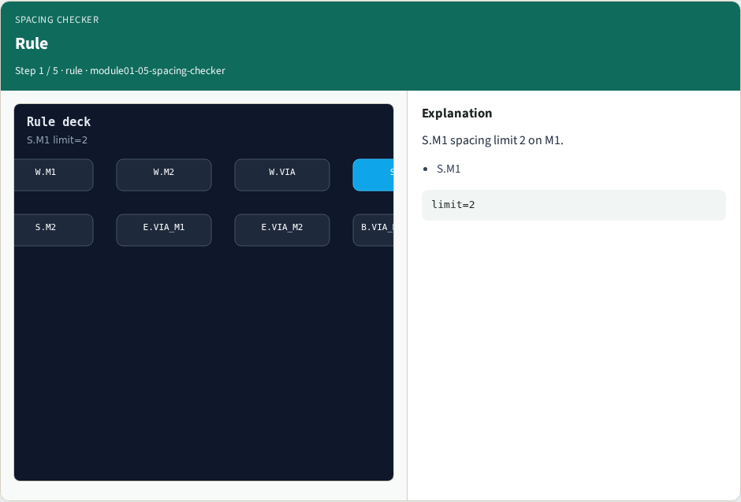
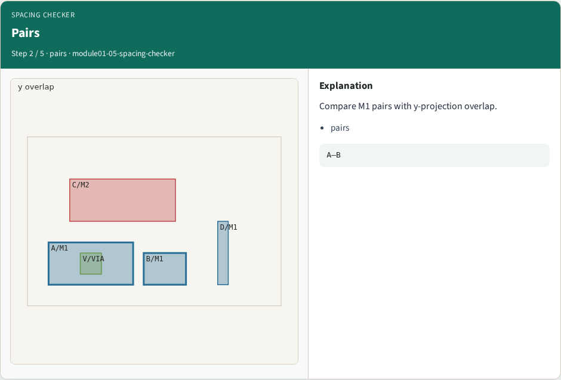
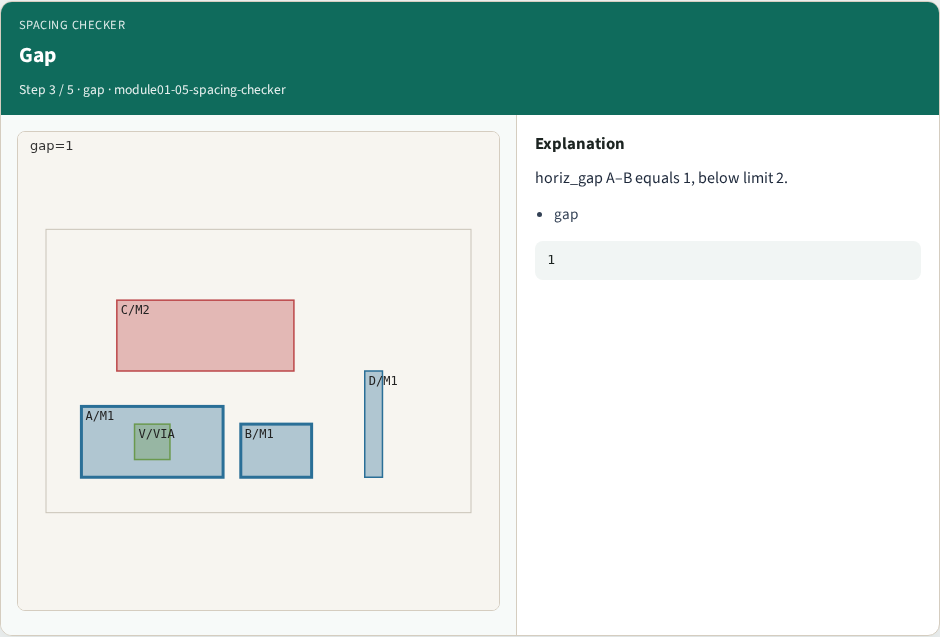
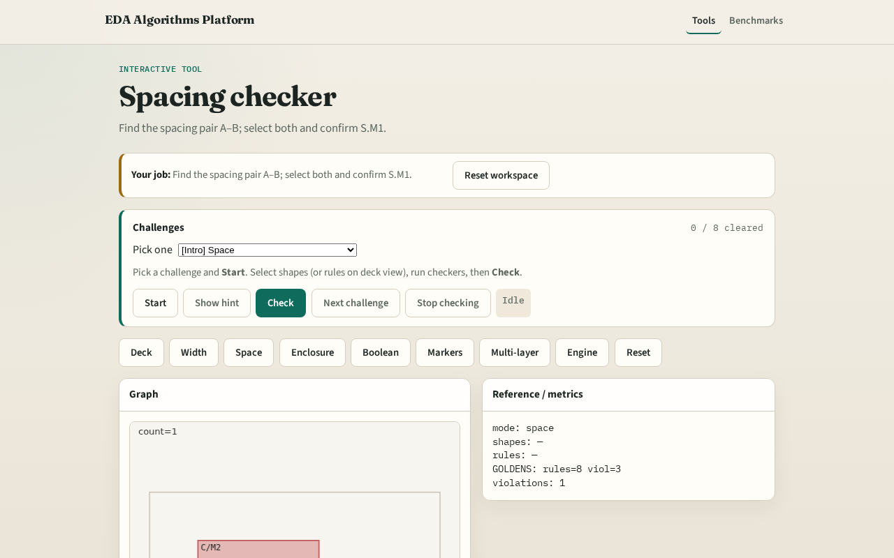

# Spacing checker

**Module id:** module01-05-spacing-checker
**Lab:** spacing-checker
**Tracks:** A (implement) · B (browser lab)

## Slide 1 — Spacing

Spacing rules compare horizontal gaps between overlapping-y shapes.

## Slide 2 — The idea

GOLDEN: space=1 A–B, rule S.M1.

<!-- algorithm-walkthrough -->

## Slide 3 — Rule

S.M1 spacing limit 2 on M1.

## Slide 4 — Pairs

Compare M1 pairs with y-projection overlap.

## Slide 5 — Gap

horiz_gap A–B equals 1, below limit 2.

## Slide 6 — Hit

Shapes A and B violate S.M1.

## Slide 7 — Golden

GOLDEN: space=1 A–B, rule S.M1.

<!-- /algorithm-walkthrough -->

## Slide 8 — Browser lab track

Open **spacing-checker**. Select A and B; run spacing check.

## Slide 9 — Implement track

Call check_spacing(); assert count==1 and set(shapes)=={'A','B'}.

## Slide 10 — Pitfalls

Measuring vertical gap when shapes are side-by-side. Ignoring y overlap requirement.

## Slide 11 — Your turn

Next: enclosure checker.
