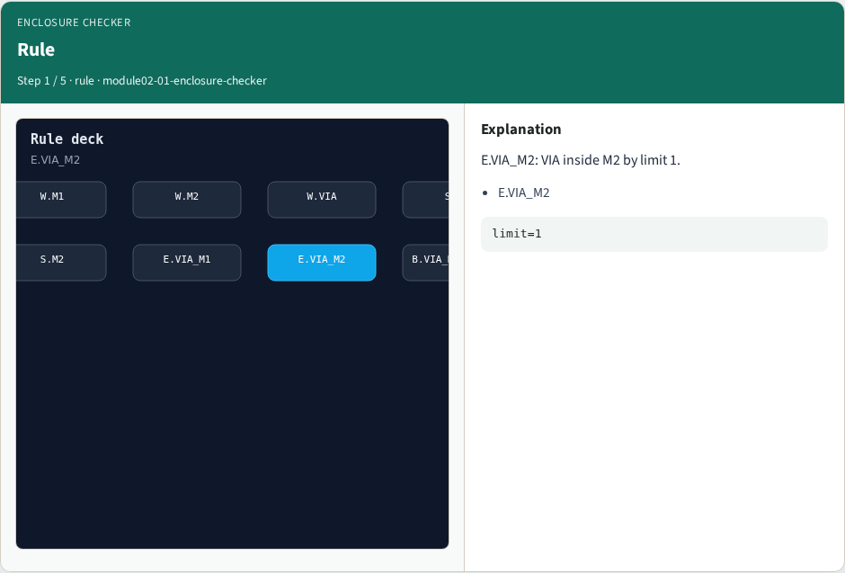
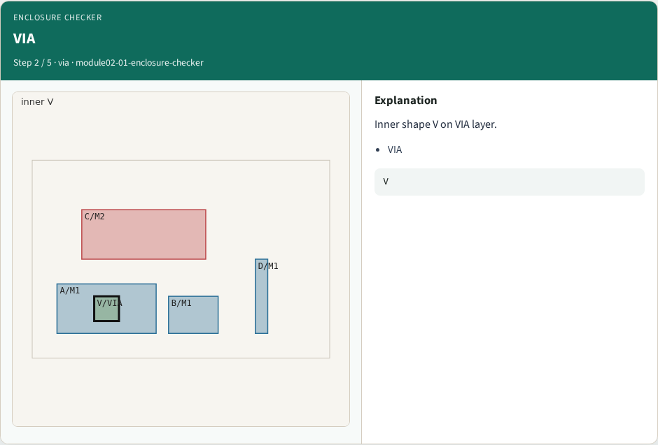
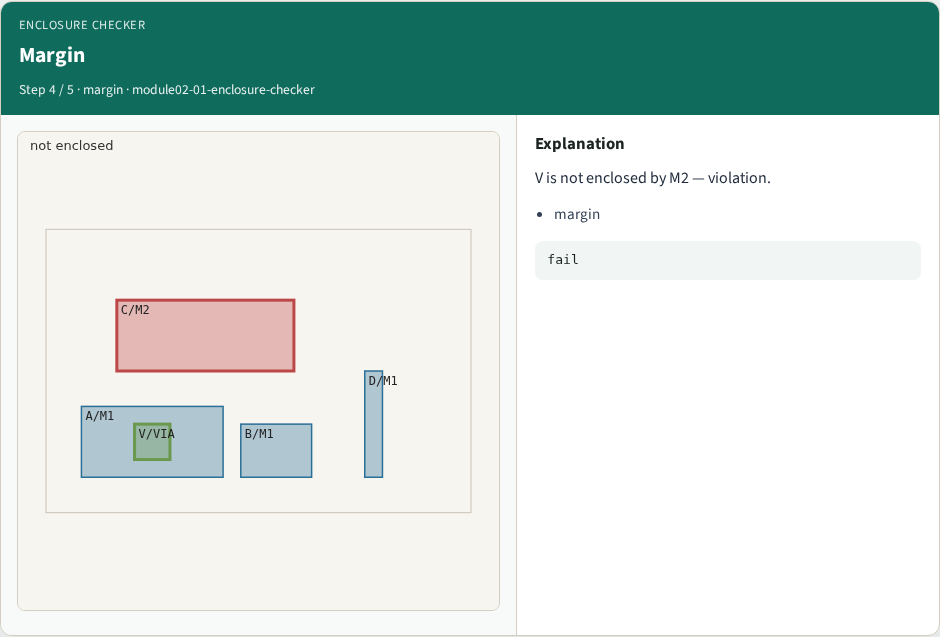

# Enclosure checker — step-by-step (for slides / transcript)

**Module:** `module02-01-enclosure-checker`  
**Lab / algo:** `enclosure-checker`  
**Viewer:** `/tools/algorithm-walkthrough/?algo=enclosure-checker&step=1`

Use each **Caption** as spoken prose (or a shortened slide note).
Use **Bullets** on the PPT; pair with the PNG in `assets/steps/`.

## Step 1 — Rule



**Caption (transcript):** E.VIA_M2: VIA inside M2 by limit 1.

**Slide bullets:**

- E.VIA_M2

**On-screen metrics:**

```
limit=1
```

## Step 2 — VIA



**Caption (transcript):** Inner shape V on VIA layer.

**Slide bullets:**

- VIA

**On-screen metrics:**

```
V
```

## Step 3 — M2


**Caption (transcript):** Outer M2 shape C should enclose V.

**Slide bullets:**

- M2

**On-screen metrics:**

```
C
```

## Step 4 — Margin



**Caption (transcript):** V is not enclosed by M2 — violation.

**Slide bullets:**

- margin

**On-screen metrics:**

```
fail
```

## Step 5 — Golden


**Caption (transcript):** GOLDEN: enc=1 V vs M2, E.VIA_M2.

**Slide bullets:**

- GOLDEN

**On-screen metrics:**

```
1
```

