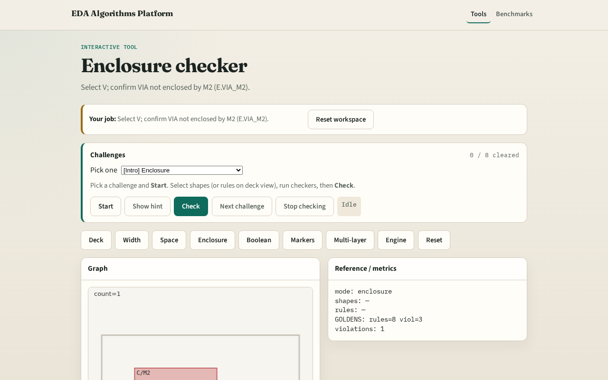

# Enclosure

Enclosure rules require VIA (inner) to sit inside metal (outer) by a margin

---

## The idea
- GOLDEN: enc=1 V vs M2, E.VIA_M2

---

## Rule

---

## VIA

---

## M2

---

## Margin

---

## Golden

---

## Browser lab track

---

## Implement track
- Call check_enclosure(); assert count==1 and inner=='V'

---

## Pitfalls
- Checking M1 enclosure when M2 is the failing outer
- Using overlap instead of contains

---

## Your turn
- Next: collect violation markers

