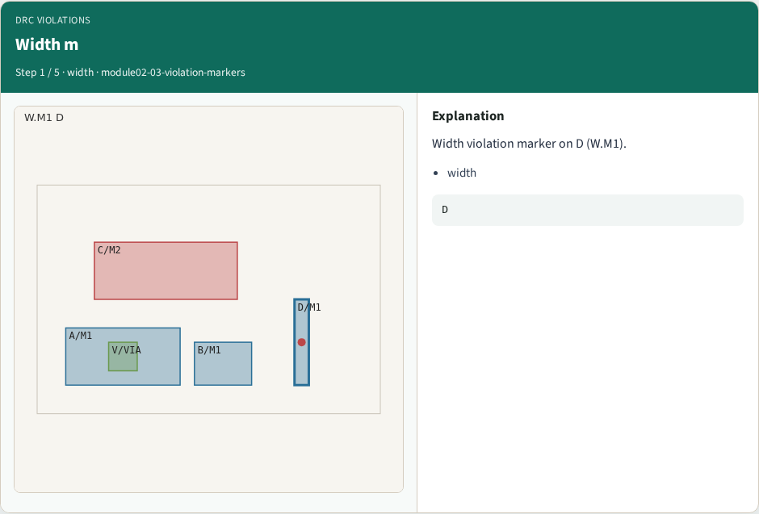
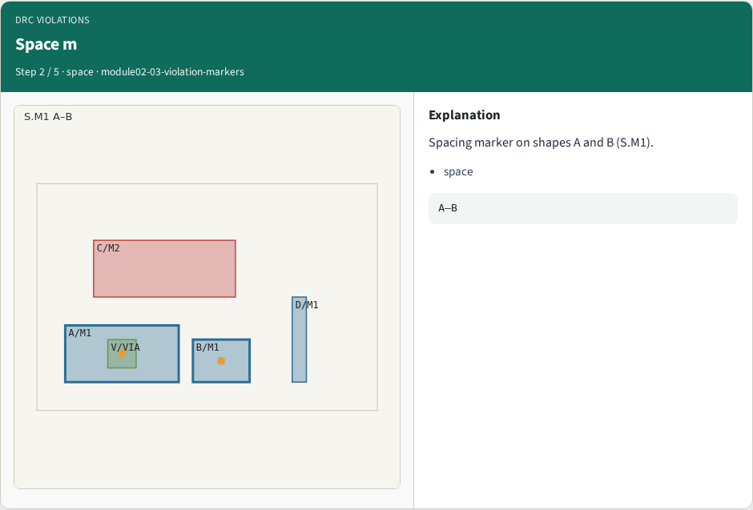
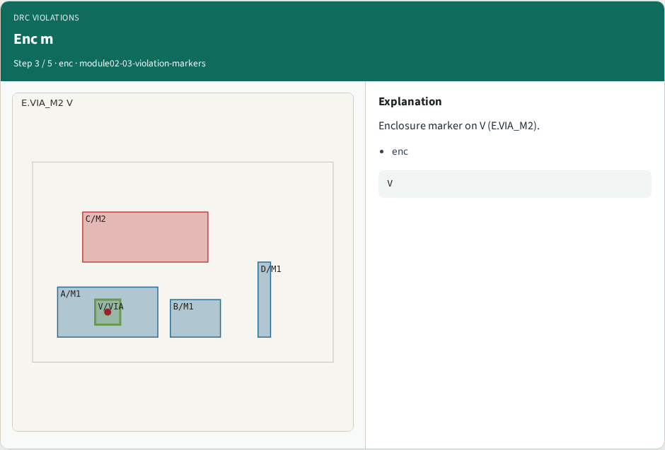

# DRC violations — step-by-step (for slides / transcript)

**Module:** `module02-03-violation-markers`  
**Lab / algo:** `violation-markers`  
**Viewer:** `/tools/algorithm-walkthrough/?algo=violation-markers&step=1`

Use each **Caption** as spoken prose (or a shortened slide note).
Use **Bullets** on the PPT; pair with the PNG in `assets/steps/`.

## Step 1 — Width m



**Caption (transcript):** Width violation marker on D (W.M1).

**Slide bullets:**

- width

**On-screen metrics:**

```
D
```

## Step 2 — Space m



**Caption (transcript):** Spacing marker on shapes A and B (S.M1).

**Slide bullets:**

- space

**On-screen metrics:**

```
A–B
```

## Step 3 — Enc m



**Caption (transcript):** Enclosure marker on V (E.VIA_M2).

**Slide bullets:**

- enc

**On-screen metrics:**

```
V
```

## Step 4 — Rule id


**Caption (transcript):** Each violation carries a rule_id field.

**Slide bullets:**

- rule_id

**On-screen metrics:**

```
3
```

## Step 5 — Golden


**Caption (transcript):** GOLDEN: violation_count=3 with rule_id.

**Slide bullets:**

- GOLDEN

**On-screen metrics:**

```
3
```

