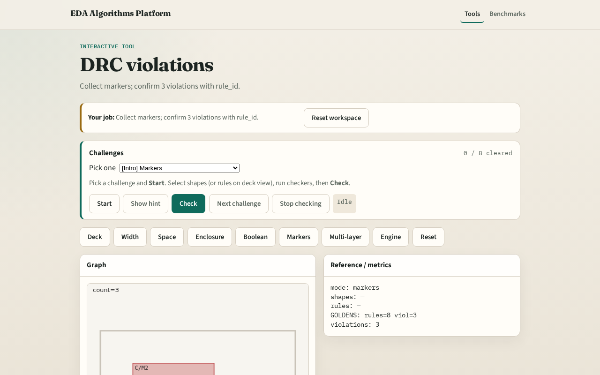

# DRC violations

**Module id:** module02-03-violation-markers
**Lab:** violation-markers
**Tracks:** A (implement) · B (browser lab)

## Slide 1 — Violations

Signoff DRC emits markers — one record per geometry violation with rule_id.

## Slide 2 — The idea

GOLDEN: violation_count=3 with rule_id.

<!-- algorithm-walkthrough -->

## Slide 3 — Width m

Width violation marker on D (W.M1).

## Slide 4 — Space m

Spacing marker on shapes A and B (S.M1).

## Slide 5 — Enc m

Enclosure marker on V (E.VIA_M2).

## Slide 6 — Rule id

Each violation carries a rule_id field.

## Slide 7 — Golden

GOLDEN: violation_count=3 with rule_id.

<!-- /algorithm-walkthrough -->

## Slide 8 — Browser lab track

Open **violation-markers**. Run collect; confirm 3 violations.

## Slide 9 — Implement track

Call collect_violations(); assert count==3 and all have rule_id.

## Slide 10 — Pitfalls

Double-counting boolean hits as geometry violations. Missing rule_id field.

## Slide 11 — Your turn

Next: multi-layer deck rules.
