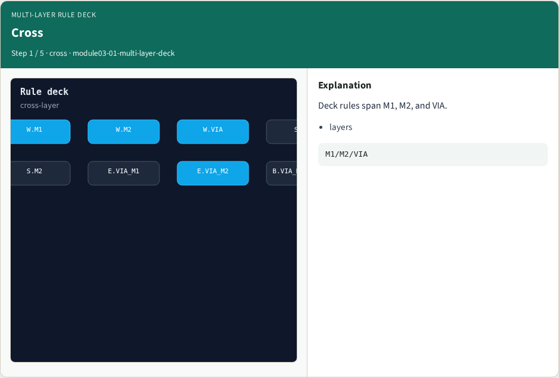
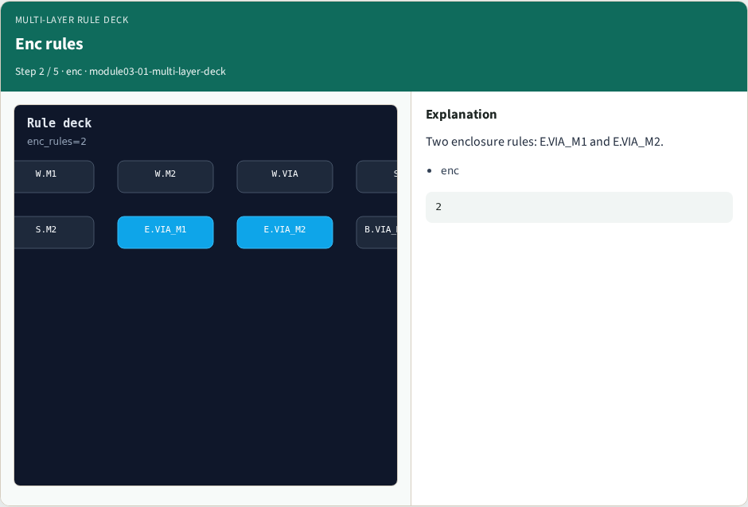
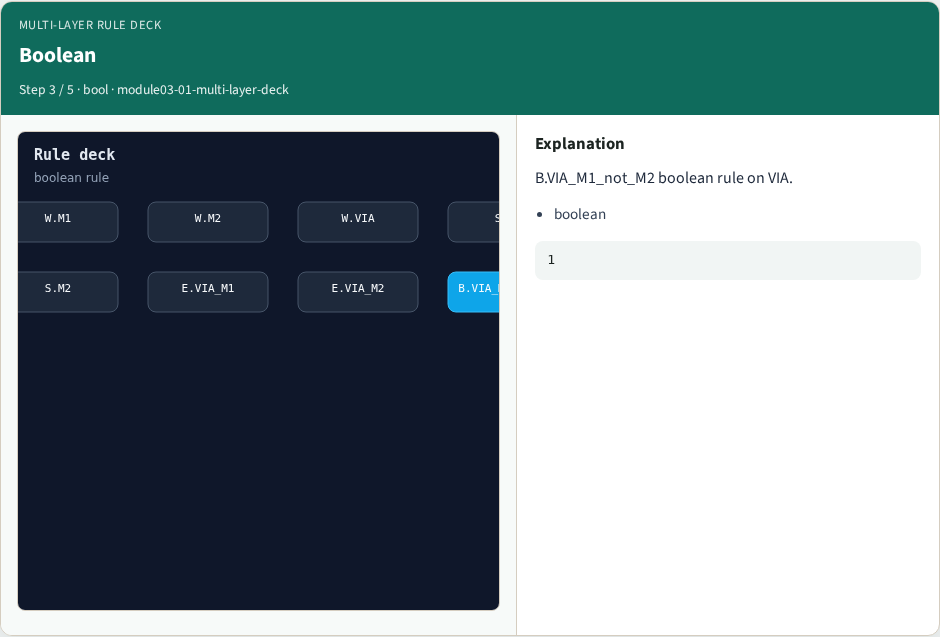
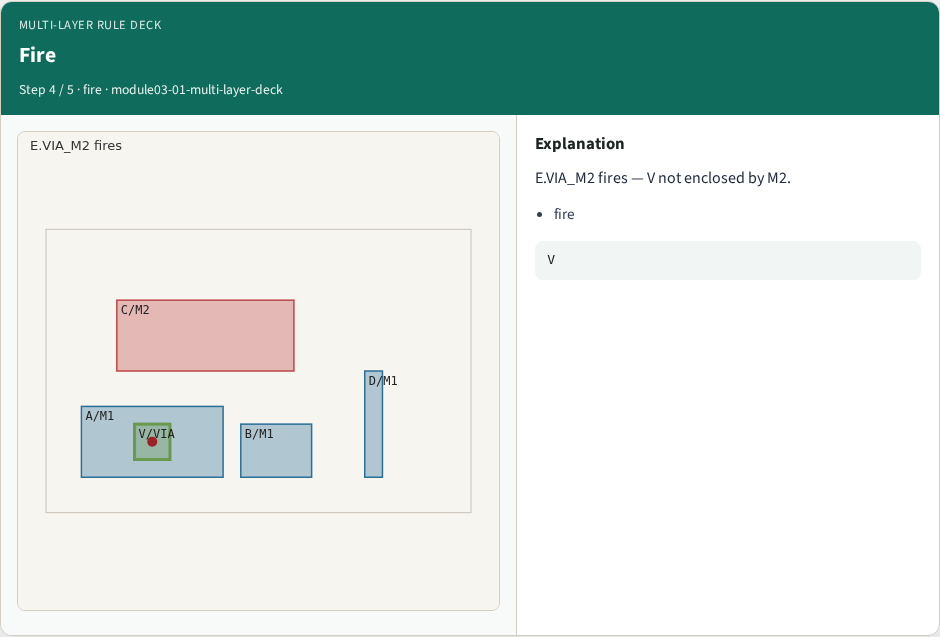
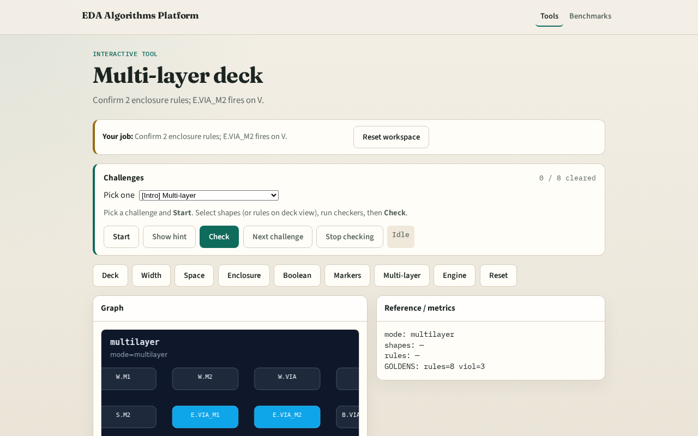

# Multi-layer

Real decks span layers , enclosure and boolean tie VIA to M1/M2

---

## The idea
- GOLDEN: 2 enclosure rules; fires E.VIA_M2

---

## Cross

---

## Enc rules

---

## Boolean

---

## Fire

---

## Golden

---

## Browser lab track

---

## Implement track
- Call multi_layer_rules(); assert enclosure_count==2 and fires count==1

---

## Pitfalls
- Counting width rules as cross-layer
- Ignoring boolean deck entries

---

## Your turn
- Next: deck boolean rules

