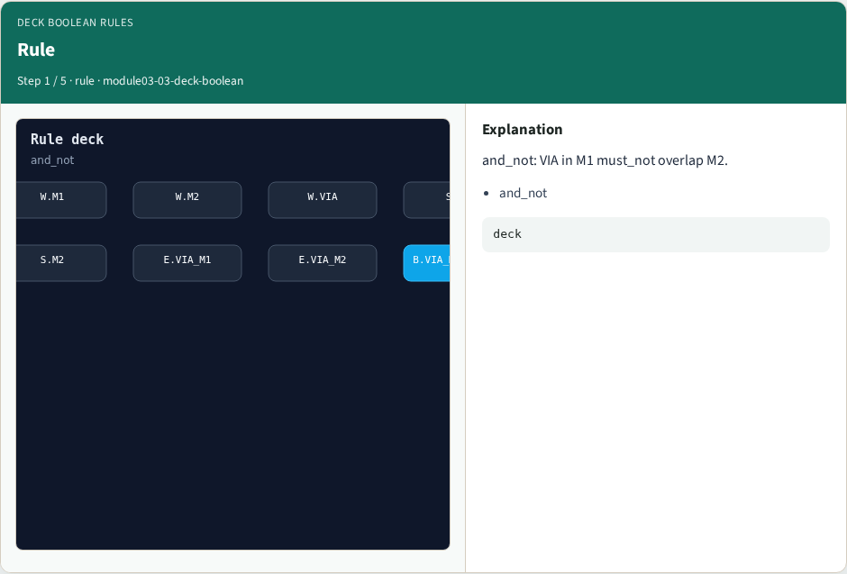
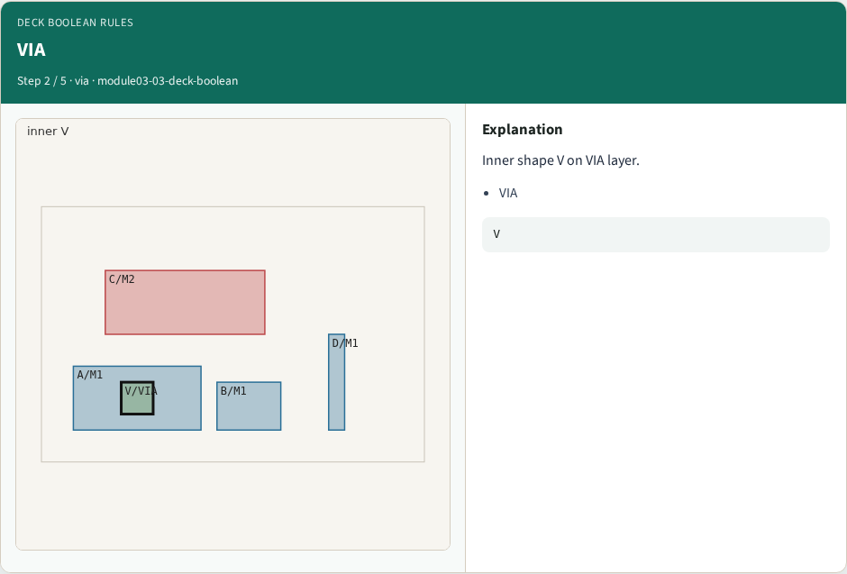
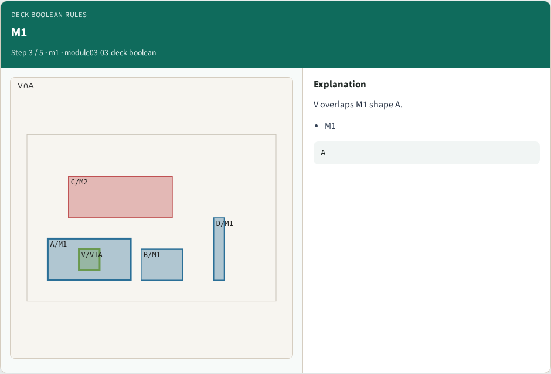
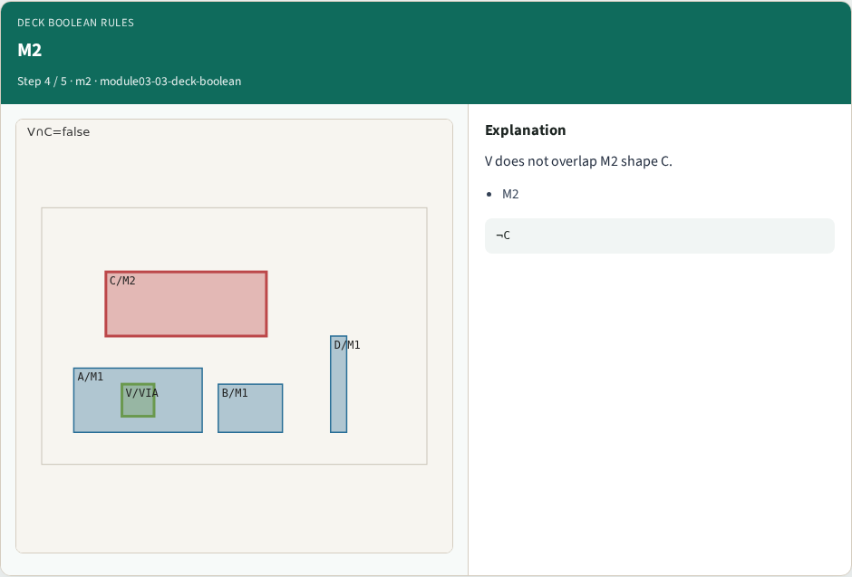

# Deck boolean rules — step-by-step (for slides / transcript)

**Module:** `module03-03-deck-boolean`  
**Lab / algo:** `deck-boolean`  
**Viewer:** `/tools/algorithm-walkthrough/?algo=deck-boolean&step=1`

Use each **Caption** as spoken prose (or a shortened slide note).
Use **Bullets** on the PPT; pair with the PNG in `assets/steps/`.

## Step 1 — Rule



**Caption (transcript):** and_not: VIA in M1 must_not overlap M2.

**Slide bullets:**

- and_not

**On-screen metrics:**

```
deck
```

## Step 2 — VIA



**Caption (transcript):** Inner shape V on VIA layer.

**Slide bullets:**

- VIA

**On-screen metrics:**

```
V
```

## Step 3 — M1



**Caption (transcript):** V overlaps M1 shape A.

**Slide bullets:**

- M1

**On-screen metrics:**

```
A
```

## Step 4 — M2



**Caption (transcript):** V does not overlap M2 shape C.

**Slide bullets:**

- M2

**On-screen metrics:**

```
¬C
```

## Step 5 — Golden


**Caption (transcript):** GOLDEN: boolean hit=1 on V.

**Slide bullets:**

- GOLDEN

**On-screen metrics:**

```
1
```

