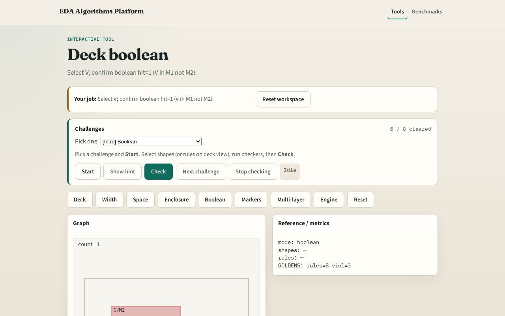

# Deck boolean rules

**Module id:** module03-03-deck-boolean
**Lab:** deck-boolean
**Tracks:** A (implement) · B (browser lab)

## Slide 1 — Boolean

Boolean deck rules express layer interactions — VIA covered by M1 and not M2.

## Slide 2 — The idea

GOLDEN: boolean hit=1 on V.

<!-- algorithm-walkthrough -->

## Slide 3 — Rule

and_not: VIA in M1 must_not overlap M2.

## Slide 4 — VIA

Inner shape V on VIA layer.

## Slide 5 — M1

V overlaps M1 shape A.

## Slide 6 — M2

V does not overlap M2 shape C.

## Slide 7 — Golden

GOLDEN: boolean hit=1 on V.

<!-- /algorithm-walkthrough -->

## Slide 8 — Browser lab track

Open **deck-boolean**. Select V; run boolean check.

## Slide 9 — Implement track

Call check_boolean(); assert count==1 and hits[0].shapes==['V'].

## Slide 10 — Pitfalls

Treating enclosure failures as boolean hits. Requiring full containment for overlap.

## Slide 11 — Your turn

Next: DRC engine integration.
