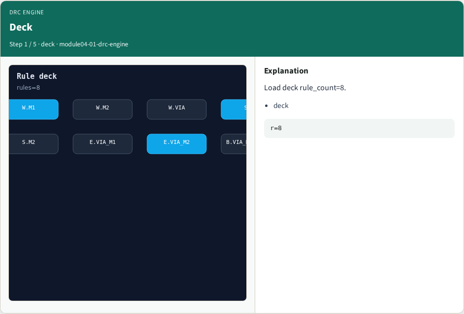
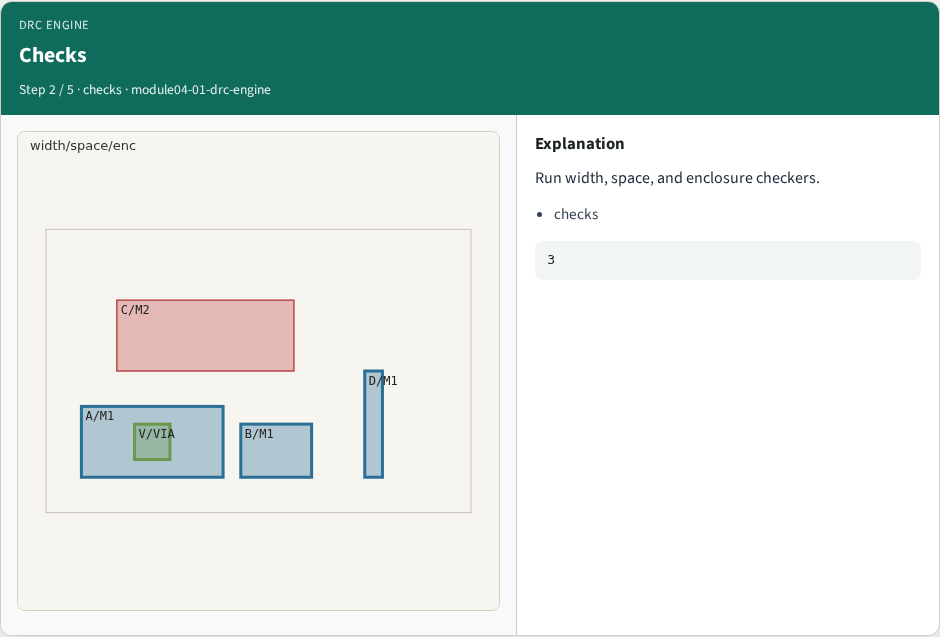
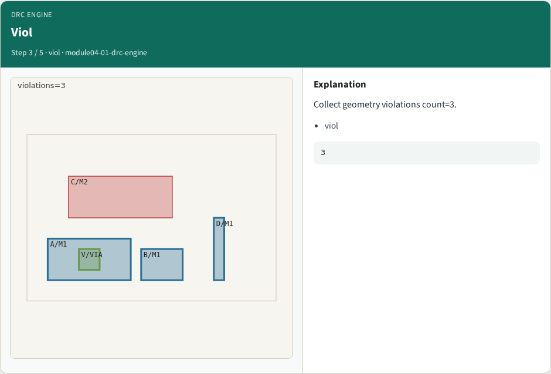
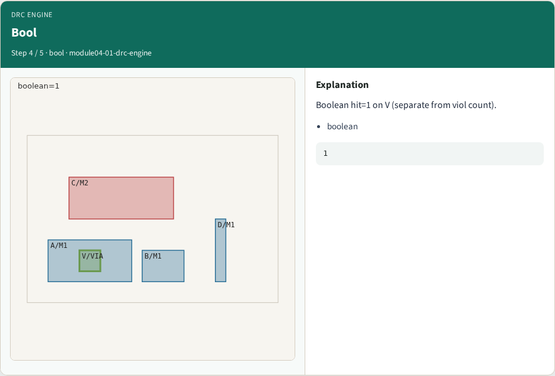

# DRC engine pass — step-by-step (for slides / transcript)

**Module:** `module04-01-drc-engine`  
**Lab / algo:** `drc-engine`  
**Viewer:** `/tools/algorithm-walkthrough/?algo=drc-engine&step=1`

Use each **Caption** as spoken prose (or a shortened slide note).
Use **Bullets** on the PPT; pair with the PNG in `assets/steps/`.

## Step 1 — Deck



**Caption (transcript):** Load deck rule_count=8.

**Slide bullets:**

- deck

**On-screen metrics:**

```
r=8
```

## Step 2 — Checks



**Caption (transcript):** Run width, space, and enclosure checkers.

**Slide bullets:**

- checks

**On-screen metrics:**

```
3
```

## Step 3 — Viol



**Caption (transcript):** Collect geometry violations count=3.

**Slide bullets:**

- viol

**On-screen metrics:**

```
3
```

## Step 4 — Bool



**Caption (transcript):** Boolean hit=1 on V (separate from viol count).

**Slide bullets:**

- boolean

**On-screen metrics:**

```
1
```

## Step 5 — OK


**Caption (transcript):** GOLDEN: ok=True viol=3.

**Slide bullets:**

- GOLDEN

**On-screen metrics:**

```
ok
```

