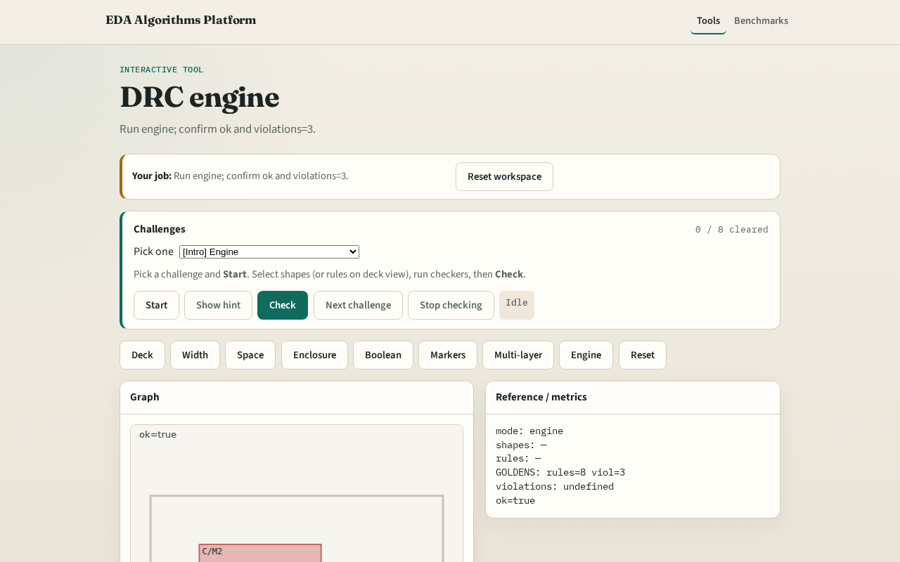

# Engine

A tiny engine chains every checker and reports ok when goldens match

---

## The idea
- GOLDEN: ok=True viol=3

---

## Deck

---

## Checks

---

## Viol

---

## Bool

---

## OK

---

## Browser lab track

---

## Implement track
- Call drc_engine(); assert ok and violations.count==3

---

## Pitfalls
- Reporting partial checks
- Changing the toy without updating goldens

---

## Your turn
- Next: offline compare, then wrap

