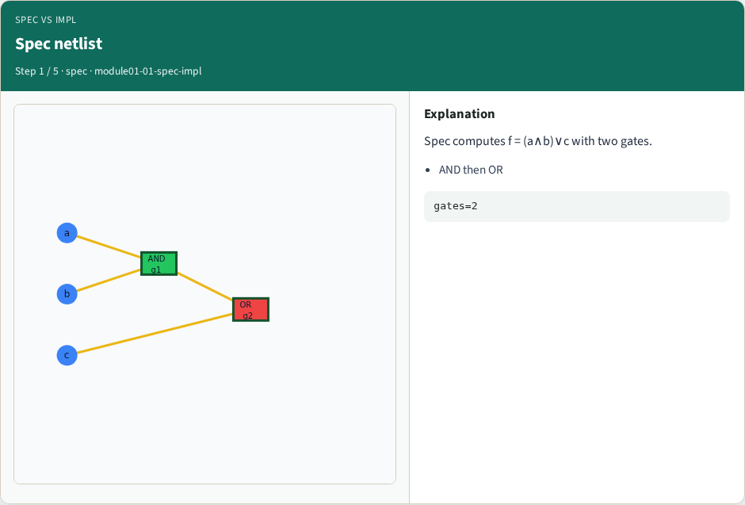
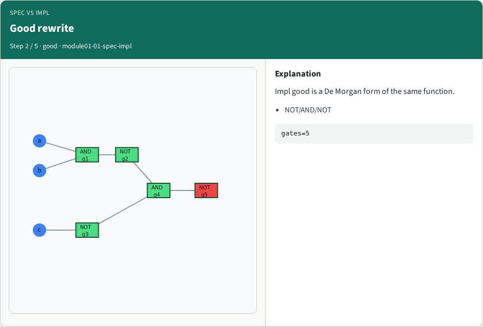
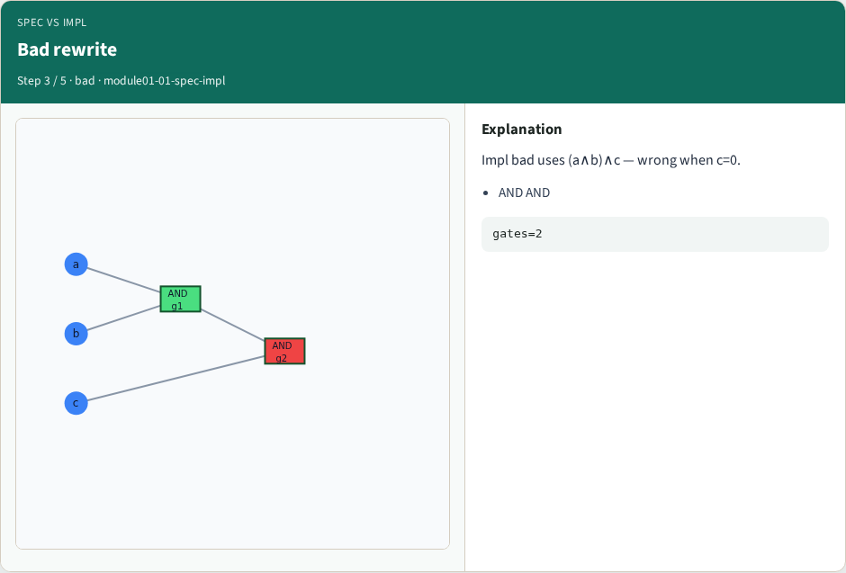
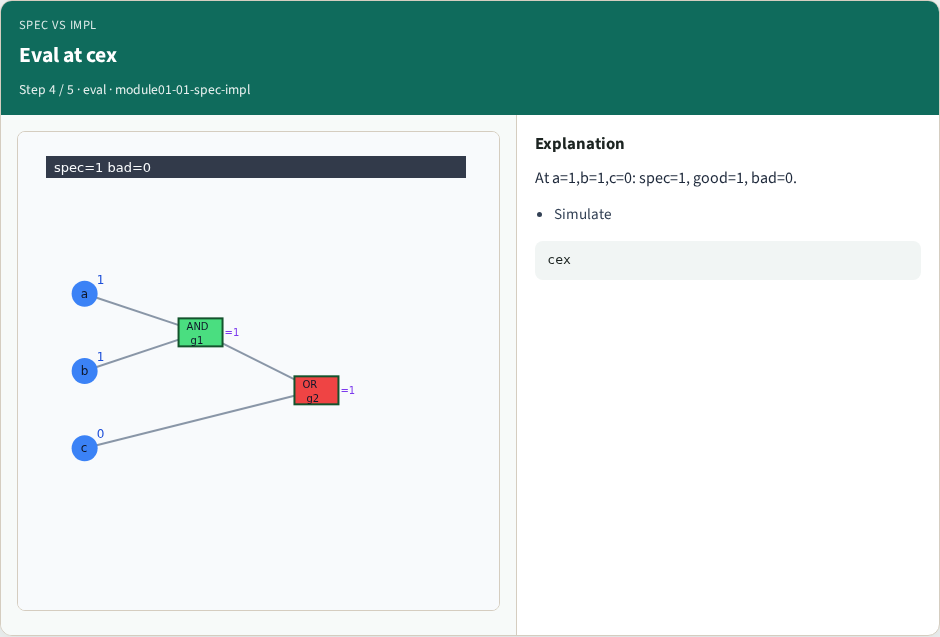
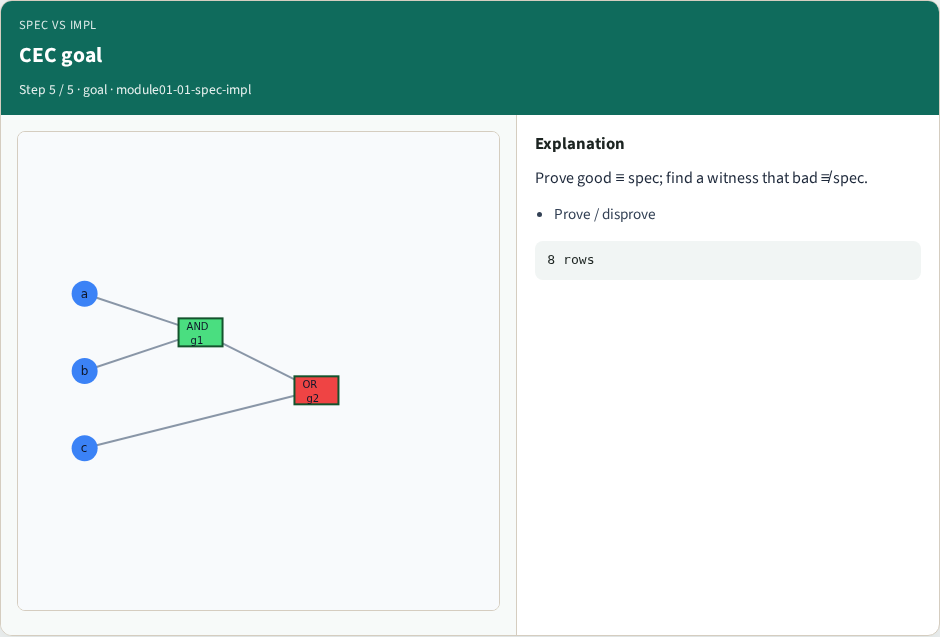

# Spec vs implementation — step-by-step (for slides / transcript)

**Module:** `module01-01-spec-impl`  
**Lab / algo:** `spec-impl`  
**Viewer:** `/tools/algorithm-walkthrough/?algo=spec-impl&step=1`

Use each **Caption** as spoken prose (or a shortened slide note).
Use **Bullets** on the PPT; pair with the PNG in `assets/steps/`.

## Step 1 — Spec netlist



**Caption (transcript):** Spec computes f = (a∧b)∨c with two gates.

**Slide bullets:**

- AND then OR

**On-screen metrics:**

```
gates=2
```

## Step 2 — Good rewrite



**Caption (transcript):** Impl good is a De Morgan form of the same function.

**Slide bullets:**

- NOT/AND/NOT

**On-screen metrics:**

```
gates=5
```

## Step 3 — Bad rewrite



**Caption (transcript):** Impl bad uses (a∧b)∧c — wrong when c=0.

**Slide bullets:**

- AND AND

**On-screen metrics:**

```
gates=2
```

## Step 4 — Eval at cex



**Caption (transcript):** At a=1,b=1,c=0: spec=1, good=1, bad=0.

**Slide bullets:**

- Simulate

**On-screen metrics:**

```
cex
```

## Step 5 — CEC goal



**Caption (transcript):** Prove good ≡ spec; find a witness that bad ≢ spec.

**Slide bullets:**

- Prove / disprove

**On-screen metrics:**

```
8 rows
```

