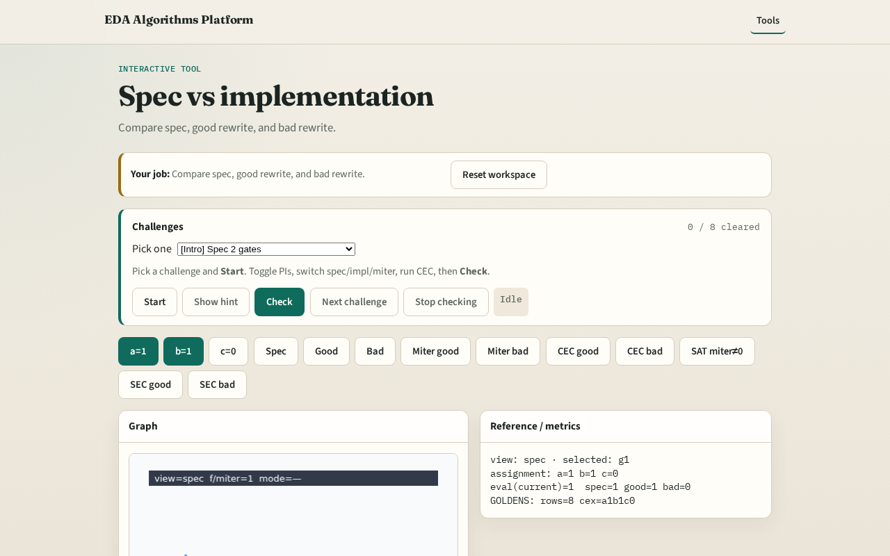

# Spec vs impl

Equivalence checking always compares two circuits: a golden spec and a candidate implementation

---

## The idea
- Spec computes f=(a∧b)∨c with two gates

---

## Spec netlist

---

## Good rewrite

---

## Bad rewrite

---

## Eval at cex

---

## CEC goal

---

## Browser lab track

---

## Implement track
- Load tiny_equiv.json; call evaluate_circuit on spec and both impls for all 8 rows

---

## Pitfalls
- Swapping spec and impl
- Comparing only one input corner

---

## Your turn
- Next: build the miter (XOR of outputs)

