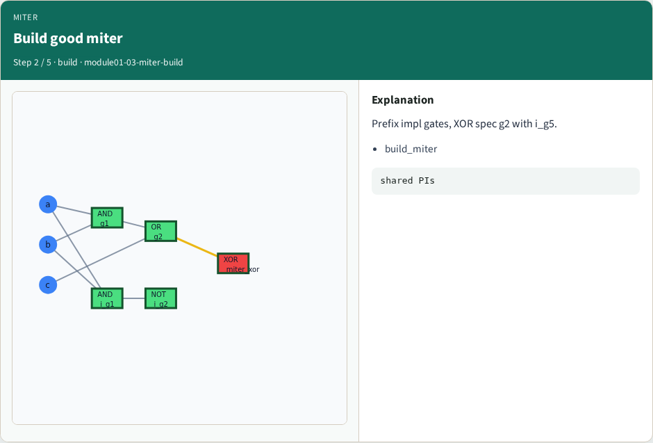
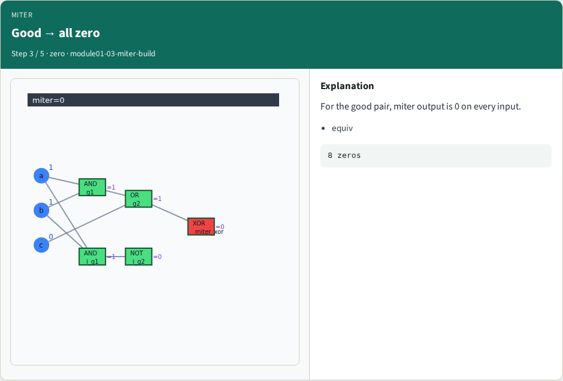
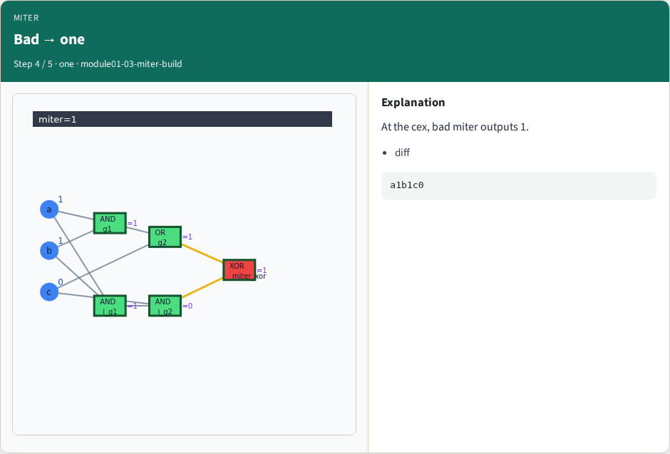
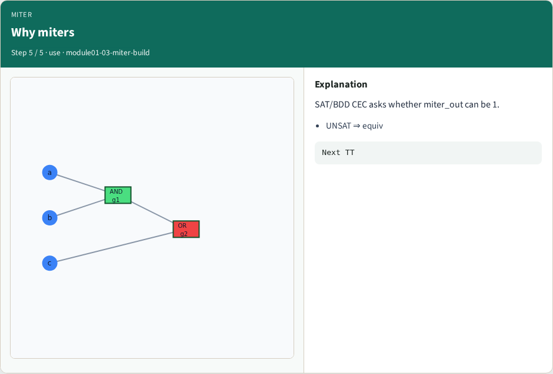
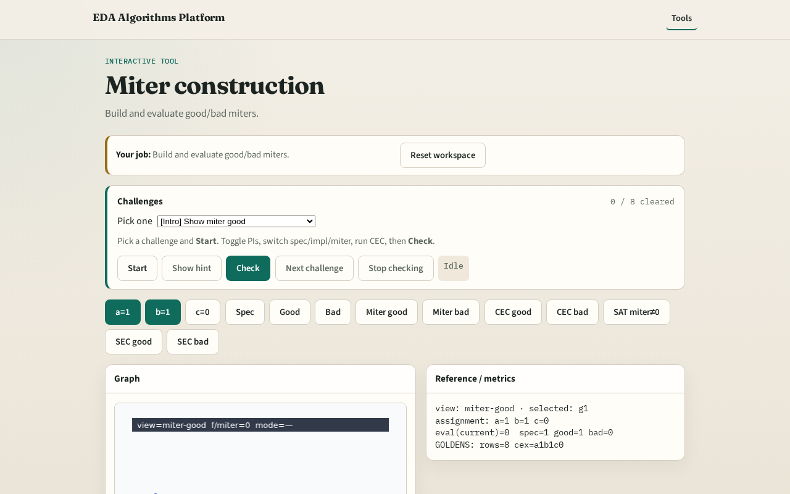

# Miter construction

**Module id:** module01-03-miter-build
**Lab:** miter-build
**Tracks:** A (implement) · B (browser lab)

## Slide 1 — Miter build

A miter merges spec and impl and XORs their outputs — equivalent designs yield miter PO=0 everywhere.

## Slide 2 — The idea

build_miter(spec, impl_good) adds i_-prefixed impl gates and miter_xor = spec_f XOR impl_f.

<!-- algorithm-walkthrough -->

## Slide 3 — XOR outputs

A miter XORs the two POs under shared PIs.

## Slide 4 — Build good miter

Prefix impl gates, XOR spec g2 with i_g5.

## Slide 5 — Good → all zero

For the good pair, miter output is 0 on every input.

## Slide 6 — Bad → one

At the cex, bad miter outputs 1.

## Slide 7 — Why miters

SAT/BDD CEC asks whether miter_out can be 1.

<!-- /algorithm-walkthrough -->

## Slide 8 — Browser lab track

Open **miter-build**. Build miter; highlight XOR output; confirm all-zero for good pair.

## Slide 9 — Implement track

Call build_miter(spec, impl_good); miter_output must be 0 on every assignment.

## Slide 10 — Pitfalls

XORing inputs instead of outputs. Forgetting to clear old output flags.

## Slide 11 — Your turn

Next: exhaustive truth-table CEC.
