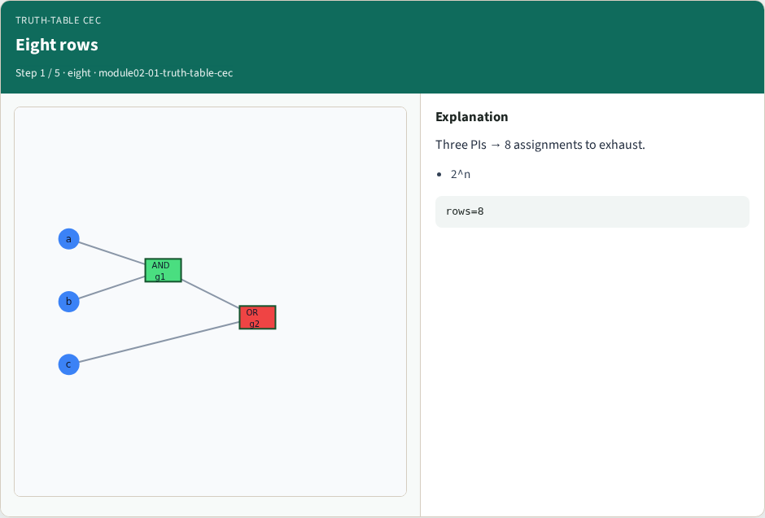
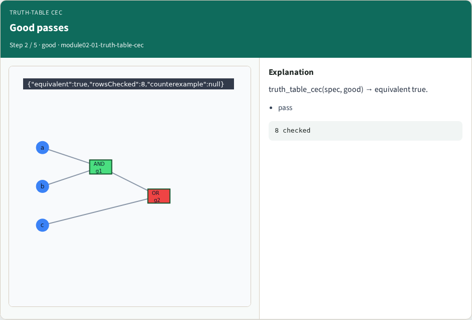
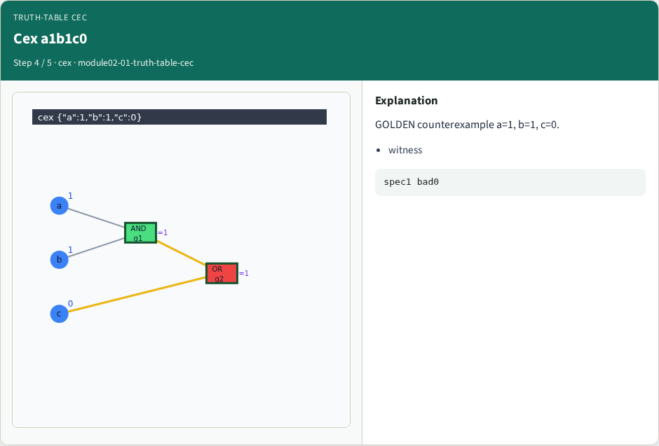
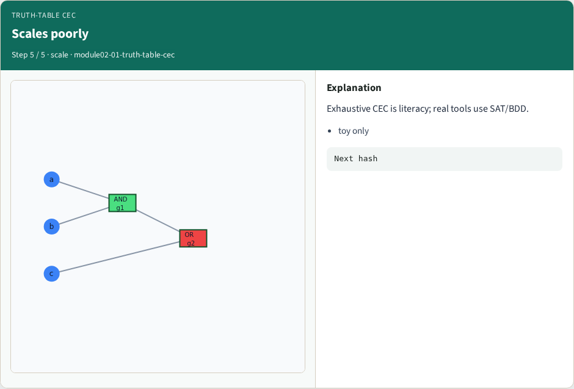
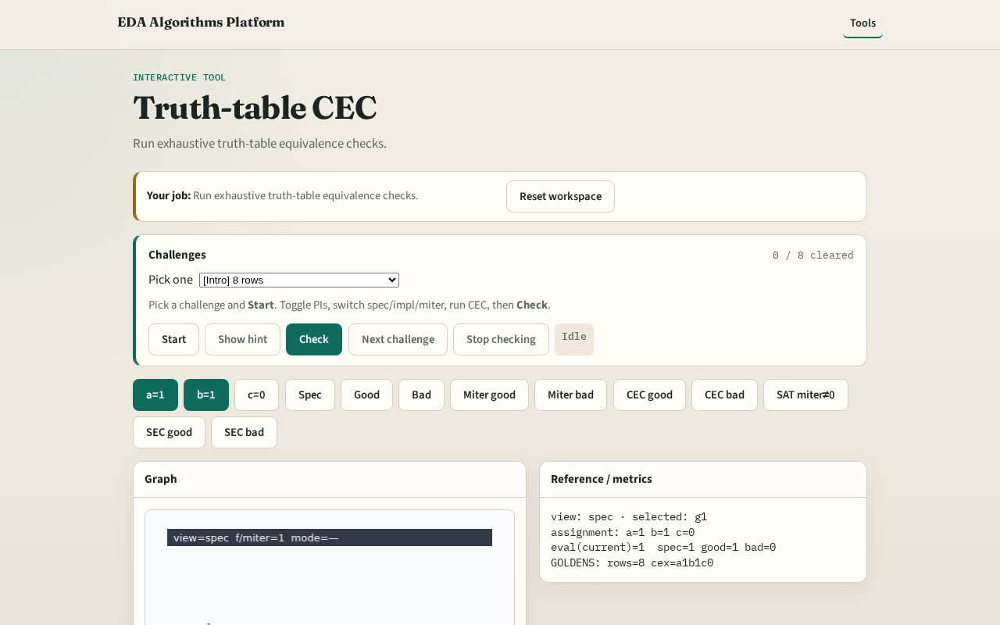

# Truth-table CEC

**Module id:** module02-01-truth-table-cec
**Lab:** truth-table-cec
**Tracks:** A (implement) · B (browser lab)

## Slide 1 — Truth-table CEC

Truth-table CEC enumerates every PI assignment — fine for tiny circuits, infeasible for wide buses.

## Slide 2 — The idea

truth_table_cec walks all 8 rows; returns equivalent=True or counterexample dict.

<!-- algorithm-walkthrough -->

## Slide 3 — Eight rows

Three PIs → 8 assignments to exhaust.

## Slide 4 — Good passes

truth_table_cec(spec, good) → equivalent true.

## Slide 5 — Bad fails

Bad fails; first mismatch is the counterexample.

## Slide 6 — Cex a1b1c0

GOLDEN counterexample a=1, b=1, c=0.

## Slide 7 — Scales poorly

Exhaustive CEC is literacy; real tools use SAT/BDD.

<!-- /algorithm-walkthrough -->

## Slide 8 — Browser lab track

Open **truth-table-cec**. Run CEC on good and bad pairs; read counterexample panel.

## Slide 9 — Implement track

Call truth_table_cec(spec, impl_good) and (spec, impl_bad); assert goldens.

## Slide 10 — Pitfalls

Stopping at first match instead of first mismatch. Missing a PI bit in enumeration.

## Slide 11 — Your turn

Next: structural hashing / FRAIG lite.
