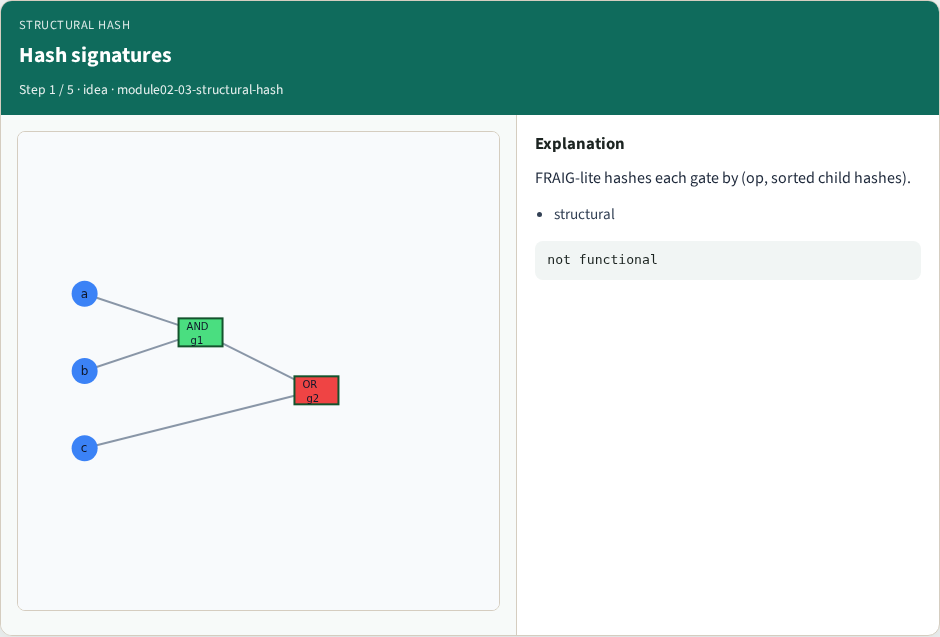
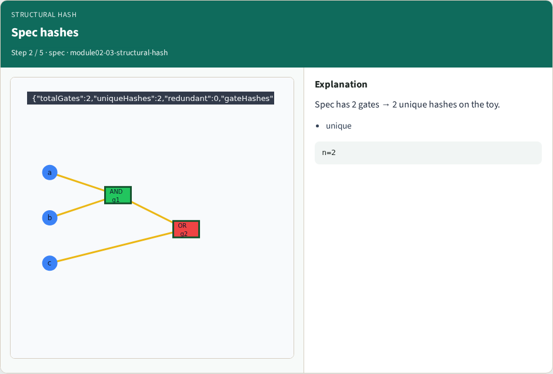
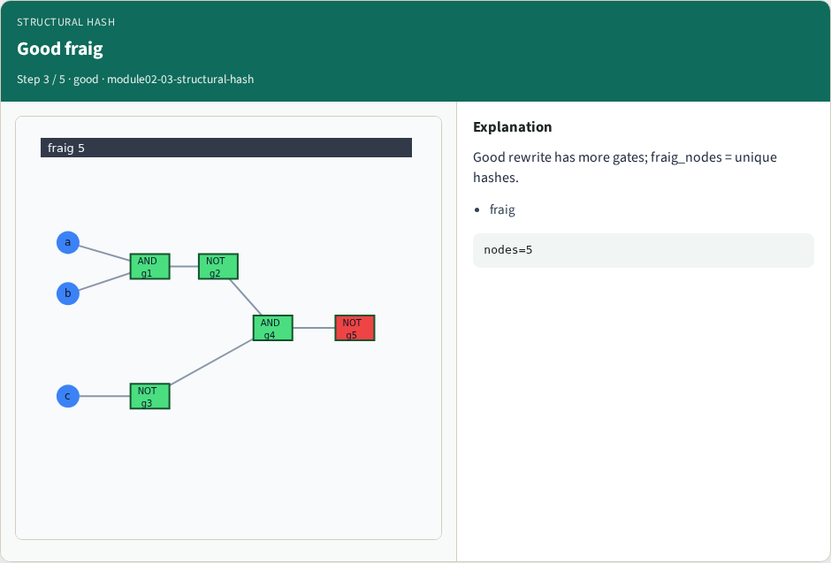
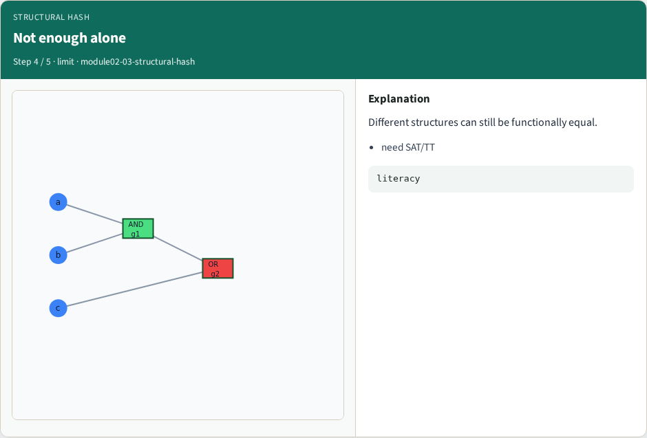
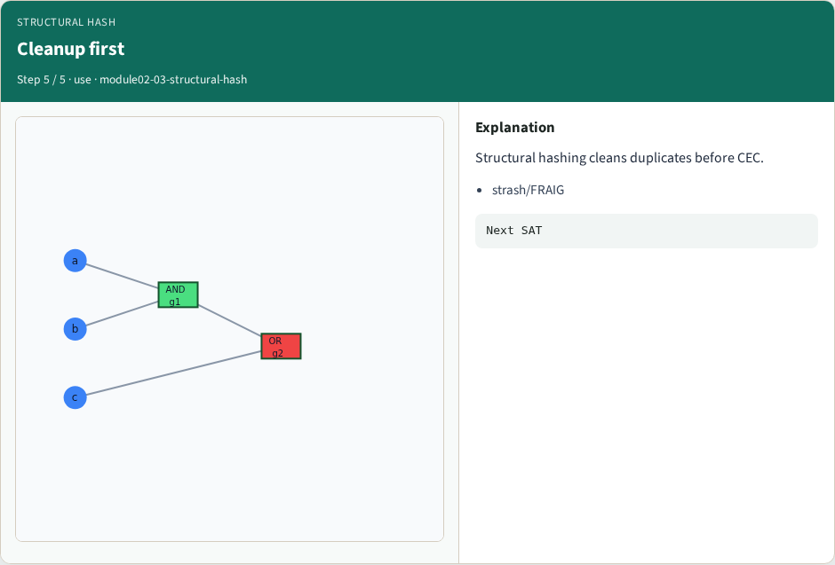
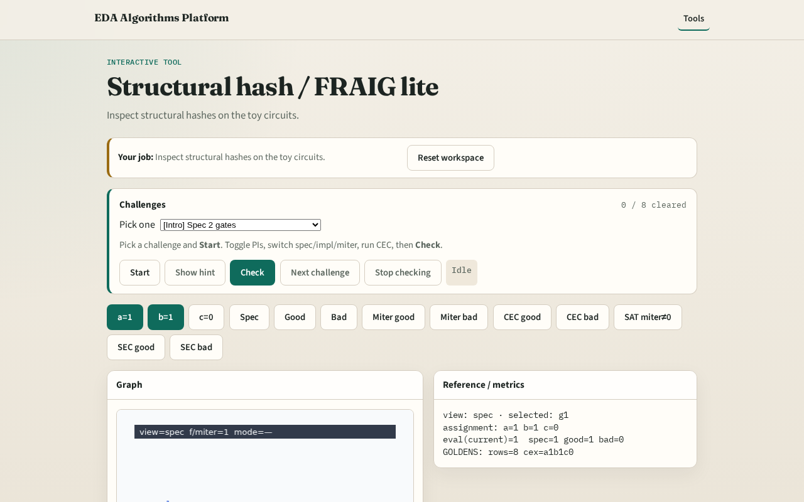

# Structural hash / FRAIG lite

**Module id:** module02-03-structural-hash
**Lab:** structural-hash
**Tracks:** A (implement) · B (browser lab)

## Slide 1 — Struct hash

Structural hashing finds functionally identical subexpressions — the idea behind FRAIG and AIG strashing.

## Slide 2 — The idea

Spec has 2 unique gates; impl_good has 5 gates but fewer unique hashes after sharing literals.

<!-- algorithm-walkthrough -->

## Slide 3 — Hash signatures

FRAIG-lite hashes each gate by (op, sorted child hashes).

## Slide 4 — Spec hashes

Spec has 2 gates → 2 unique hashes on the toy.

## Slide 5 — Good fraig

Good rewrite has more gates; fraig_nodes = unique hashes.

## Slide 6 — Not enough alone

Different structures can still be functionally equal.

## Slide 7 — Cleanup first

Structural hashing cleans duplicates before CEC.

<!-- /algorithm-walkthrough -->

## Slide 8 — Browser lab track

Open **structural-hash**. Highlight hash buckets; compare spec vs impl_good gate counts.

## Slide 9 — Implement track

Call structural_hash_stats(spec) and fraig_lite(impl_good).

## Slide 10 — Pitfalls

Hashing by gate id instead of structure. Expecting full industrial FRAIG fixpoint.

## Slide 11 — Your turn

Next: SAT / CNF encoding lite.
