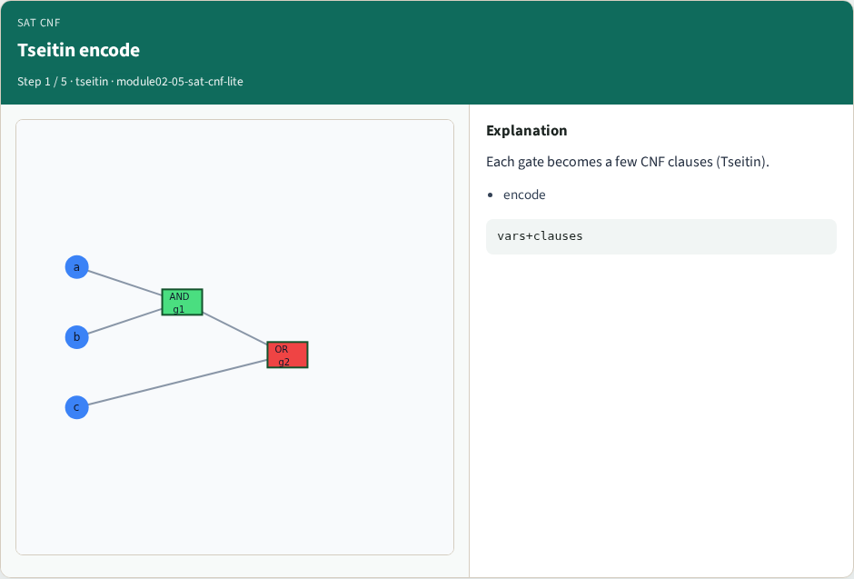
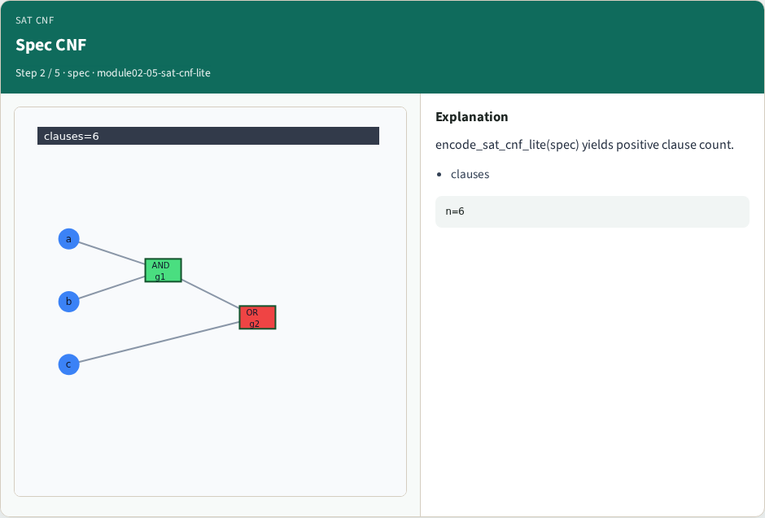
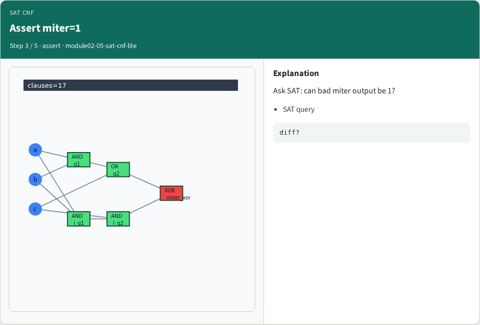
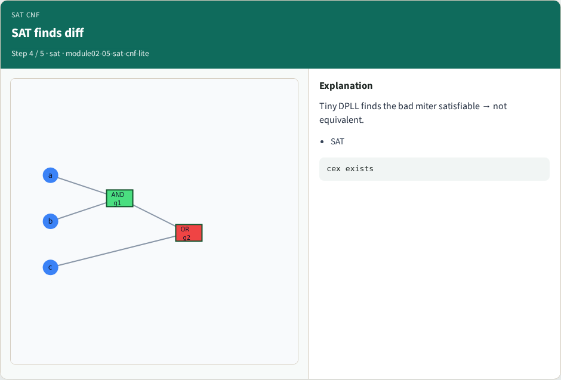
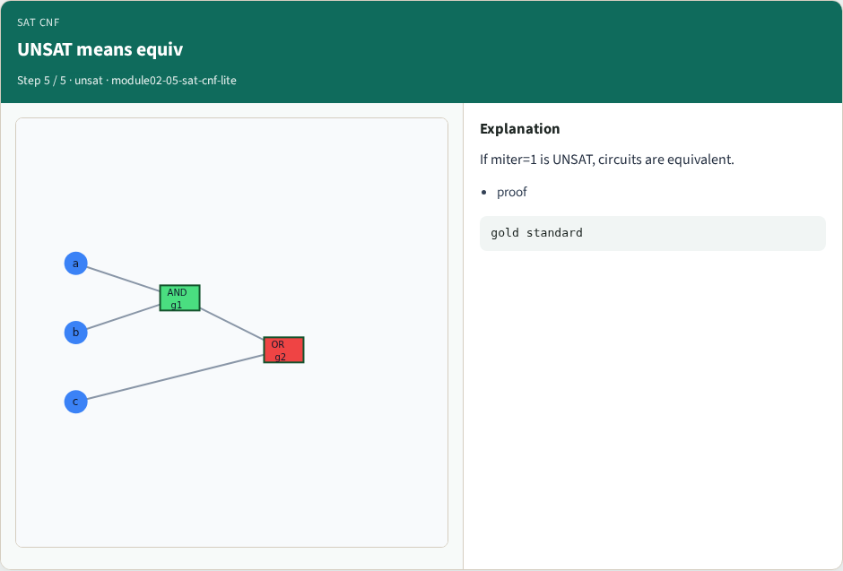

# SAT / CNF encoding lite — step-by-step (for slides / transcript)

**Module:** `module02-05-sat-cnf-lite`  
**Lab / algo:** `sat-cnf-lite`  
**Viewer:** `/tools/algorithm-walkthrough/?algo=sat-cnf-lite&step=1`

Use each **Caption** as spoken prose (or a shortened slide note).
Use **Bullets** on the PPT; pair with the PNG in `assets/steps/`.

## Step 1 — Tseitin encode



**Caption (transcript):** Each gate becomes a few CNF clauses (Tseitin).

**Slide bullets:**

- encode

**On-screen metrics:**

```
vars+clauses
```

## Step 2 — Spec CNF



**Caption (transcript):** encode_sat_cnf_lite(spec) yields positive clause count.

**Slide bullets:**

- clauses

**On-screen metrics:**

```
n=6
```

## Step 3 — Assert miter=1



**Caption (transcript):** Ask SAT: can bad miter output be 1?

**Slide bullets:**

- SAT query

**On-screen metrics:**

```
diff?
```

## Step 4 — SAT finds diff



**Caption (transcript):** Tiny DPLL finds the bad miter satisfiable → not equivalent.

**Slide bullets:**

- SAT

**On-screen metrics:**

```
cex exists
```

## Step 5 — UNSAT means equiv



**Caption (transcript):** If miter=1 is UNSAT, circuits are equivalent.

**Slide bullets:**

- proof

**On-screen metrics:**

```
gold standard
```

