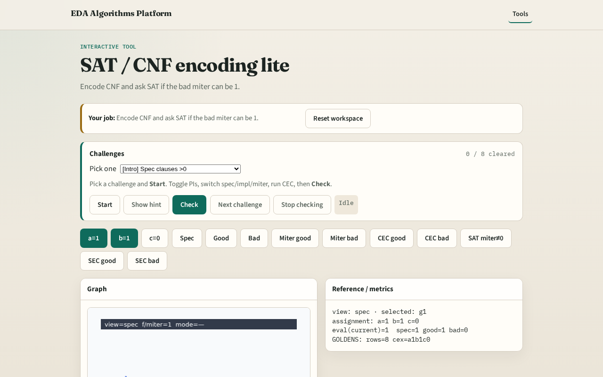

# SAT / CNF encoding lite

**Module id:** module02-05-sat-cnf-lite
**Lab:** sat-cnf-lite
**Tracks:** A (implement) · B (browser lab)

## Slide 1 — SAT CNF lite

Industrial CEC uses SAT on a miter — first learn clause count on a tiny netlist.

## Slide 2 — The idea

encode_sat_cnf_lite assigns PI vars 1..3 and adds clauses per AND/OR/NOT gate.

<!-- algorithm-walkthrough -->

## Slide 3 — Tseitin encode

Each gate becomes a few CNF clauses (Tseitin).

## Slide 4 — Spec CNF

encode_sat_cnf_lite(spec) yields positive clause count.

## Slide 5 — Assert miter=1

Ask SAT: can bad miter output be 1?

## Slide 6 — SAT finds diff

Tiny DPLL finds the bad miter satisfiable → not equivalent.

## Slide 7 — UNSAT means equiv

If miter=1 is UNSAT, circuits are equivalent.

<!-- /algorithm-walkthrough -->

## Slide 8 — Browser lab track

Open **sat-cnf-lite**. Show CNF stats; toggle assert PO=1 and run Check.

## Slide 9 — Implement track

Call encode_sat_cnf_lite(spec); print num_vars, num_clauses; sat_satisfiable on asserted PO.

## Slide 10 — Pitfalls

CNF on outputs without Tseitin auxiliaries. Expecting full Glucose run.

## Slide 11 — Your turn

Next: counterexample debug from CEC.
