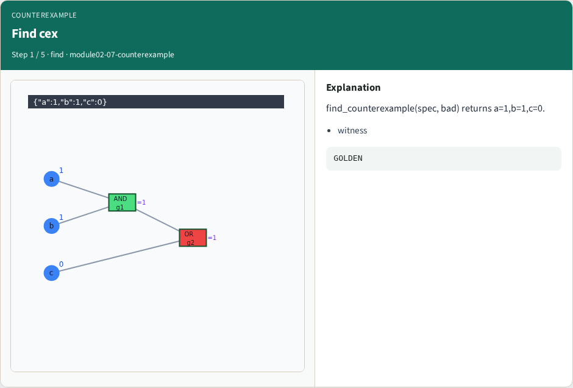
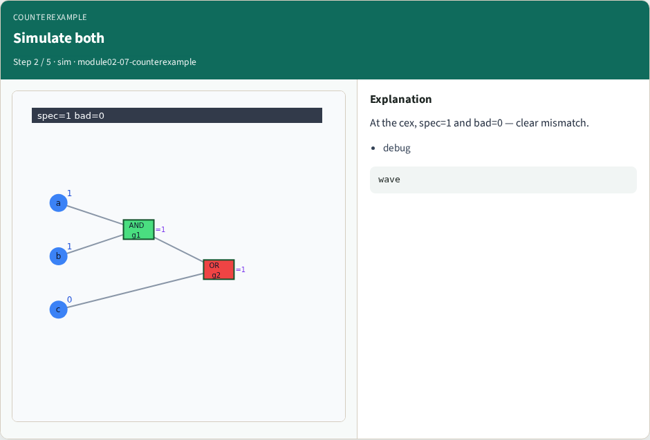
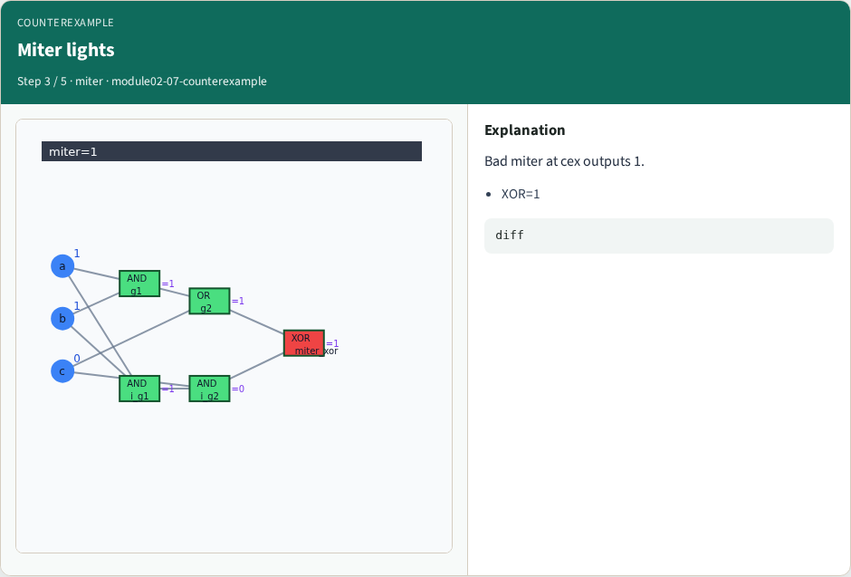
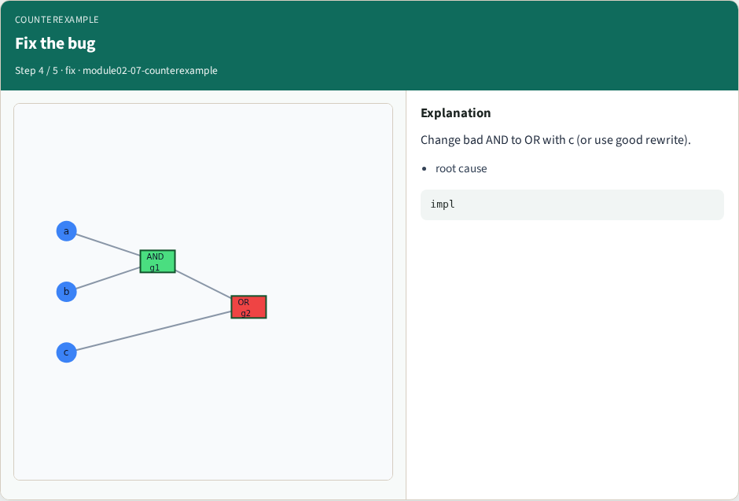
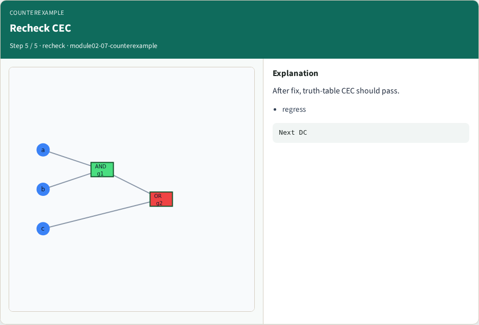

# Counterexample debug — step-by-step (for slides / transcript)

**Module:** `module02-07-counterexample`  
**Lab / algo:** `counterexample`  
**Viewer:** `/tools/algorithm-walkthrough/?algo=counterexample&step=1`

Use each **Caption** as spoken prose (or a shortened slide note).
Use **Bullets** on the PPT; pair with the PNG in `assets/steps/`.

## Step 1 — Find cex



**Caption (transcript):** find_counterexample(spec, bad) returns a=1,b=1,c=0.

**Slide bullets:**

- witness

**On-screen metrics:**

```
GOLDEN
```

## Step 2 — Simulate both



**Caption (transcript):** At the cex, spec=1 and bad=0 — clear mismatch.

**Slide bullets:**

- debug

**On-screen metrics:**

```
wave
```

## Step 3 — Miter lights



**Caption (transcript):** Bad miter at cex outputs 1.

**Slide bullets:**

- XOR=1

**On-screen metrics:**

```
diff
```

## Step 4 — Fix the bug



**Caption (transcript):** Change bad AND to OR with c (or use good rewrite).

**Slide bullets:**

- root cause

**On-screen metrics:**

```
impl
```

## Step 5 — Recheck CEC



**Caption (transcript):** After fix, truth-table CEC should pass.

**Slide bullets:**

- regress

**On-screen metrics:**

```
Next DC
```

