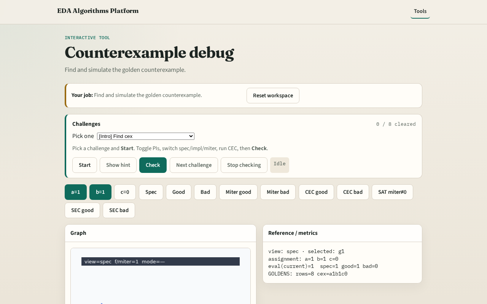

# Counterexample debug

**Module id:** module02-07-counterexample
**Lab:** counterexample
**Tracks:** A (implement) · B (browser lab)

## Slide 1 — Counterexample

When CEC fails, the counterexample is your shortest bug story — one input pattern where POs differ.

## Slide 2 — The idea

find_counterexample(spec, impl_bad) returns {'a':1,'b':1,'c':0}; spec_out=1, impl_out=0.

<!-- algorithm-walkthrough -->

## Slide 3 — Find cex

find_counterexample(spec, bad) returns a=1,b=1,c=0.

## Slide 4 — Simulate both

At the cex, spec=1 and bad=0 — clear mismatch.

## Slide 5 — Miter lights

Bad miter at cex outputs 1.

## Slide 6 — Fix the bug

Change bad AND to OR with c (or use good rewrite).

## Slide 7 — Recheck CEC

After fix, truth-table CEC should pass.

<!-- /algorithm-walkthrough -->

## Slide 8 — Browser lab track

Open **counterexample**. Load bad impl; highlight cex row in truth table.

## Slide 9 — Implement track

Call find_counterexample(spec, impl_bad); print spec and impl PO at cex.

## Slide 10 — Pitfalls

Ignoring cex and random sim. Fixing only one corner without regression.

## Slide 11 — Your turn

Next: don't-care CEC.
