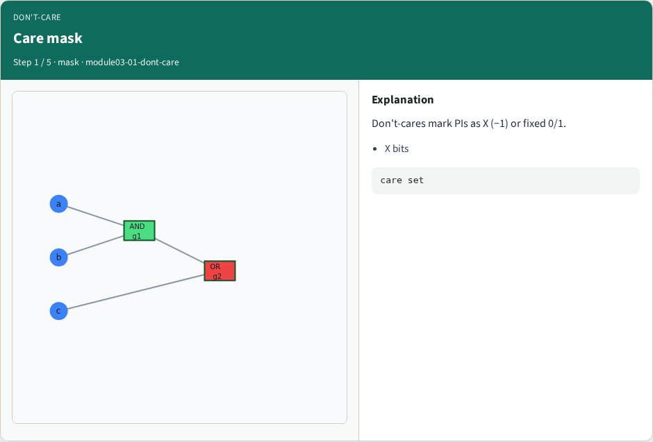
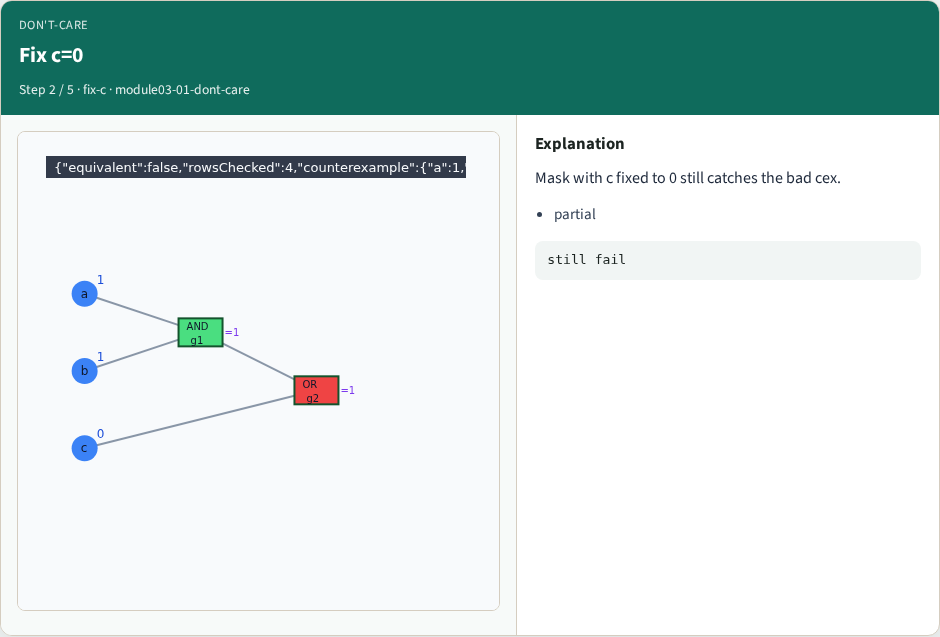
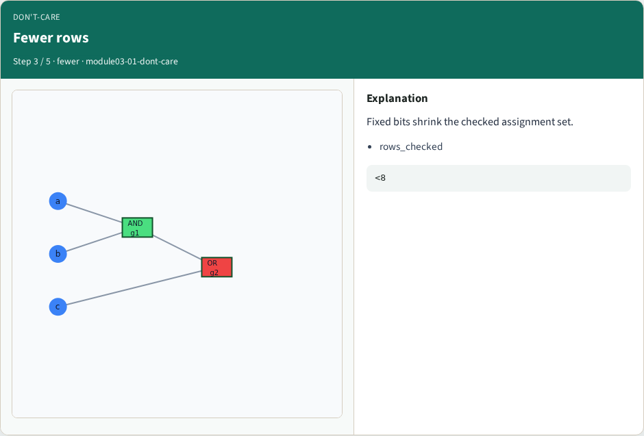
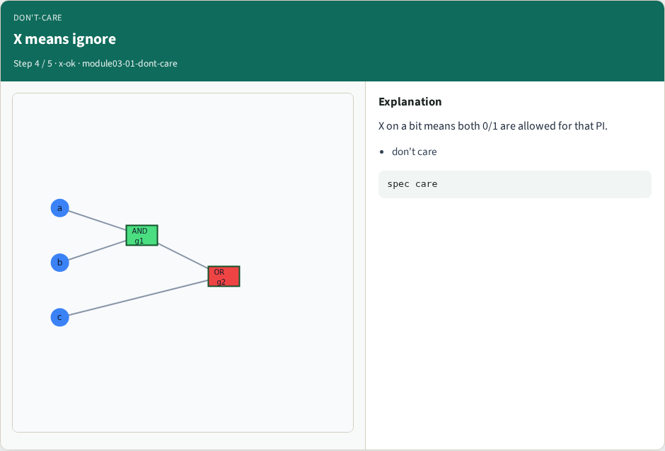
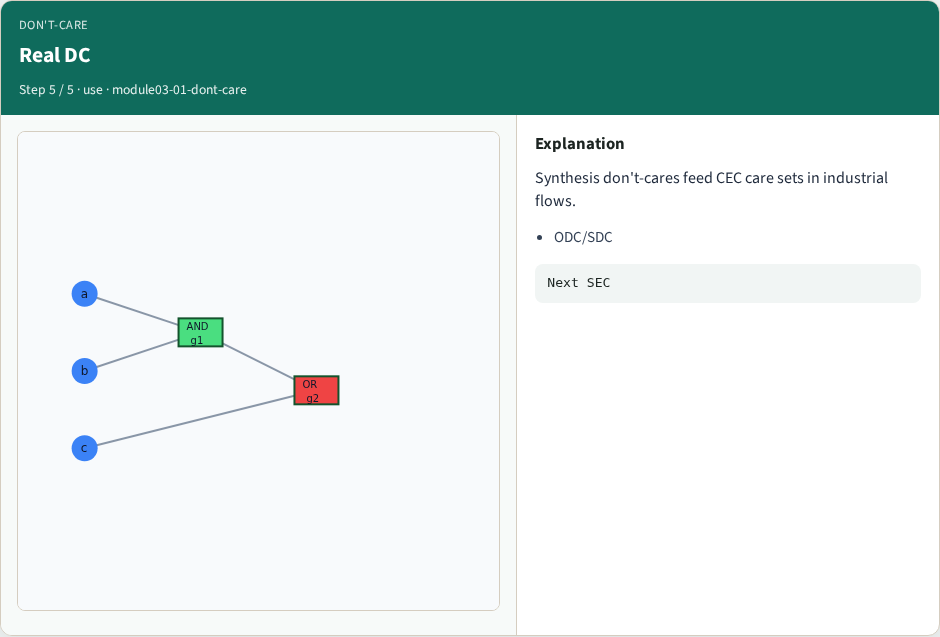
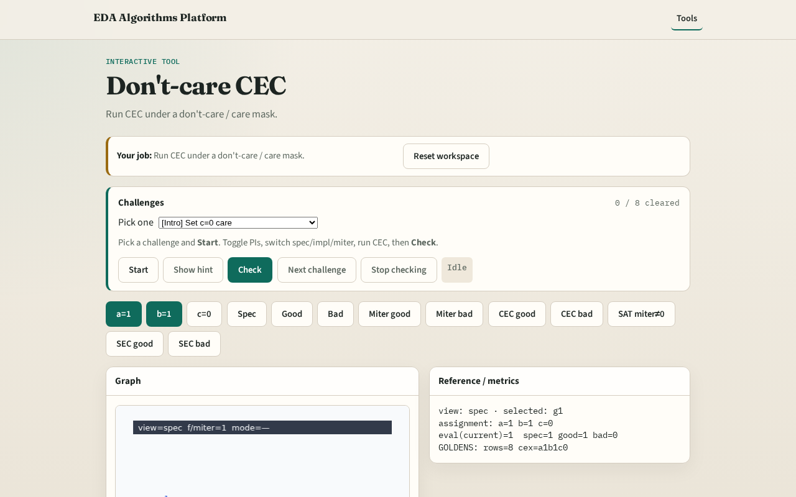

# Don't-care CEC

**Module id:** module03-01-dont-care
**Lab:** dont-care
**Tracks:** A (implement) · B (browser lab)

## Slide 1 — Don't-care

Real specs have don't-cares — CEC must only compare care inputs, not illegal or unconstrained bits.

## Slide 2 — The idea

dont_care_mask with c fixed to 0 still finds a=1,b=1,c=0 mismatch on impl_bad.

<!-- algorithm-walkthrough -->

## Slide 3 — Care mask

Don't-cares mark PIs as X (−1) or fixed 0/1.

## Slide 4 — Fix c=0

Mask with c fixed to 0 still catches the bad cex.

## Slide 5 — Fewer rows

Fixed bits shrink the checked assignment set.

## Slide 6 — X means ignore

X on a bit means both 0/1 are allowed for that PI.

## Slide 7 — Real DC

Synthesis don't-cares feed CEC care sets in industrial flows.

<!-- /algorithm-walkthrough -->

## Slide 8 — Browser lab track

Open **dont-care**. Set c care=0; run masked CEC; read reduced row count.

## Slide 9 — Implement track

Call dont_care_mask(spec, impl_bad, {'a':-1,'b':-1,'c':0}).

## Slide 10 — Pitfalls

Treating X as 0. Checking illegal input combinations as failures.

## Slide 11 — Your turn

Next: sequential unrolling.
