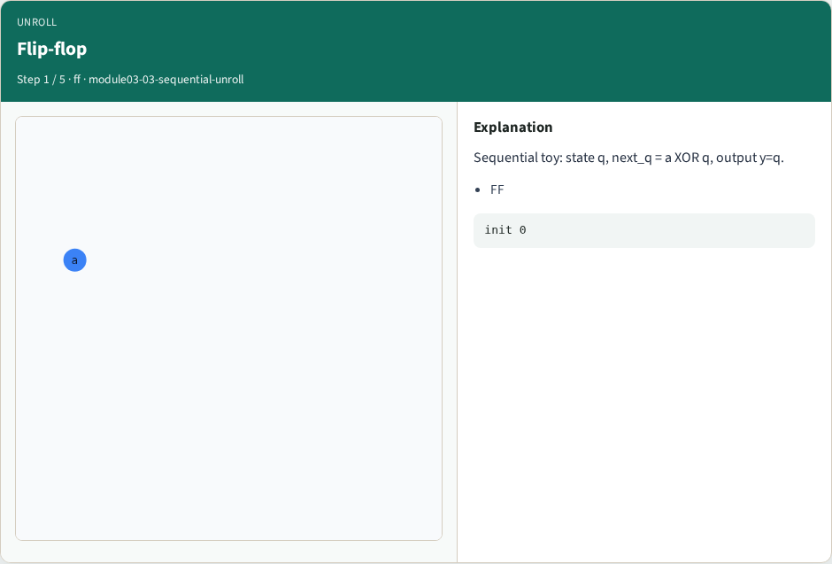
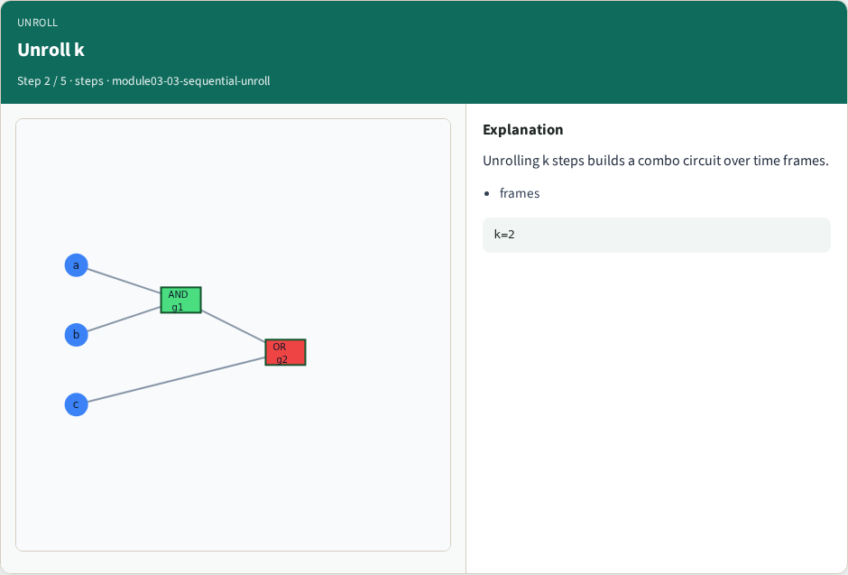
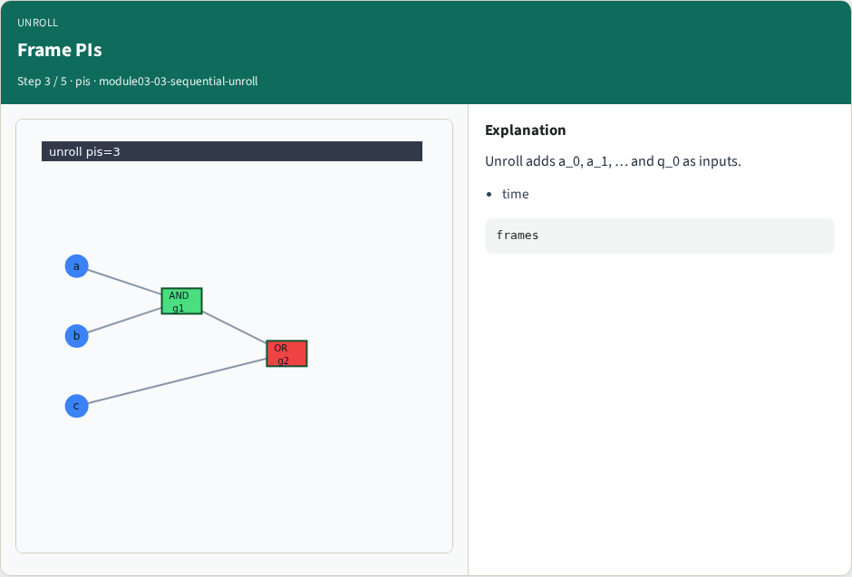
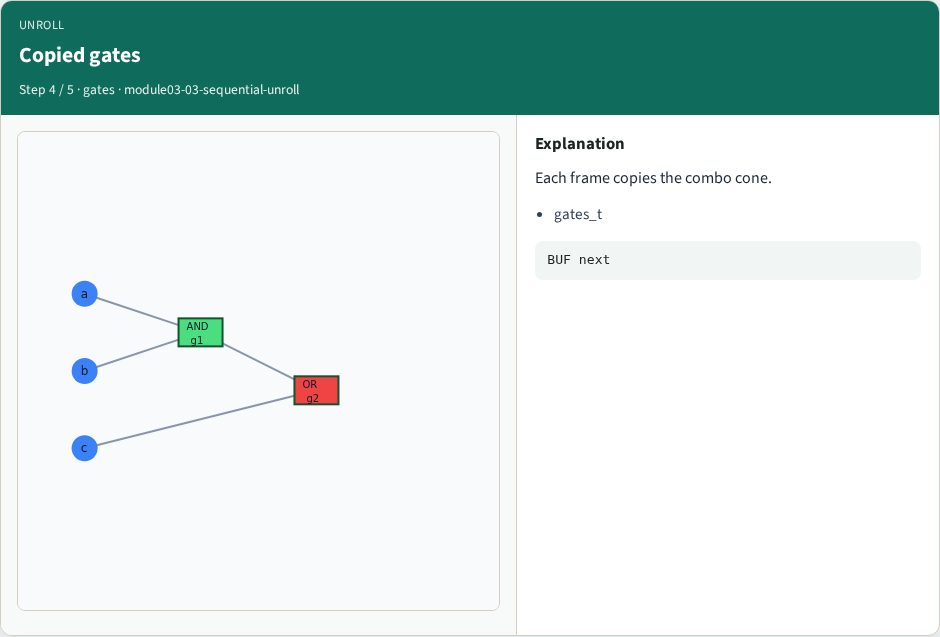
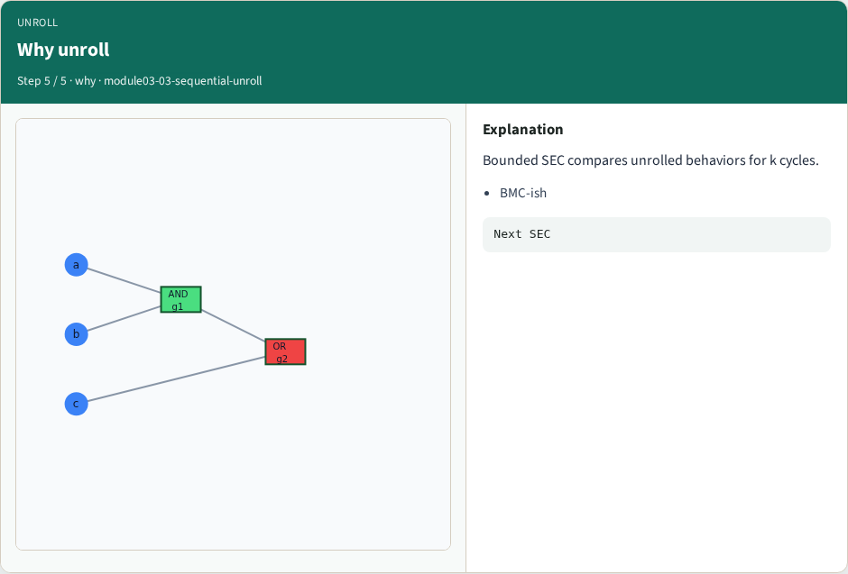

# Sequential unrolling — step-by-step (for slides / transcript)

**Module:** `module03-03-sequential-unroll`  
**Lab / algo:** `sequential-unroll`  
**Viewer:** `/tools/algorithm-walkthrough/?algo=sequential-unroll&step=1`

Use each **Caption** as spoken prose (or a shortened slide note).
Use **Bullets** on the PPT; pair with the PNG in `assets/steps/`.

## Step 1 — Flip-flop



**Caption (transcript):** Sequential toy: state q, next_q = a XOR q, output y=q.

**Slide bullets:**

- FF

**On-screen metrics:**

```
init 0
```

## Step 2 — Unroll k



**Caption (transcript):** Unrolling k steps builds a combo circuit over time frames.

**Slide bullets:**

- frames

**On-screen metrics:**

```
k=2
```

## Step 3 — Frame PIs



**Caption (transcript):** Unroll adds a_0, a_1, … and q_0 as inputs.

**Slide bullets:**

- time

**On-screen metrics:**

```
frames
```

## Step 4 — Copied gates



**Caption (transcript):** Each frame copies the combo cone.

**Slide bullets:**

- gates_t

**On-screen metrics:**

```
BUF next
```

## Step 5 — Why unroll



**Caption (transcript):** Bounded SEC compares unrolled behaviors for k cycles.

**Slide bullets:**

- BMC-ish

**On-screen metrics:**

```
Next SEC
```

