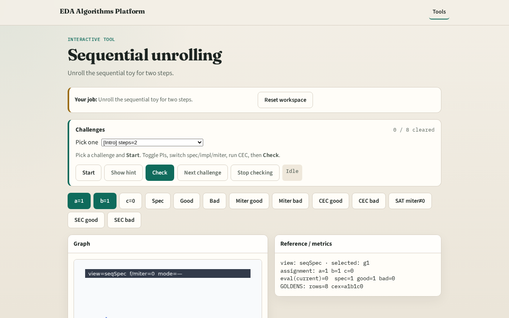

# Seq unroll

Sequential equivalence often unrolls both designs for k cycles and runs combinational CEC on the unrolled POs

---

## The idea
- Sequential_unroll(spec

---

## Flip-flop

---

## Unroll k

---

## Frame PIs

---

## Copied gates

---

## Why unroll

---

## Browser lab track

---

## Implement track
- Call sequential_unroll(DATA['sequential']['spec'], 2); inspect gates and PIs

---

## Pitfalls
- Unrolling without resetting state
- Confusing PO y with next state

---

## Your turn
- Next: sequential CEC lite

