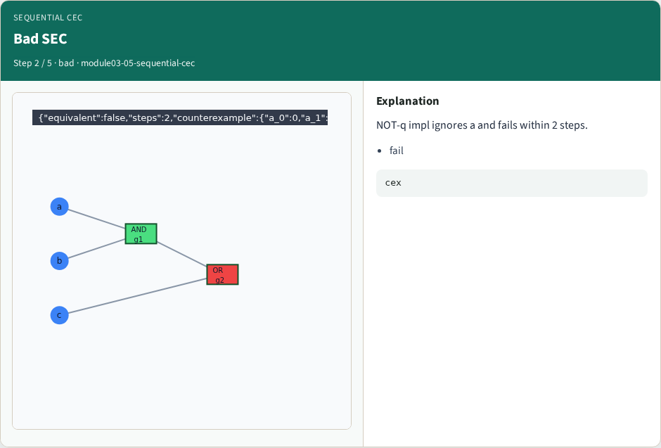
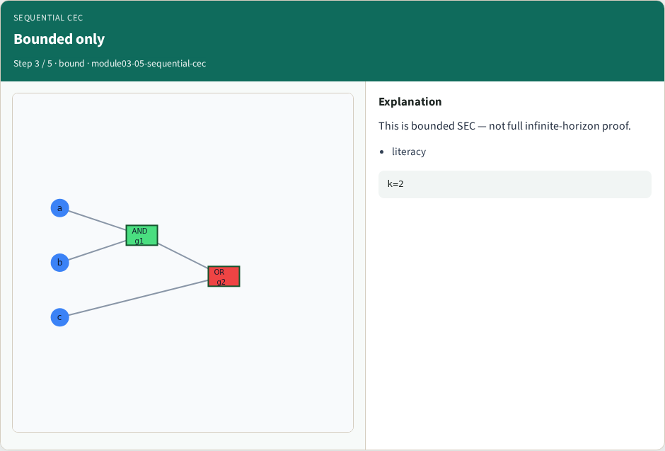
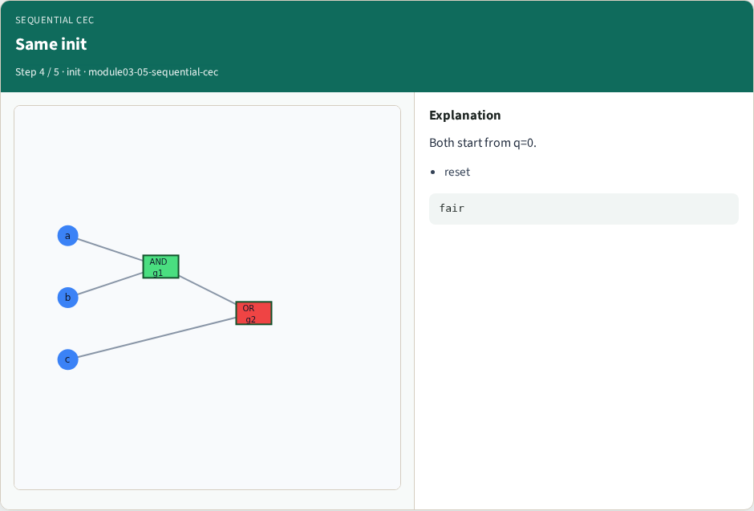
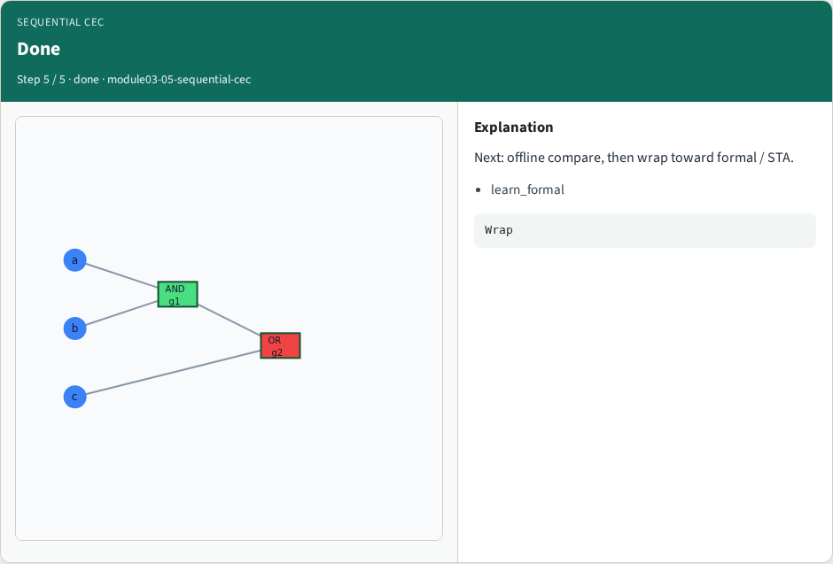
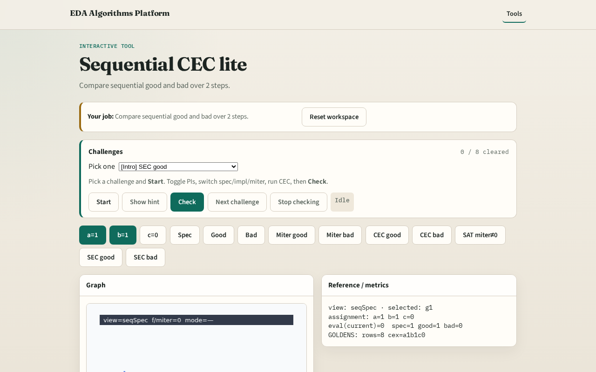

# Sequential CEC

Sequential CEC asks whether two FSMs agree on all input sequences , we check 2 unroll steps as literacy

---

## The idea
- Sequential_cec_lite enumerates input sequences

---

## Good SEC

---

## Bad SEC

---

## Bounded only

---

## Same init

---

## Done

---

## Browser lab track

---

## Implement track
- Call sequential_cec_lite(seq_spec, seq_good, 2) True; seq_bad False

---

## Pitfalls
- Checking one reset cycle only
- Comparing comb outputs without state update

---

## Your turn
- Next: offline benchmark, then wrap

