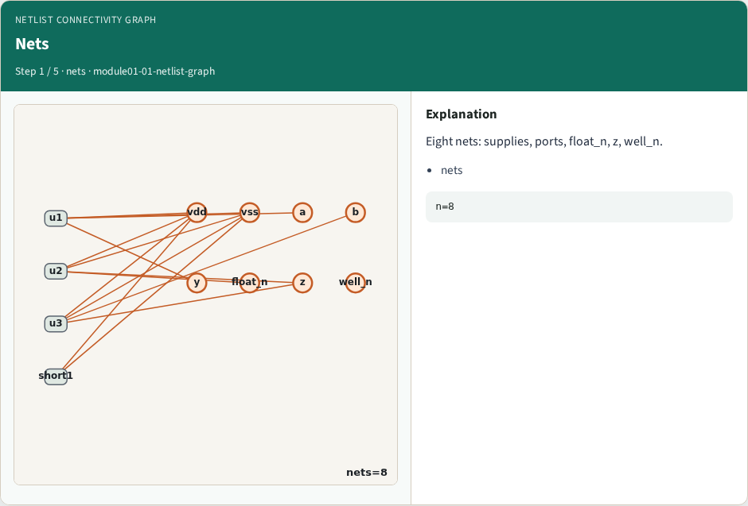
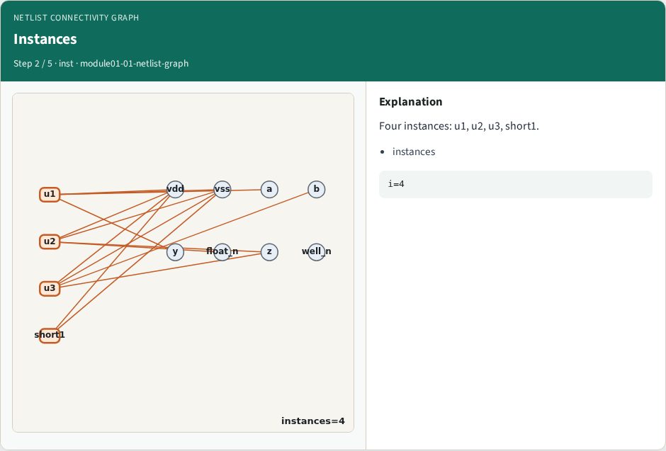
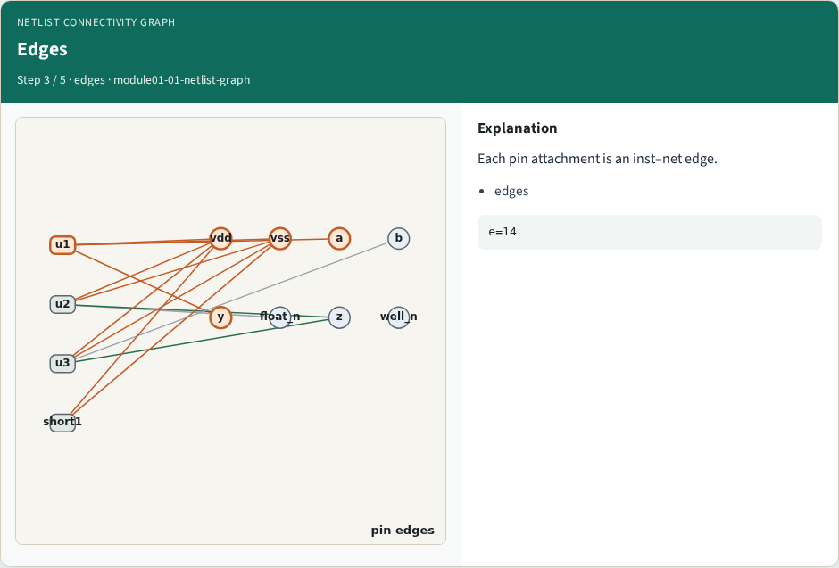
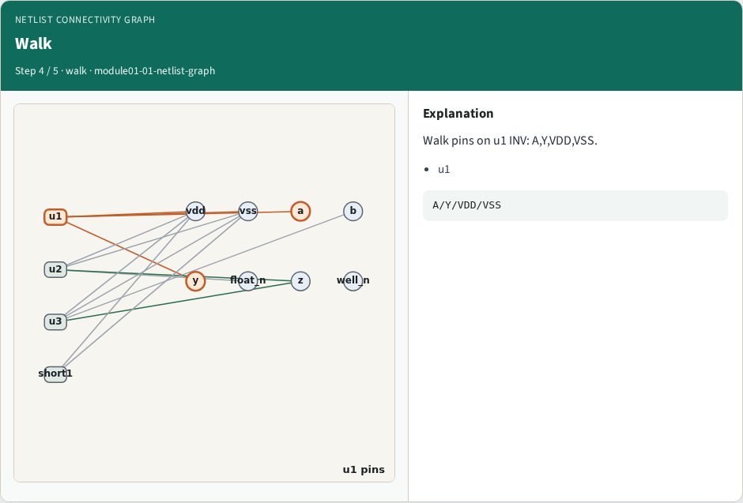
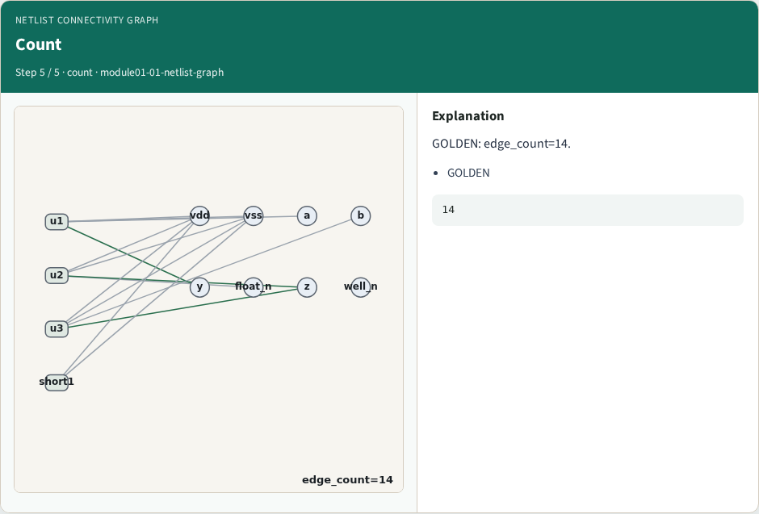

# Netlist connectivity graph — step-by-step (for slides / transcript)

**Module:** `module01-01-netlist-graph`  
**Lab / algo:** `netlist-graph`  
**Viewer:** `/tools/algorithm-walkthrough/?algo=netlist-graph&step=1`

Use each **Caption** as spoken prose (or a shortened slide note).
Use **Bullets** on the PPT; pair with the PNG in `assets/steps/`.

## Step 1 — Nets



**Caption (transcript):** Eight nets: supplies, ports, float_n, z, well_n.

**Slide bullets:**

- nets

**On-screen metrics:**

```
n=8
```

## Step 2 — Instances



**Caption (transcript):** Four instances: u1, u2, u3, short1.

**Slide bullets:**

- instances

**On-screen metrics:**

```
i=4
```

## Step 3 — Edges



**Caption (transcript):** Each pin attachment is an inst–net edge.

**Slide bullets:**

- edges

**On-screen metrics:**

```
e=14
```

## Step 4 — Walk



**Caption (transcript):** Walk pins on u1 INV: A,Y,VDD,VSS.

**Slide bullets:**

- u1

**On-screen metrics:**

```
A/Y/VDD/VSS
```

## Step 5 — Count



**Caption (transcript):** GOLDEN: edge_count=14.

**Slide bullets:**

- GOLDEN

**On-screen metrics:**

```
14
```

