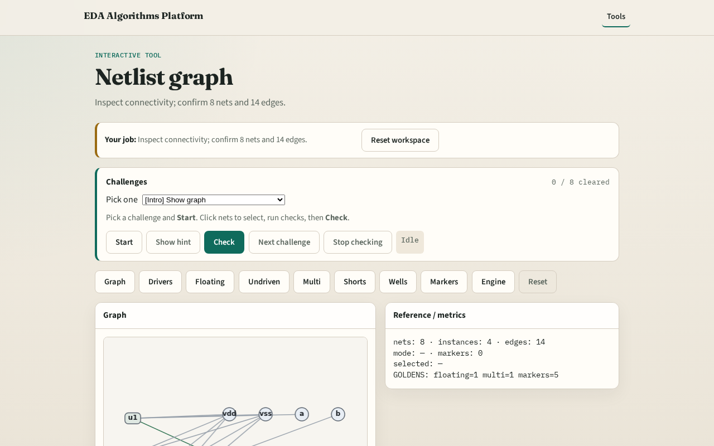

# Why graph

ERC starts from a connectivity graph , instances, nets, and pin edges

---

## The idea
- GOLDEN: 8 nets, 4 instances, 14 pin edges

---

## Nets

---

## Instances

---

## Edges

---

## Walk

---

## Count

---

## Browser lab track

---

## Implement track
- Call design_stats() and build_connectivity(); assert net_count==8, edge_count==14

---

## Pitfalls
- Counting wells as instances
- Double-counting supply pins

---

## Your turn
- Next: classify drivers vs loads

