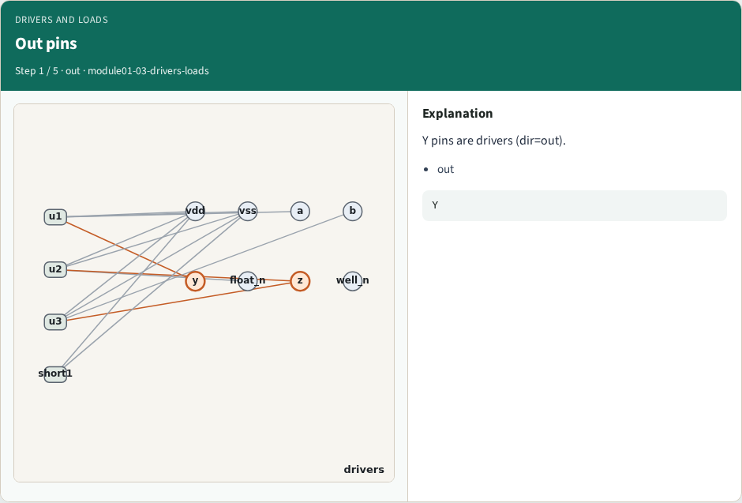
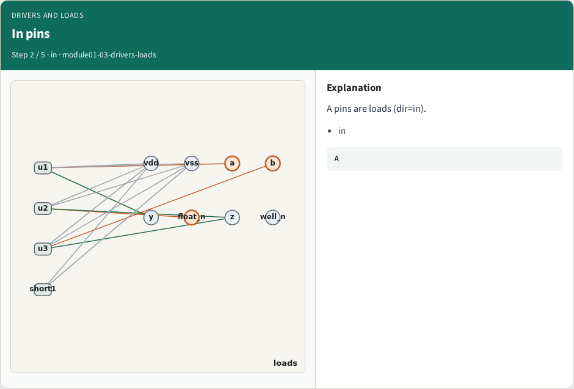
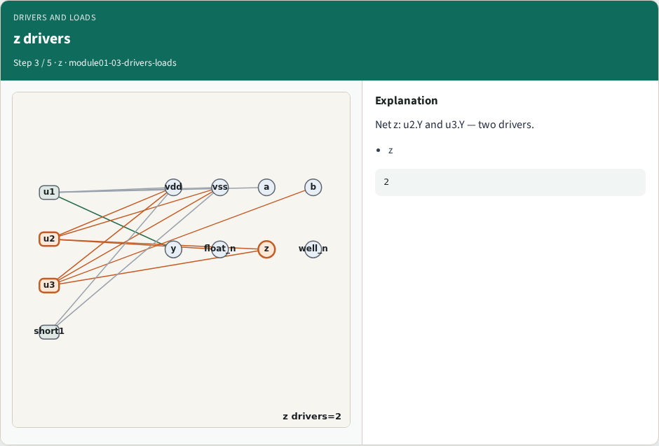
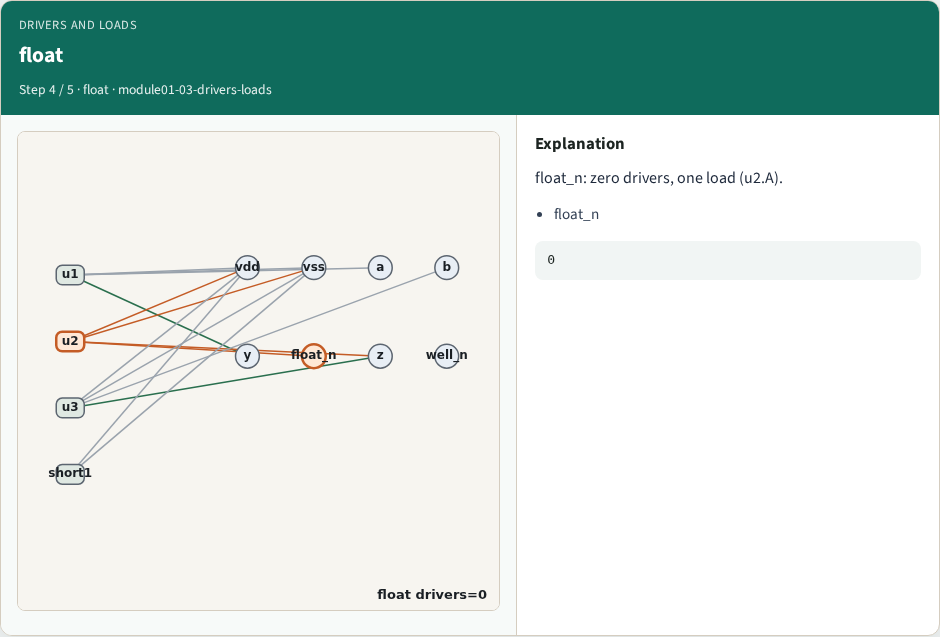
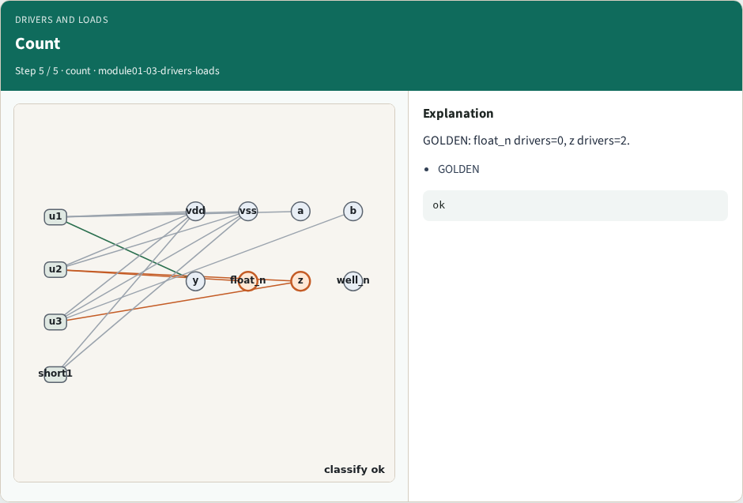
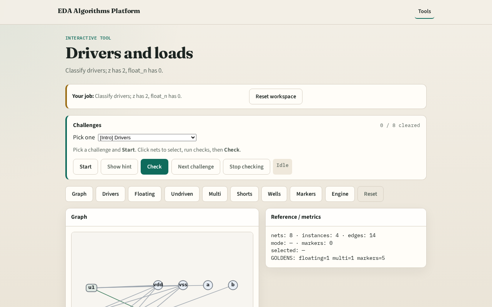

# Why drivers

ERC needs drivers and loads , output pins drive; input pins load

---

## The idea
- GOLDEN: z has 2 drivers; float_n has 0 drivers and 1 load

---

## Out pins

---

## In pins

---

## z drivers

---

## float

---

## Count

---

## Browser lab track

---

## Implement track
- Call drivers_and_loads(); assert len(by_net['z']['drivers'])==2

---

## Pitfalls
- Treating power pins as drivers
- Ignoring SHORT io pins

---

## Your turn
- Next: floating nets

