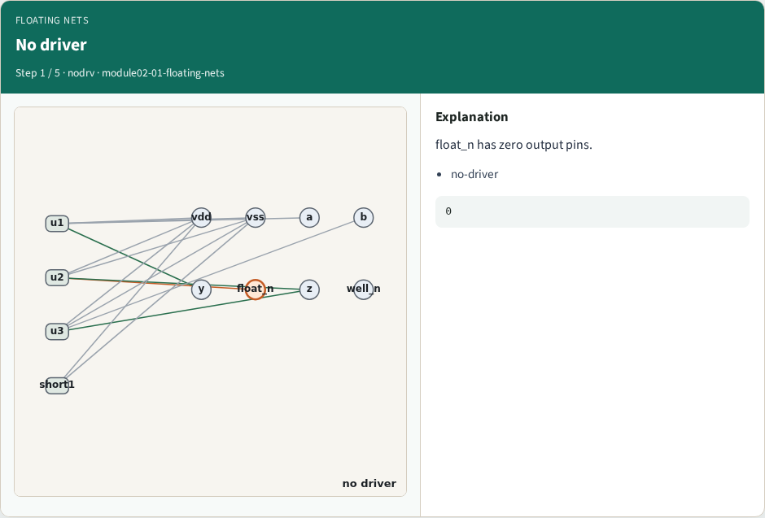
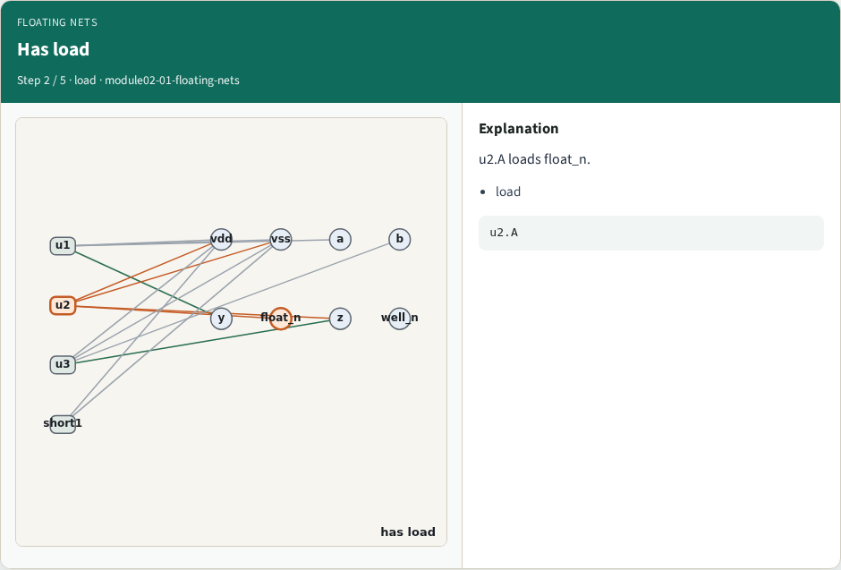
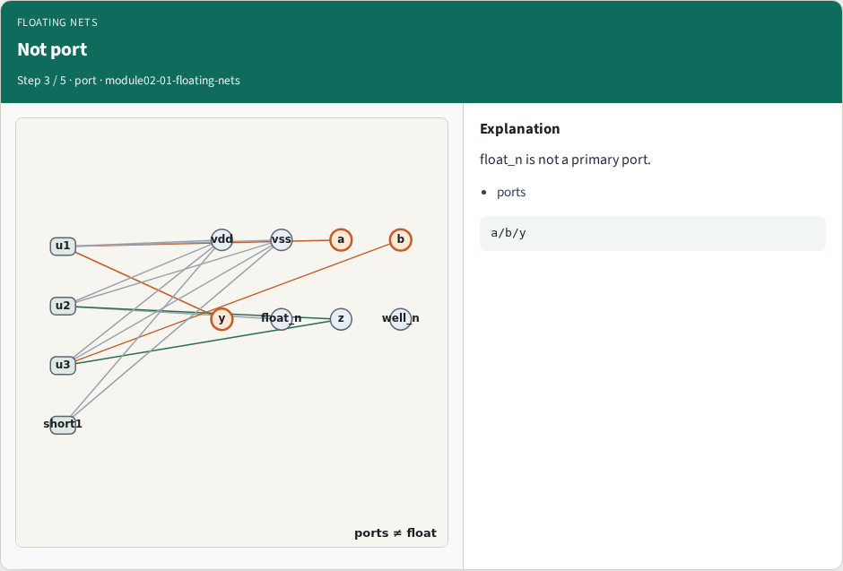
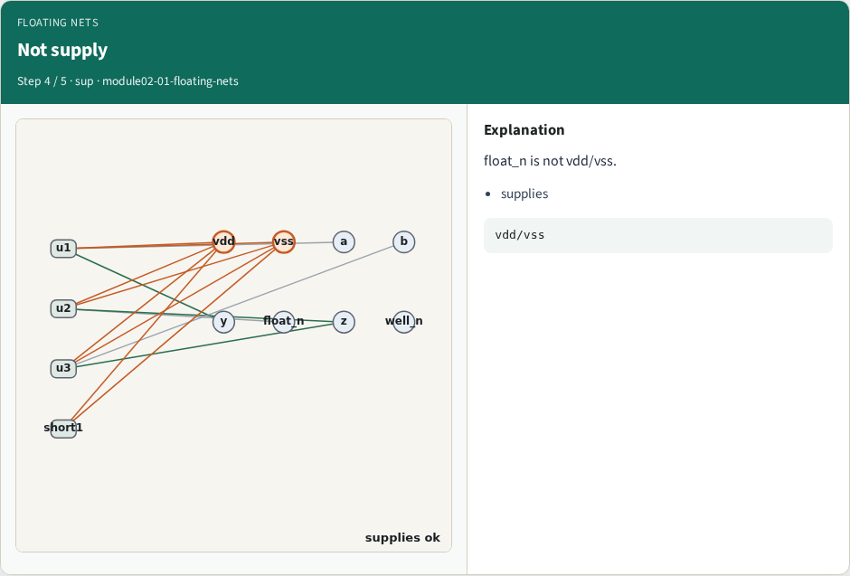
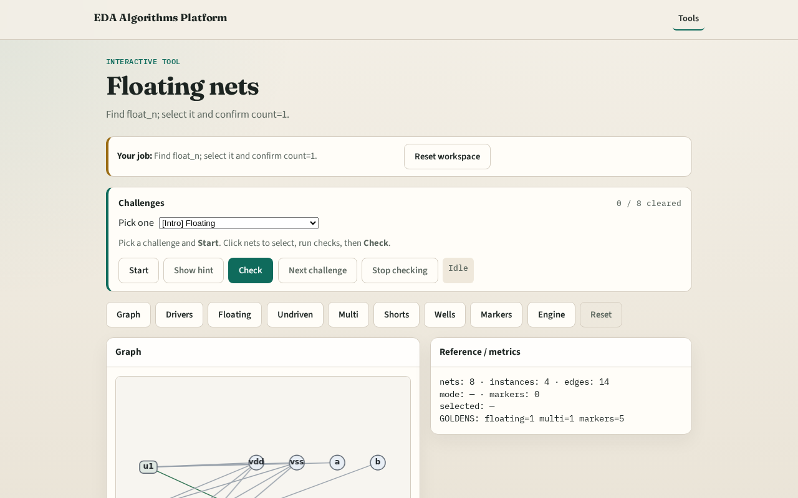

# Why floating

A floating net has loads but no driver , classic ERC fail

---

## The idea
- GOLDEN: floating_nets=['float_n'], count=1

---

## No driver

---

## Has load

---

## Not port

---

## Not supply

---

## Golden

---

## Browser lab track

---

## Implement track
- Call find_floating_nets(); assert nets==['float_n']

---

## Pitfalls
- Flagging primary inputs as floating
- Ignoring unused well nets

---

## Your turn
- Next: undriven inputs

