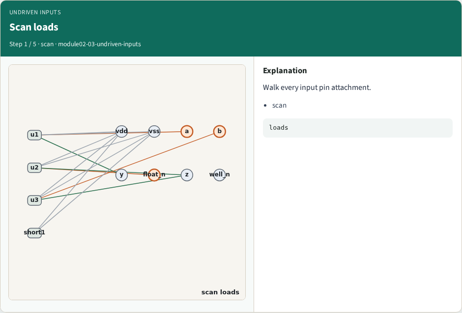
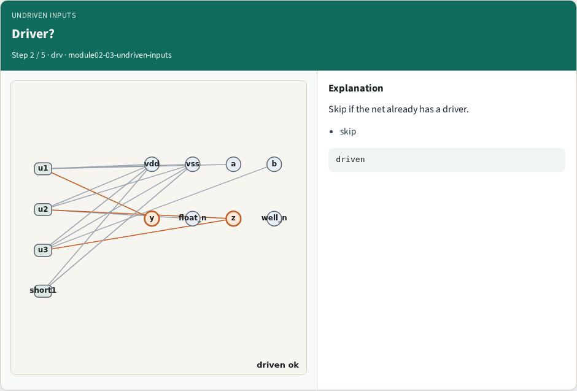
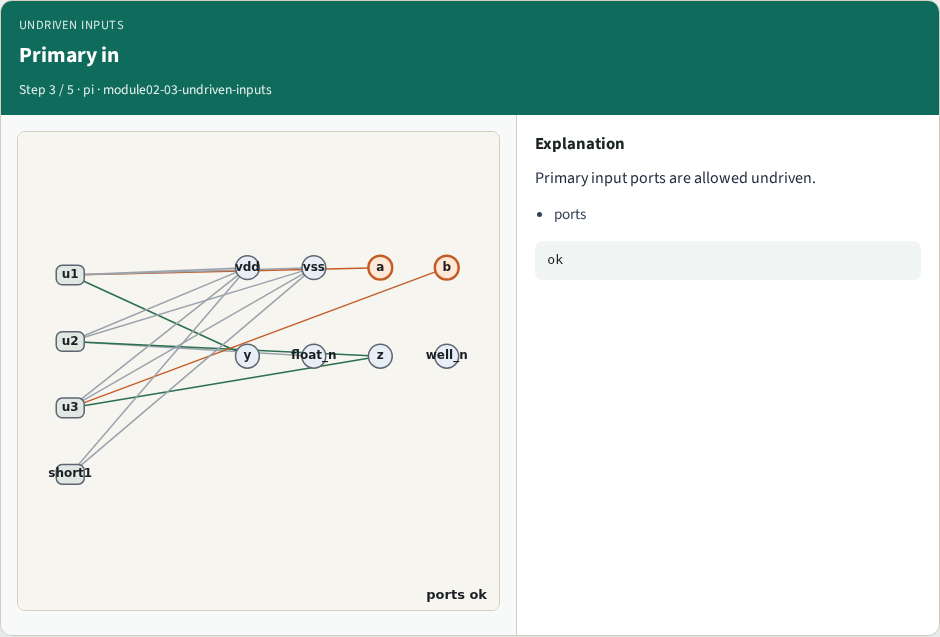
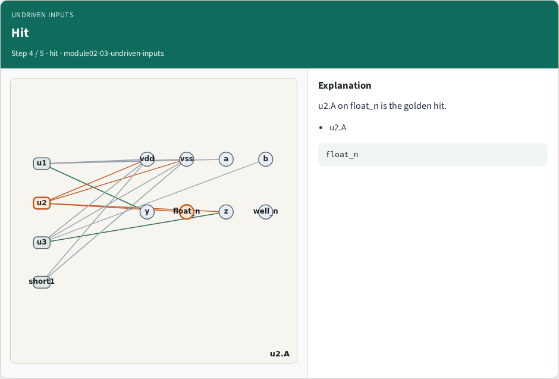
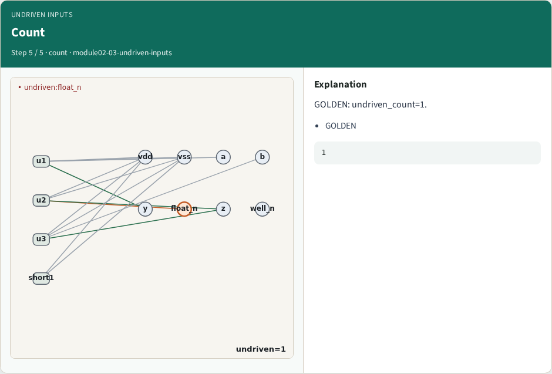
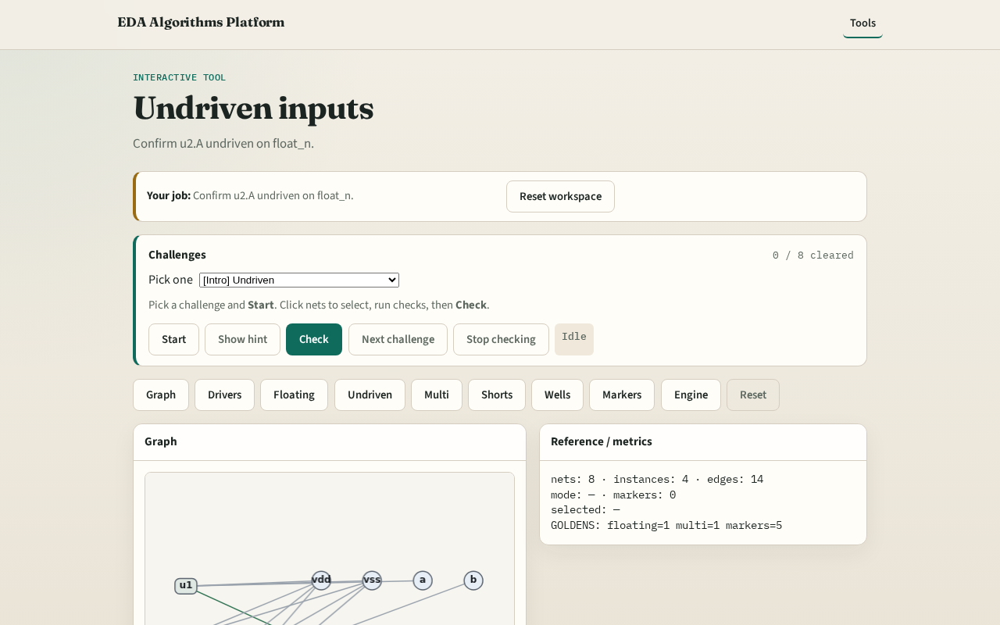

# Undriven inputs

**Module id:** module02-03-undriven-inputs
**Lab:** undriven-inputs
**Tracks:** A (implement) · B (browser lab)

## Slide 1 — Why undriven

Undriven inputs are the pin-level view of floating connectivity.

## Slide 2 — The idea

GOLDEN: one hit — u2.A on float_n.

<!-- algorithm-walkthrough -->

## Slide 3 — Scan loads

Walk every input pin attachment.

## Slide 4 — Driver?

Skip if the net already has a driver.

## Slide 5 — Primary in

Primary input ports are allowed undriven.

## Slide 6 — Hit

u2.A on float_n is the golden hit.

## Slide 7 — Count

GOLDEN: undriven_count=1.

<!-- /algorithm-walkthrough -->

## Slide 8 — Browser lab track

Open **undriven-inputs**. Confirm u2.A undriven.

## Slide 9 — Implement track

Call find_undriven_inputs(); assert count==1 and hits[0].net=='float_n'.

## Slide 10 — Pitfalls

Flagging port a as undriven. Missing the float_n load.

## Slide 11 — Your turn

Next: multi-driven nets.
