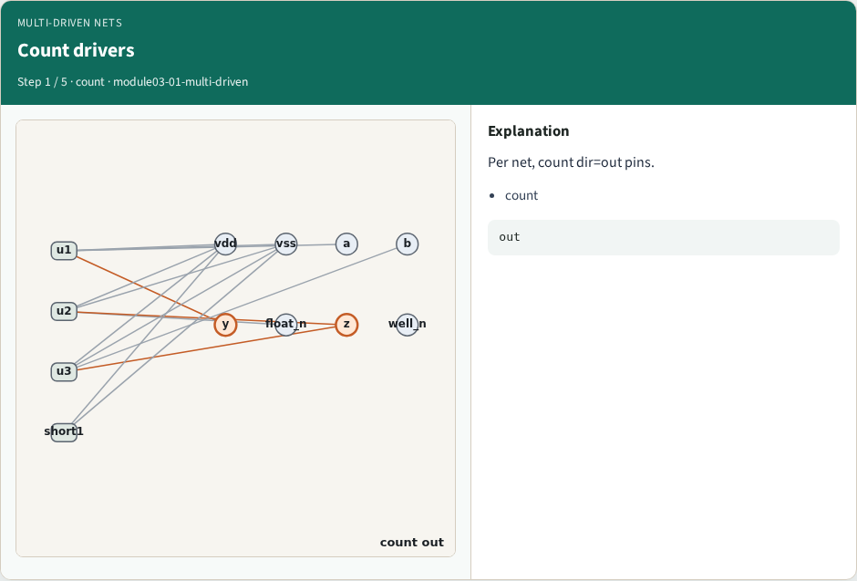
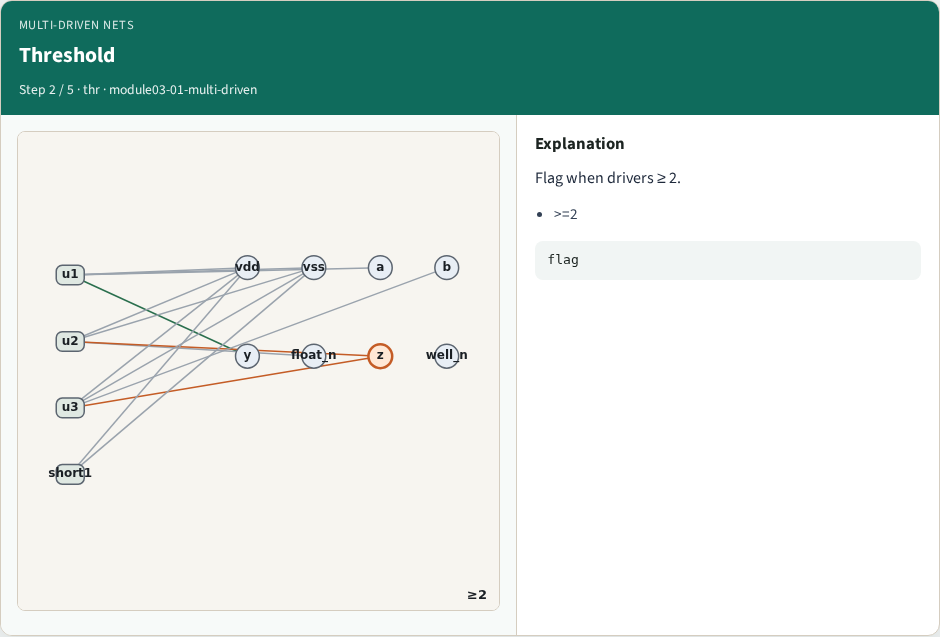
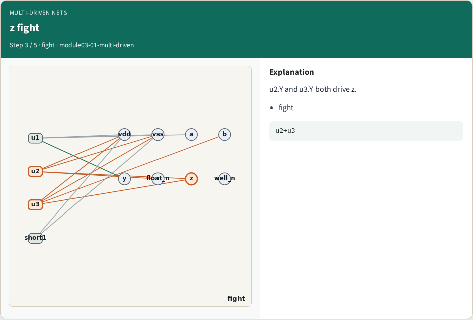
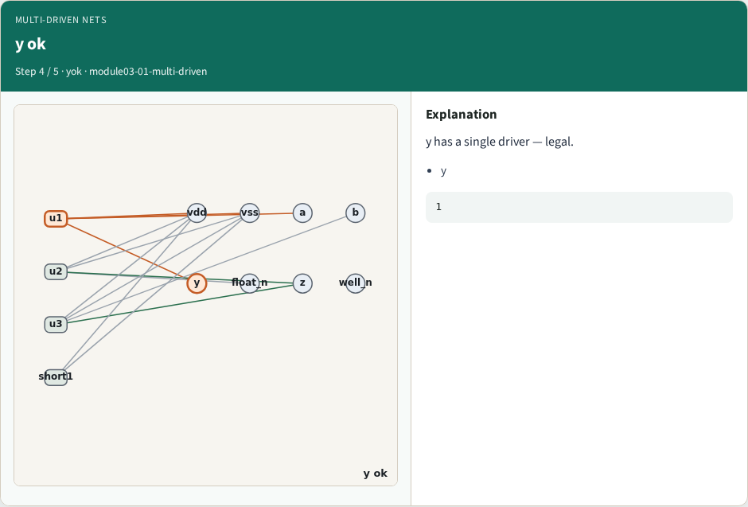
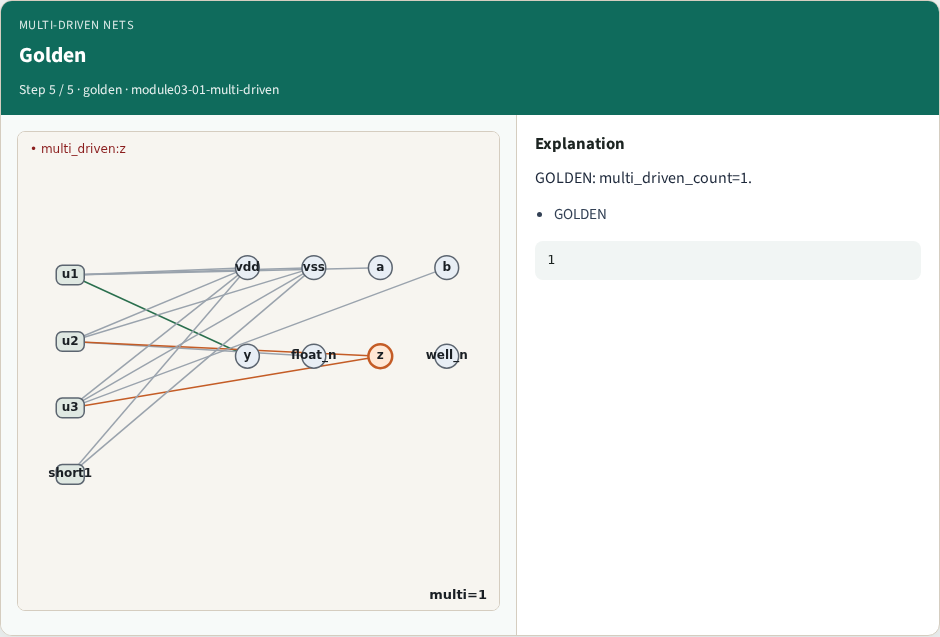

# Multi-driven nets — step-by-step (for slides / transcript)

**Module:** `module03-01-multi-driven`  
**Lab / algo:** `multi-driven`  
**Viewer:** `/tools/algorithm-walkthrough/?algo=multi-driven&step=1`

Use each **Caption** as spoken prose (or a shortened slide note).
Use **Bullets** on the PPT; pair with the PNG in `assets/steps/`.

## Step 1 — Count drivers



**Caption (transcript):** Per net, count dir=out pins.

**Slide bullets:**

- count

**On-screen metrics:**

```
out
```

## Step 2 — Threshold



**Caption (transcript):** Flag when drivers ≥ 2.

**Slide bullets:**

- >=2

**On-screen metrics:**

```
flag
```

## Step 3 — z fight



**Caption (transcript):** u2.Y and u3.Y both drive z.

**Slide bullets:**

- fight

**On-screen metrics:**

```
u2+u3
```

## Step 4 — y ok



**Caption (transcript):** y has a single driver — legal.

**Slide bullets:**

- y

**On-screen metrics:**

```
1
```

## Step 5 — Golden



**Caption (transcript):** GOLDEN: multi_driven_count=1.

**Slide bullets:**

- GOLDEN

**On-screen metrics:**

```
1
```

