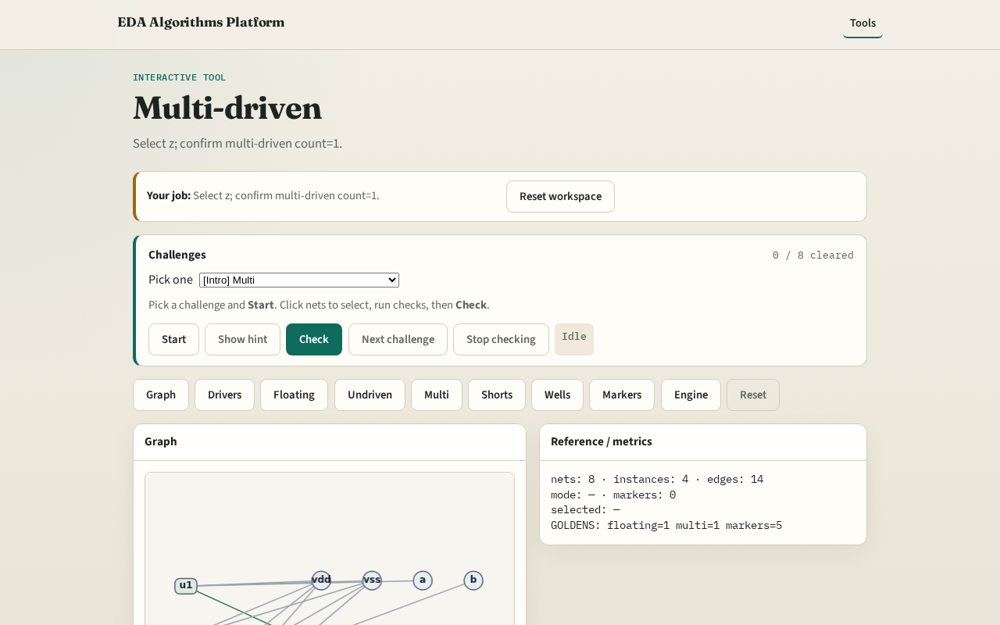

# Multi-driven nets

**Module id:** module03-01-multi-driven
**Lab:** multi-driven
**Tracks:** A (implement) · B (browser lab)

## Slide 1 — Why multi

Two outputs on one net is a fight — multi-driven ERC.

## Slide 2 — The idea

GOLDEN: multi_driven_nets=['z'] from u2.Y and u3.Y.

<!-- algorithm-walkthrough -->

## Slide 3 — Count drivers

Per net, count dir=out pins.

## Slide 4 — Threshold

Flag when drivers ≥ 2.

## Slide 5 — z fight

u2.Y and u3.Y both drive z.

## Slide 6 — y ok

y has a single driver — legal.

## Slide 7 — Golden

GOLDEN: multi_driven_count=1.

<!-- /algorithm-walkthrough -->

## Slide 8 — Browser lab track

Open **multi-driven**. Select z; confirm multi-driven.

## Slide 9 — Implement track

Call find_multi_driven(); assert nets==['z'].

## Slide 10 — Pitfalls

Counting power pins as drivers. Flagging single-driver nets.

## Slide 11 — Your turn

Next: supply shorts.
