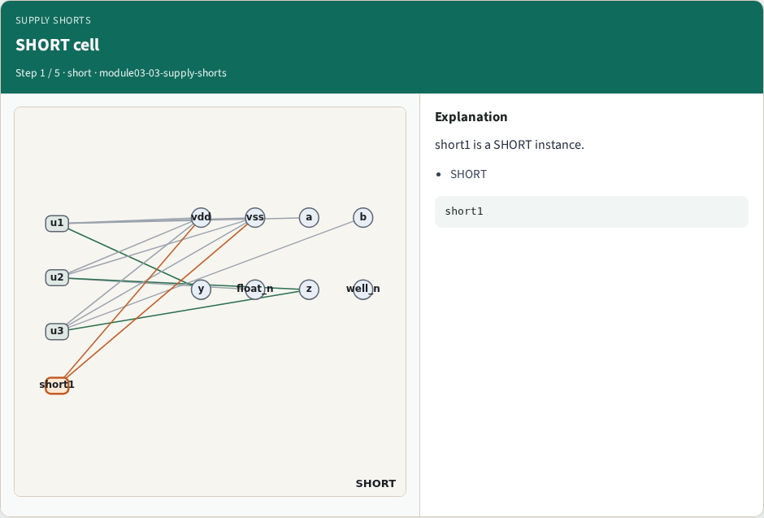
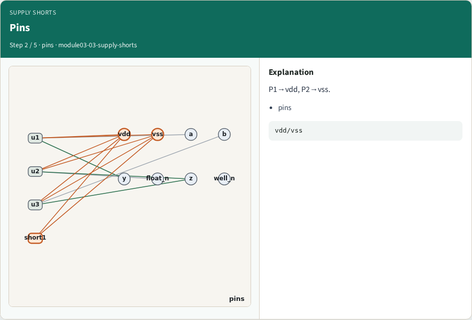
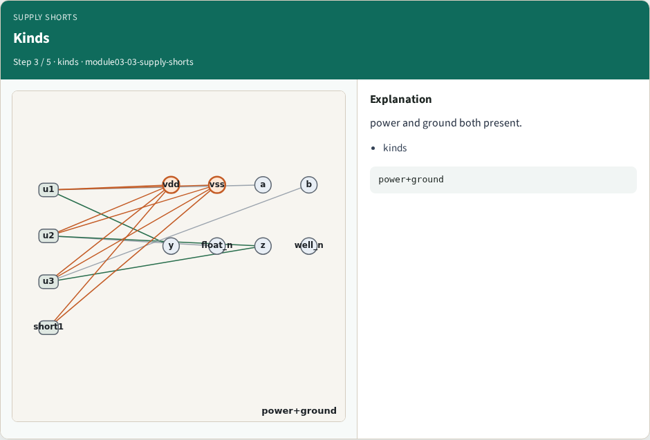
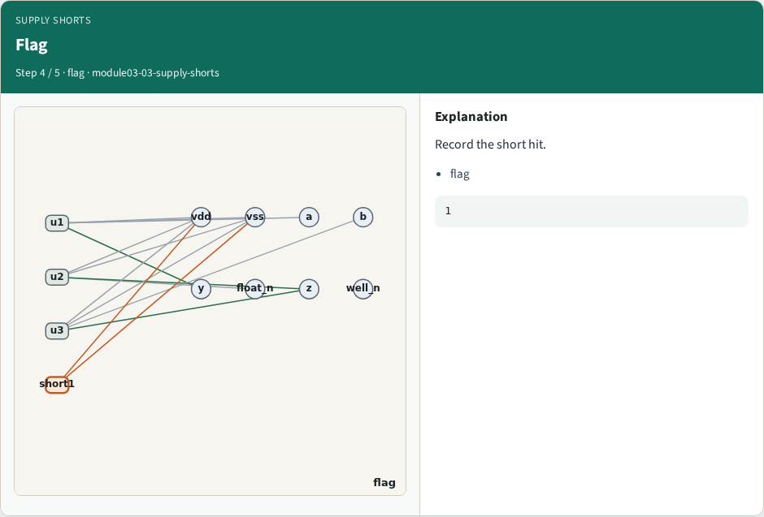
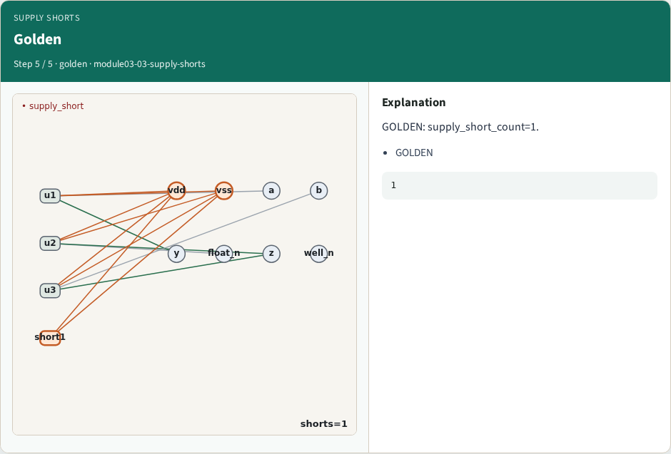
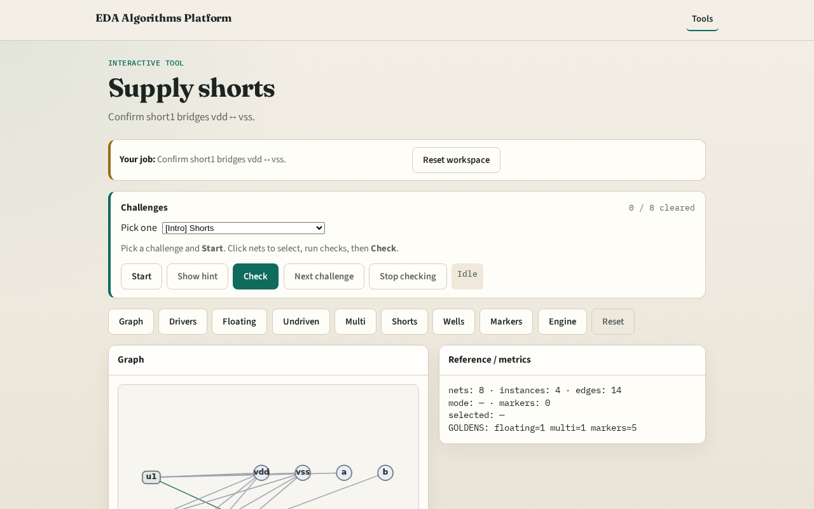

# Why shorts

A hard short between vdd and vss is catastrophic ERC

---

## The idea
- GOLDEN: supply_short_count=1 via short1

---

## SHORT cell

---

## Pins

---

## Kinds

---

## Flag

---

## Golden

---

## Browser lab track

---

## Implement track
- Call find_supply_shorts(); assert count==1

---

## Pitfalls
- Treating normal INV VDD/VSS as a short
- Missing SHORT cell type

---

## Your turn
- Next: well/substrate ties

