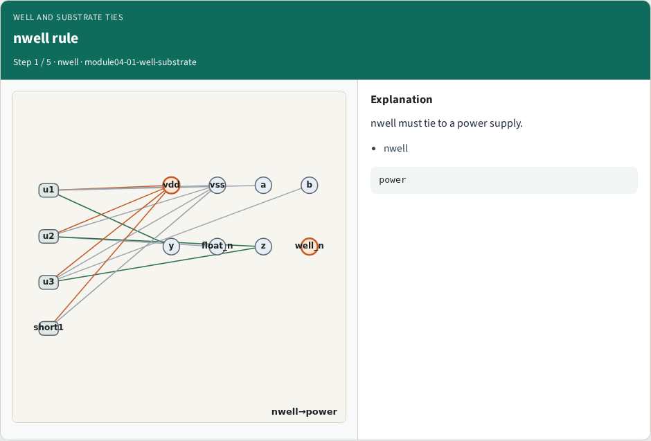
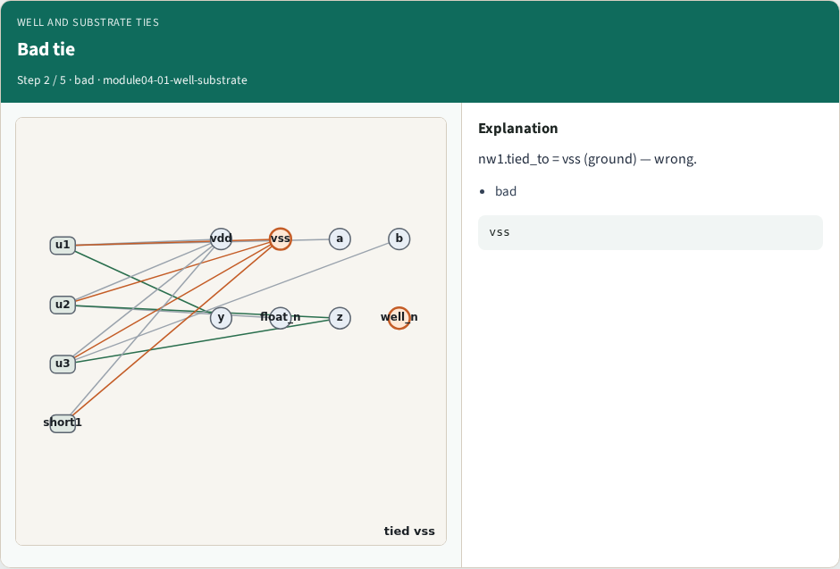
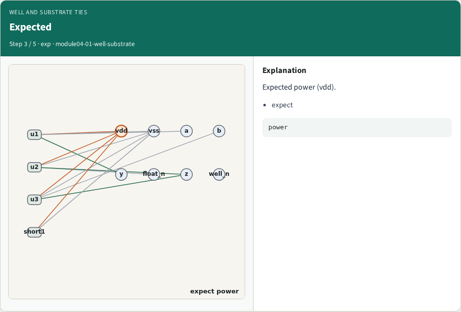
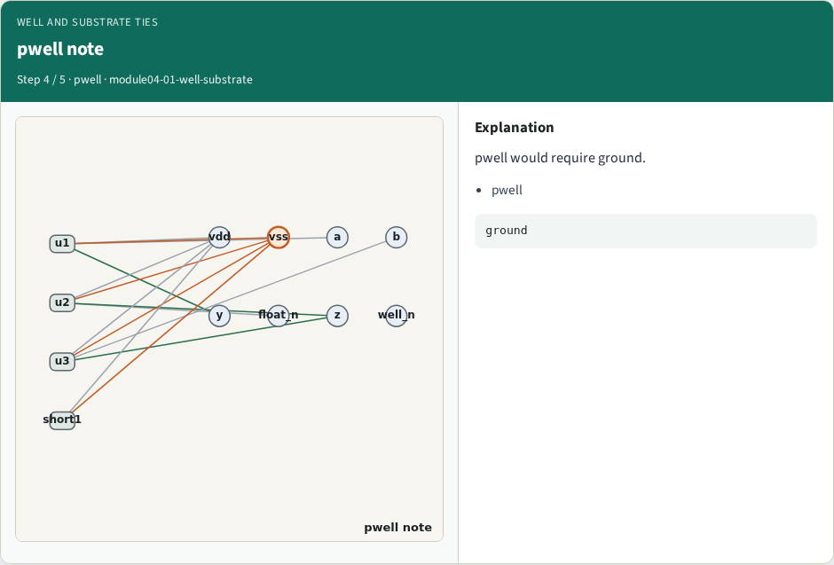
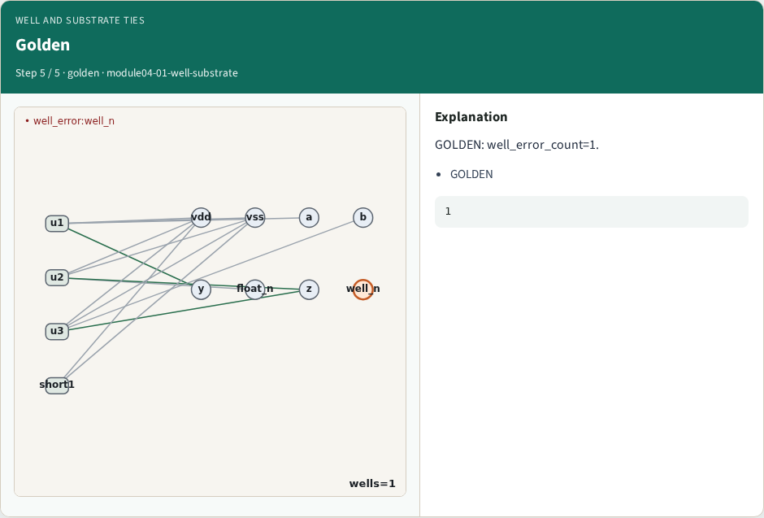
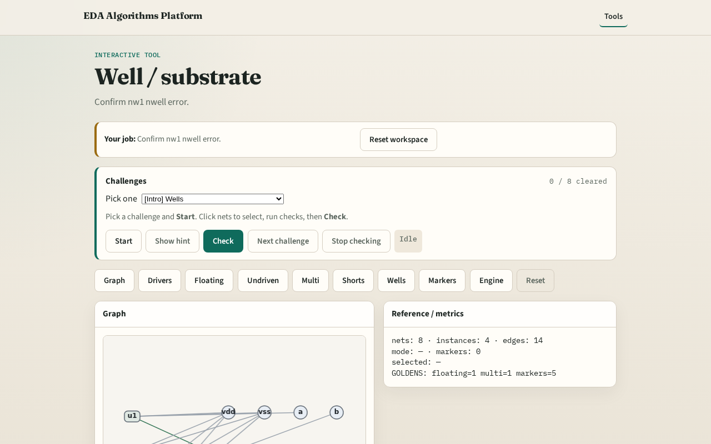

# Well and substrate ties

**Module id:** module04-01-well-substrate
**Lab:** well-substrate
**Tracks:** A (implement) · B (browser lab)

## Slide 1 — Why wells

Wells must tie to the right rail — nwell→power, pwell→ground.

## Slide 2 — The idea

GOLDEN: well_error_count=1 — nw1 nwell tied to vss.

<!-- algorithm-walkthrough -->

## Slide 3 — nwell rule

nwell must tie to a power supply.

## Slide 4 — Bad tie

nw1.tied_to = vss (ground) — wrong.

## Slide 5 — Expected

Expected power (vdd).

## Slide 6 — pwell note

pwell would require ground.

## Slide 7 — Golden

GOLDEN: well_error_count=1.

<!-- /algorithm-walkthrough -->

## Slide 8 — Browser lab track

Open **well-substrate**. Confirm nw1 error.

## Slide 9 — Implement track

Call find_well_errors(); assert count==1.

## Slide 10 — Pitfalls

Accepting nwell→vss. Ignoring well records.

## Slide 11 — Your turn

Next: collect ERC markers.
