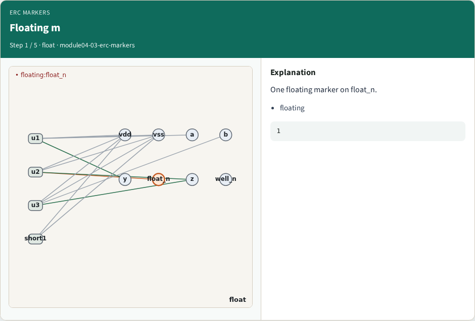
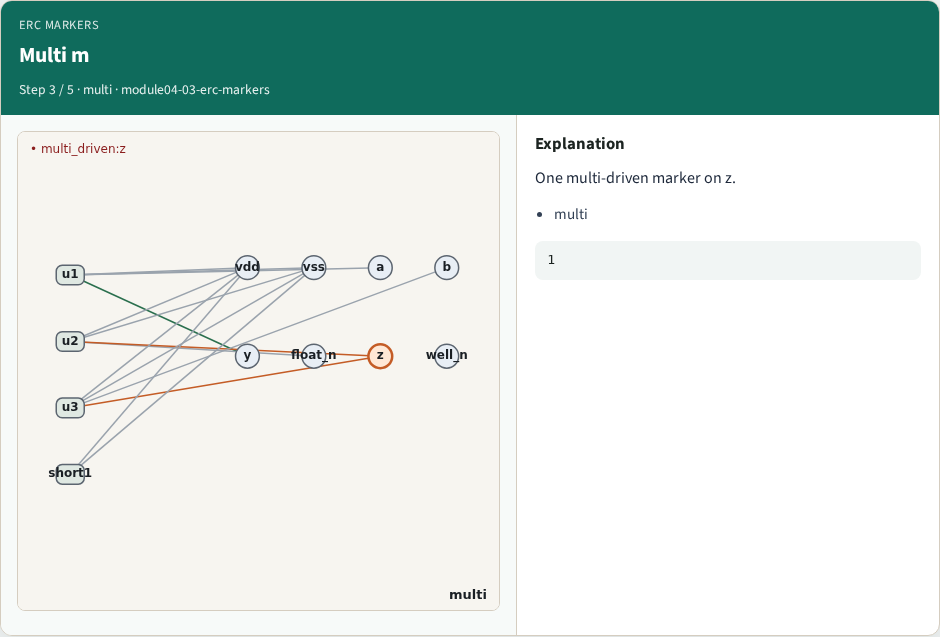
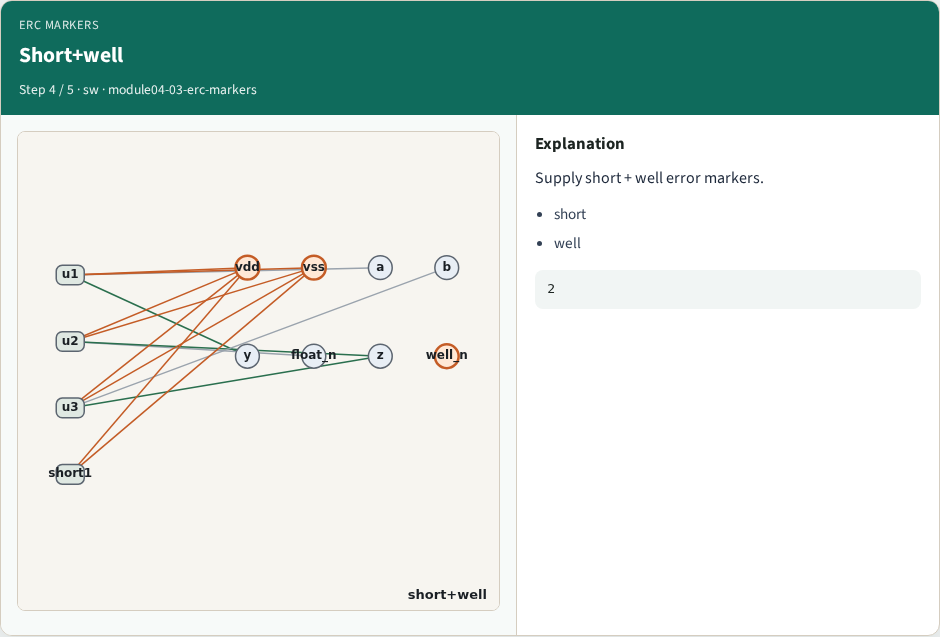
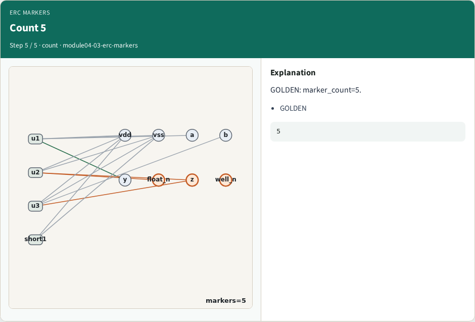
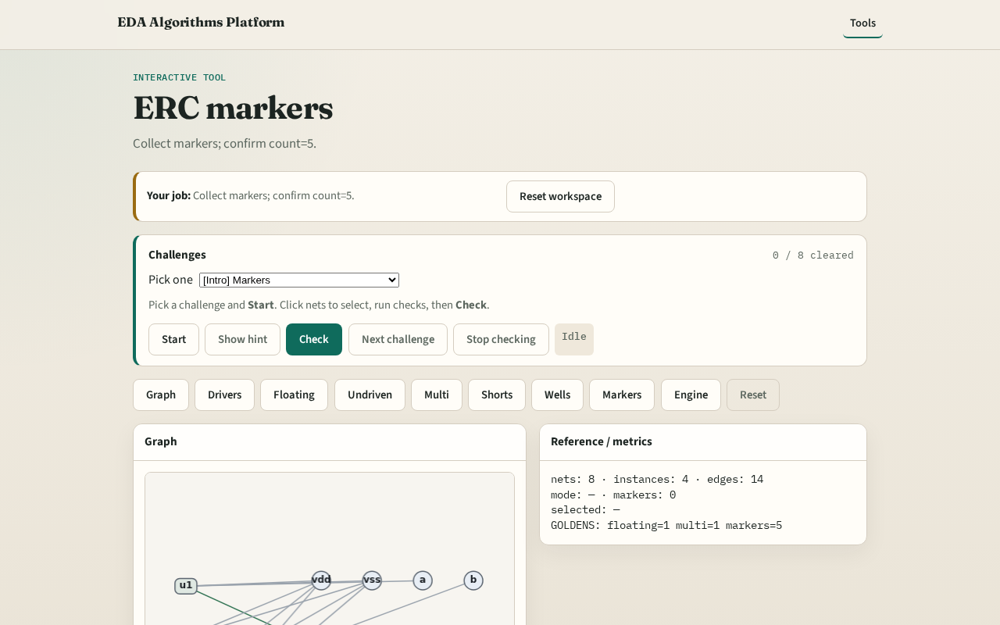

# ERC markers

**Module id:** module04-03-erc-markers
**Lab:** erc-markers
**Tracks:** A (implement) · B (browser lab)

## Slide 1 — Why markers

Signoff ERC emits markers — one record per violation class hit.

## Slide 2 — The idea

GOLDEN: marker_count=5 on tiny_erc.

<!-- algorithm-walkthrough -->

## Slide 3 — Floating m

One floating marker on float_n.

## Slide 4 — Undriven m

One undriven marker on u2.A.

## Slide 5 — Multi m

One multi-driven marker on z.

## Slide 6 — Short+well

Supply short + well error markers.

## Slide 7 — Count 5

GOLDEN: marker_count=5.

<!-- /algorithm-walkthrough -->

## Slide 8 — Browser lab track

Open **erc-markers**. Run collect; confirm 5 markers.

## Slide 9 — Implement track

Call collect_markers(); assert count==5.

## Slide 10 — Pitfalls

Double-counting float as two markers incorrectly in the golden. Missing well.

## Slide 11 — Your turn

Next: erc_engine integration.
