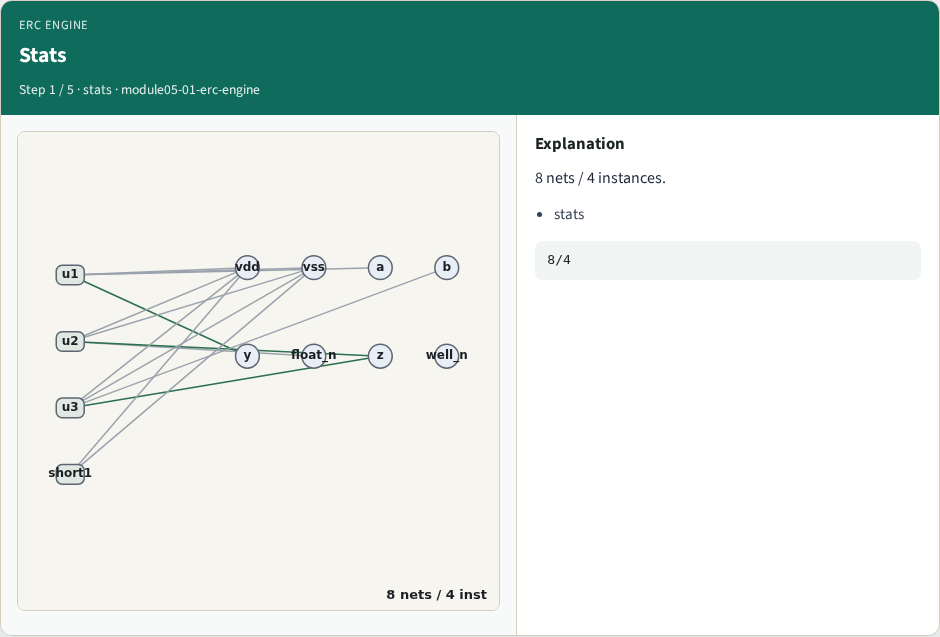
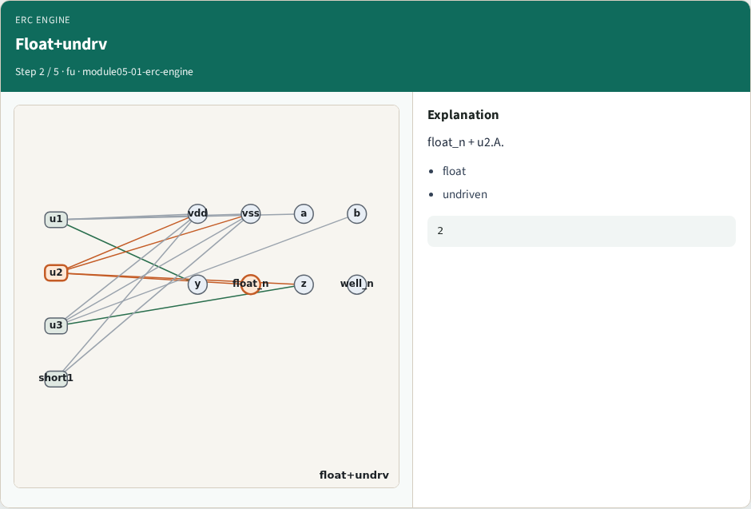
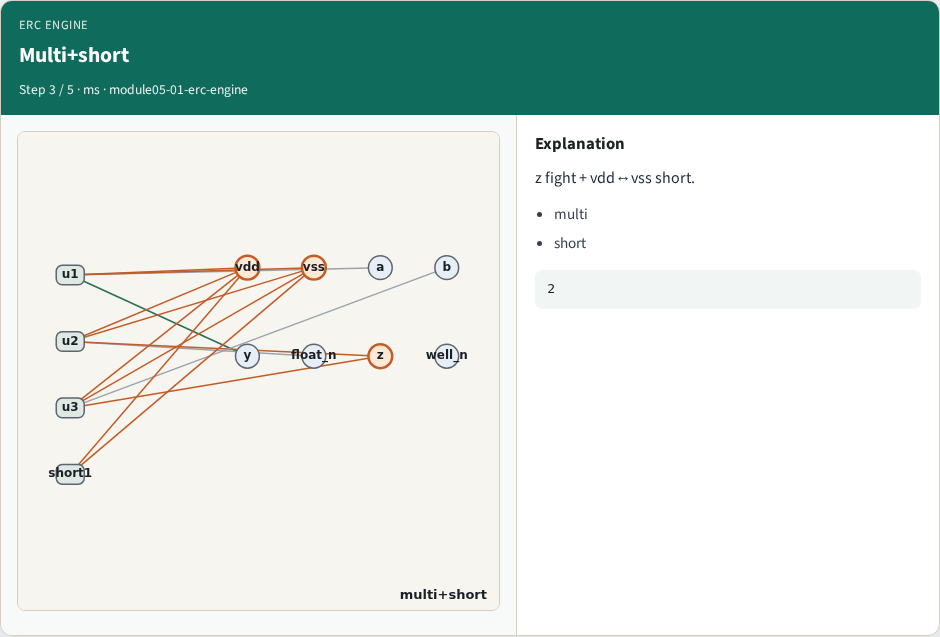
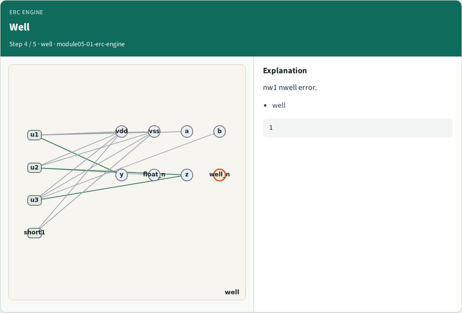
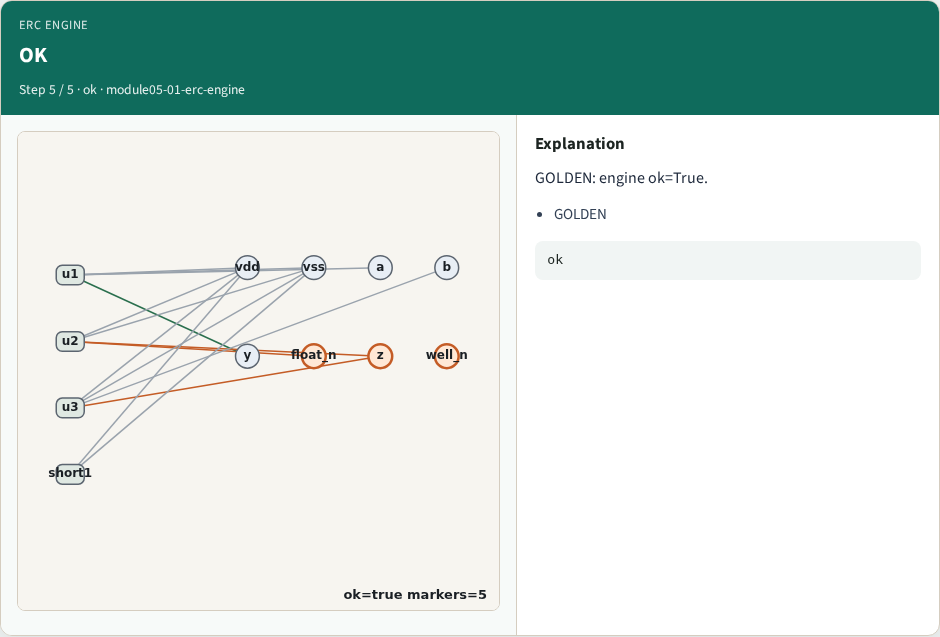

# ERC engine integration — step-by-step (for slides / transcript)

**Module:** `module05-01-erc-engine`  
**Lab / algo:** `erc-engine`  
**Viewer:** `/tools/algorithm-walkthrough/?algo=erc-engine&step=1`

Use each **Caption** as spoken prose (or a shortened slide note).
Use **Bullets** on the PPT; pair with the PNG in `assets/steps/`.

## Step 1 — Stats



**Caption (transcript):** 8 nets / 4 instances.

**Slide bullets:**

- stats

**On-screen metrics:**

```
8/4
```

## Step 2 — Float+undrv



**Caption (transcript):** float_n + u2.A.

**Slide bullets:**

- float
- undriven

**On-screen metrics:**

```
2
```

## Step 3 — Multi+short



**Caption (transcript):** z fight + vdd↔vss short.

**Slide bullets:**

- multi
- short

**On-screen metrics:**

```
2
```

## Step 4 — Well



**Caption (transcript):** nw1 nwell error.

**Slide bullets:**

- well

**On-screen metrics:**

```
1
```

## Step 5 — OK



**Caption (transcript):** GOLDEN: engine ok=True.

**Slide bullets:**

- GOLDEN

**On-screen metrics:**

```
ok
```

