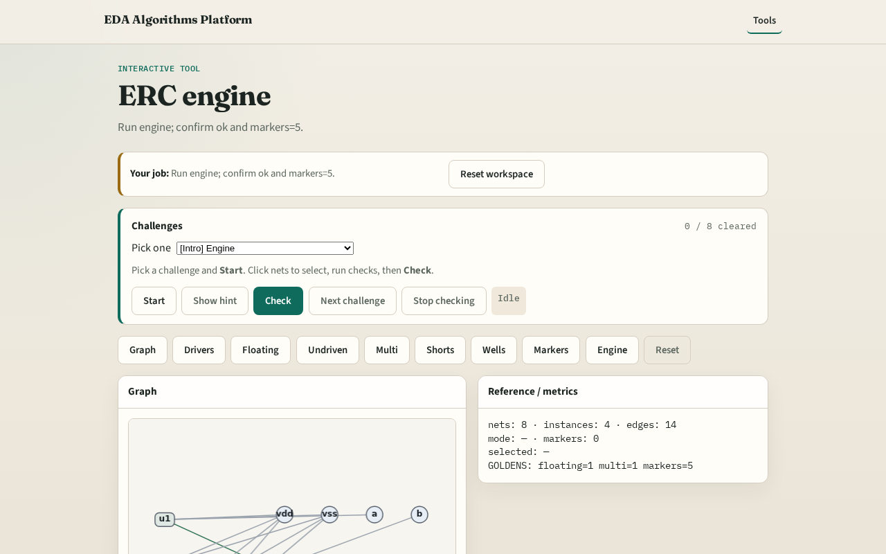

# ERC engine integration

**Module id:** module05-01-erc-engine
**Lab:** erc-engine
**Tracks:** A (implement) · B (browser lab)

## Slide 1 — Why engine

A tiny engine chains every ERC check and reports ok when goldens match.

## Slide 2 — The idea

GOLDEN: floating=1, undriven=1, multi=1, short=1, well=1, markers=5, ok=True.

<!-- algorithm-walkthrough -->

## Slide 3 — Stats

8 nets / 4 instances.

## Slide 4 — Float+undrv

float_n + u2.A.

## Slide 5 — Multi+short

z fight + vdd↔vss short.

## Slide 6 — Well

nw1 nwell error.

## Slide 7 — OK

GOLDEN: engine ok=True.

<!-- /algorithm-walkthrough -->

## Slide 8 — Browser lab track

Open **erc-engine**. Run engine; confirm ok.

## Slide 9 — Implement track

Call erc_engine(); assert ok and markers.count==5.

## Slide 10 — Pitfalls

Reporting partial checks. Changing the toy without updating goldens.

## Slide 11 — Your turn

Next: offline compare, then wrap.
